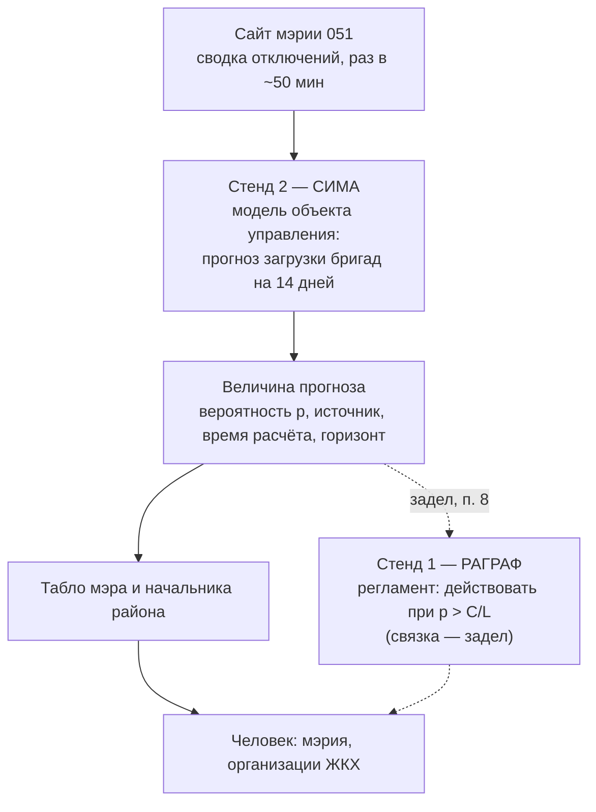

# ОТЧЁТ О НАУЧНО-ИССЛЕДОВАТЕЛЬСКОЙ РАБОТЕ

## Второй испытательный стенд СИМА: модель объекта управления «загрузка ремонтных бригад ЖКХ», прогноз с мерой неопределённости
### Краткий отчёт, редакция 1.0

---

> **Обозначение:** не присвоено. Отчёт написан отдельно; включать ли его приложением к отчёту
> о НИР РАГРАФ.НИР.002-2026 [1], решает руководитель работы после ревью.
> **Вид:** краткий, редакция 1.0 от 2026-11-17. УДК и ГРНТИ не присвоены.
> **Изделие стенда:** модуль прогноза СИМА (кодовая база NSK_OpenData_Bot) — `src/power_forecast.py`,
> регламент `config/rules/power_forecast_rules.yaml` версии 1.1. Состояние кода — прил. Б.
> **Основание:**
> - рекомендация 7 отчёта РАГРАФ [1]: «развить ЦД ОУ… прогноз между точками опроса с мерой
>   неопределённости» (п. 2.2 [1]);
> - цель задания на Фреймворк «Сигма» — «прогноз и выработка решений с объяснениями» [2];
> - интервью с заказчиком демонстрации (мэрия Новосибирска) 2026-11-16.
>
> **Место стенда.** СИМА — инициативный демонстрационный стенд ЦИИ НГУ для разведки открытых
> данных города. Он стоит **рядом с Фреймворком «Сигма», а не входит в него**. По отношению
> к работе РАГРАФ [1] он — второй испытательный стенд: первый (РАГРАФ) испытывает субъект
> управления — регламенты, второй (СИМА) — модель объекта управления, прогноз.
> **Стандарт:** ГОСТ 7.32-2017 [3].

---

## Состояние документа

**Что в отчёте.**
- **Постановка и стенд прогноза** загрузки бригад ЖКХ на две недели по открытой сводке отключений.
- **Отрицательный результат** о калибровке по месяцам.
- **Калибровка по режимам отопления** и откалиброванные вероятности.
- **Связь с понятиями отчёта РАГРАФ:** ЦД ОУ, частичный поставщик данных, правило
  «стоимость / потери».

**Чего в документе нет.**
- Печатной формы и точного числа страниц.
- Рецензий.
- Чистой проспективной проверки. Недели после 16.11.2026 ещё не наступили; отложенные
  недели частично видены при разведке (п. 6).
- Испытания связки «прогноз СИМА → регламент РАГРАФ»: она описана как направление (п. 8),
  но не собрана.
- Решения о месте отчёта: включать ли его приложением к отчёту РАГРАФ — после ревью.

---

## Лист утверждения

Таблица 1 — Лист утверждения

| Роль | ФИО | Подпись | Дата |
|---|---|---|---|
| Руководитель работы, автор | Барбашин О. В. | _____________ | 2026-11-17 |

## Список исполнителей

Таблица 2 — Список исполнителей

| Роль | ФИО | Разделы |
|---|---|---|
| Руководитель и единственный исполнитель | Барбашин О. В. | все разделы |

**Методологическая опора** — авторы аппарата, на котором стоит работа. Исполнителями
они не являются.

Таблица 3 — Методологическая опора

| Аппарат | Авторы | Где используется |
|---|---|---|
| ЦД СУ и ЦД ОУ, задачное пространство | НИР «Фреймворк Сигма» 2024 [4]; Витяев Е. Е., Свириденко Д. И., Рофе А. Р. [5] | пп. 1, 8 |
| эмпирический байесовский оценщик долей | Efron B., Morris C. [6] | п. 4.2 |
| оценка прогноза со скользящим началом | Hyndman R. J., Athanasopoulos G. [7]; Tashman L. J. [8] | пп. 3, 5 |
| прерывистый спрос | Teunter R. H., Syntetos A. A., Babai M. Z. [9] | п. 4.2 |
| надёжность вероятностного прогноза | Dimitriadis T., Gneiting T., Jordan A. I. [10] | п. 4.3 |
| ценность вероятностного прогноза, правило «стоимость / потери» | Murphy A. H. [11] | п. 8.2 |

**Порядок работы.** Код, расчёты и текст подготовлены руководителем работы в паре
с ИИ-агентом. Агент — средство, а не исполнитель; ответственность за содержание несёт
руководитель работы.

---

## РЕФЕРАТ

Отчёт: 16 табл., 1 рис., 22 источн., 2 прил. Число страниц определяется по PDF при печати.

ЦИФРОВОЙ ДВОЙНИК ОБЪЕКТА УПРАВЛЕНИЯ, ПРОГНОЗ ПЛАНОВЫХ РАБОТ, РЕМОНТНЫЕ БРИГАДЫ, ЖКХ,
ОТКРЫТЫЕ ДАННЫЕ, РЕЖИМ ОТОПЛЕНИЯ, ЭМПИРИЧЕСКИЙ БАЙЕС, СКОЛЬЗЯЩЕЕ НАЧАЛО, МЕРА
НЕОПРЕДЕЛЁННОСТИ, КАЛИБРОВКА ВЕРОЯТНОСТЕЙ, ШКАЛА БРАЙЕРА, СТОИМОСТЬ И ПОТЕРИ,
ОТРИЦАТЕЛЬНЫЙ РЕЗУЛЬТАТ, ТАБЛО МЭРА

**Основание и замысел.** Отчёт о НИР РАГРАФ [1] назвал слабость модели мира этого изделия:
- прогноз приходит одним числом, без меры неопределённости;
- регламент решает без вероятности события, хотя по правилу «стоимость / потери» действовать
  выгодно при p > C/L [11].

Направление — двойник объекта управления (п. 2.2, рекомендация 7 [1]). Работа строит
такой двойник для одного объекта — загрузки ремонтных бригад ЖКХ — на втором стенде, СИМА.

**Объект исследования** — суточный ряд плановых и аварийных отключений систем
жизнеобеспечения Новосибирска: 10 районов, 5 услуг, 2026-03-25 … 2026-11-16. Ряд собран
СИМА с сайта мэрии [12].

**Цель** — дать мэру и начальнику района прогноз на две недели: в какие рабочие дни
бригады района по услуге будут свободны, а где ожидается перегруз. Прогноз должен
выдаваться вероятностью с проверяемой надёжностью, на уже собираемых данных, без
численности бригад.

**Метод:**
- правило по дню недели;
- режимы отопления по правилу «5 суток ниже/выше +8 °C» [13];
- сглаживание вероятности к обычной частоте работ (эмпирический Байес [6]);
- проверка со скользящим началом с разведением отборочных и отложенных недель [7], [8];
- оценка точностью меток, шкалой Брайера и таблицей «обещано / сбылось» [10].

**Результаты.**

*Завершено.*
1. **Стенд прогноза.** Модуль, регламент, эндпоинт `/power/forecast`, блок на табло мэра и
   в панели района, самопроверка на прошлых неделях. Проверок изделия 692 из 692 зелёные.
2. **Калибровка по 12 месяцам не проверяема:** каждый месяц встречается один раз.
   Сезонность в данных — это режим отопления, граница которого переносится год от года.
3. **Калиброванное правило v2.** На отложенных неделях точность «свободного дня» 79%
   против 66% у исходного (+13,4 п.п.). Вероятности откалиброваны: «свободно 82%»
   сбывается в 81% случаев. Шкала Брайера 0,156 против 0,179.

*Условно.*
4. **Полнота v2** на отложенных неделях 47% против 49%: критерий заказчика «не меньшей
   полноты» формально не выполнен. Отложенные недели частично видены.
5. **Перегруз** лучше случайного в 1,5–3 раза. Ёмкость бригад — гипотеза.

*Задел.*
6. **Ёмкость** по наибольшему числу одновременно открытых работ из поштучных карточек [14].
7. **Передача прогноза в регламент РАГРАФ** как величины с вероятностью, источником,
   временем и горизонтом [15].

**Отрицательные результаты** (п. 6):
- помесячная калибровка отклонена;
- исходное правило самоуверенно на краях: «100% свободно» сбывалось в 87%;
- две ошибки формулы объёма в СИМА найдены и исправлены.

**Область применения** — табло мэра и начальника района. **Рекомендации** — п. «Рекомендации»
заключения. **Значимость** — пример внешнего модуля модели [15] с мерой неопределённости,
которую можно проверить серией, и с порогом решения, прочитанным как отношение
стоимости к потерям.

---

## СОДЕРЖАНИЕ

- Термины, определения и сокращения
- Введение
- 1 Второй стенд: место рядом с РАГРАФ
- 2 Исходные данные
- 3 Исходное правило и метрика «до»
- 4 Калибровка
- 5 Стенд и измерения
- 6 Отрицательные результаты и пределы
- 7 Новизна и чужое
- 8 Связь с работой РАГРАФ
- Заключение
- Список использованных источников
- Приложение А. Протокол замеров
- Приложение Б. Сверка чисел и состояние кода

## ТЕРМИНЫ, ОПРЕДЕЛЕНИЯ И СОКРАЩЕНИЯ

Таблица 4 — Термины и сокращения

| Термин | Значение в отчёте |
|---|---|
| ЦД СУ, ЦД ОУ | цифровой двойник субъекта и объекта управления — по [4], п. 2.2 [1] |
| ячейка | «район × услуга × рабочий день» |
| регулярная ячейка | ячейка, где плановые работы идут постоянно (не менее 5 рабочих дней с работами за 12 недель) |
| режим | «отопление включено» или «выключено» по правилу п. 4.2 |
| уверенность «свободно» | вероятность, что в ячейке не будет плановых работ, 1 − p |
| обещано / сбылось | средняя уверенность прогнозов корзины и доля сбывшихся |
| п.п. | процентный пункт |
| ГВС, ХВС | горячее и холодное (вместе с канализацией) водоснабжение |
| P75 | 75-й процентиль |

---

## ВВЕДЕНИЕ

### Основание и замысел

Модель мира РАГРАФ дискретна (п. 2.2 [1]). Мир виден в точках опроса, прогноз приходит
одним числом, история в решения не идёт. Выбор действия при неопределённости там не
моделируется. Направление — двойник объекта управления, дающий прогноз с мерой
неопределённости. В Платформе «Сигма» такой прогноз готовят внешние модули моделей,
а фреймворк принимает его с источником, временем расчёта и прогнозным периодом [15].
Строить такую модель — не задача модуля РАГРАФ. Настоящая работа строит её на втором стенде
для одного объекта управления.

### Актуальность

Бригад у ресурсоснабжающих организаций столько же, а плановых работ по дням то нет
совсем, то вдвое больше обычного: пустые дни — простой, перегруженные — сверхурочные
(интервью 2026-11-16). Мэрия даты работ не назначает, только публикует. Прогноз для неё —
аргумент в разговоре с организациями. Численности бригад в открытых данных нет.

У задачи та же беда, что у регламентов РАГРАФ: **«нет данных — значит норма»**.
Там молчащий датчик давал «свободно» (п. 2.2 [1]). Здесь провал сбора выглядел бы днём
без работ и давал бы ложное «свободно». Решение то же: пропуск — третье значение, а не ноль.

### Цель работы

Дать мэру и начальнику района прогноз на две недели вперёд — свободные и перегруженные
рабочие дни бригад по району и услуге. Прогноз выдаётся вероятностью с проверяемой
надёжностью, работает на уже собираемых данных СИМА, а ёмкость бригад задана гипотезой.

### Задачи

Итоги по каждой задаче — в заключении, по тому же перечню.
- а) проверить пригодность и полноту данных СИМА об отключениях;
- б) построить правило прогноза и измерить его точность («до»);
- в) проверить предложение заказчика калибровать коэффициенты по месяцам или сезонам;
- г) найти способ оценки с откалиброванными вероятностями и проверить его на отложенных неделях;
- д) определить предсказуемость перегруза при гипотетической ёмкости бригад;
- е) связать результат с понятиями работы РАГРАФ: ЦД ОУ, частичный поставщик данных,
  выбор действия при неопределённости.

### Объект и предмет исследования

**Объект** — ряд отключений (см. реферат) как наблюдение объекта управления «загрузка
ремонтных бригад».

**Предмет** — способ оценки вероятности плановых работ в ячейке на горизонте 1–14 суток
и проверка надёжности этой вероятности.

---

## 1. ВТОРОЙ СТЕНД: МЕСТО РЯДОМ С РАГРАФ

Два стенда делят постановку работы РАГРАФ по ролям (рисунок 1): РАГРАФ исполняет регламенты
(ЦД СУ), СИМА моделирует объект управления (ЦД ОУ) и выдаёт прогноз с мерой
неопределённости. Связка двух стендов — задел (п. 8): прогноз СИМА в регламенты РАГРАФ
пока не передаётся.



Рисунок 1 — Два стенда: регламенты (РАГРАФ) и модель объекта управления (СИМА)

## 2. ИСХОДНЫЕ ДАННЫЕ

Источник — сводка «Отключения систем жизнеобеспечения города» [12]: по каждой из 5 услуг
плановые и аварийные отключения по районам, число домов. Соответствие групп разделам
сайта сверено с разметкой страницы 2026-11-16.

Таблица 5 — Полнота и сверка данных

| Показатель | Значение |
|---|---|
| Период | 2026-03-25 … 2026-11-16, 237 суток |
| Сутки со сбором | 219 |
| Пропуски сбора | 18 суток (17–19.05, 22.05–05.06): простой сервера, а не «дни без отключений» |
| Сутки с неполным сбором (менее 20 снимков) | 10 |
| Суточный архив против пересчёта из сырых снимков | 639 из 639 строк (29 полных суток) |
| Сутки по UTC против суток по НСК | профиль недели совпадает до 1 п.п. |
| Ключевые решения заказчика | пользователь — мэрия; горизонт 2 недели; задача — заранее найти свободные дни; метрика — +10 п.п. точности при не меньшей полноте на отложенных неделях; без ML, пока правило не обыграно |

## 3. ИСХОДНОЕ ПРАВИЛО И МЕТРИКА «ДО»

Правило v1: 4 последних таких же дня недели. Вероятность работ — доля этих дней с работами,
«свободно» — при вероятности не выше 0,25. Ёмкость бригад — гипотеза: P75 объёма
загруженных рабочих дней за 12 недель. «Перегруз» — объём выше ёмкости хотя бы в половине
опорных дней.

Таблица 6 — Метрика «до»: рабочие дни 19.10–13.11, горизонт 2 недели

| Услуга | Доля свободных дней | Точность «свободно» | Полнота |
|---|---|---|---|
| Электроснабжение | 44% | 57% | 28% |
| Теплоснабжение | 32% | 43% | 64% |
| ХВС | 70% | 75% | 71% |
| Регулярные ячейки, все услуги | 45,9% | 68,5% | 51,2% |

## 4. КАЛИБРОВКА

### 4.1. По месяцам — отрицательный результат

Лучший способ оценки по месяцам:
- июнь–сентябрь — частота работ ячейки за 8 недель без учёта дня недели;
- октябрь–ноябрь — сглаженный день недели.

Смена приходится на начало отопления, а не на календарь. Каждый месяц в истории
встречается один раз, поэтому коэффициенты «под месяц» нечем проверить [7], [16].
Параметры по месяцам — только после двух лет данных.

### 4.2. Режимы отопления и сглаживание (v2)

Режим «отопление включено» включается после 5 суток подряд ниже +8 °C и выключается после
5 суток выше. Это пороги п. 5 Правил № 354 [13], а сами даты назначает мэрия. Правило
по температуре СИМА дало 28.04 и 11.10.2026. Мэрия, по данным СМИ, отключила отопление с 29.04,
включила с 23.09 и подключала дома до 16.10 [17].

Вероятность плановых работ:

**p = (k + a·b) / (n + a)**

- k из n — сколько опорных дней были с работами; опорные — тот же день недели в том же режиме;
- b — обычная частота работ ячейки за 8 недель в том же режиме;
- a = 4 — сила сглаживания.

Это эмпирический Байес для доли [6] и ступенчатый аналог оценки вероятности появления
спроса в методе TSB [9].

Таблица 7 — Отбор (недели выпуска до 12.10) и отложенная проверка (19.10–9.11), регулярные ячейки

| Вариант | Отбор: точность / полнота | Отложено: точность / полнота |
|---|---|---|
| v1, порог 0,25 | 81% / 66% | 66% / 49% |
| v2, a = 4, порог 0,35 — выбран на отборе | 85% / 69% | **79% / 47%** |
| v2, a = 2, порог 0,35 | 84% / 68% | 78% / 42% |

Для тепла память в пределах режима снизила шкалу Брайера в первые 4 недели после смены
режима с 0,333 до 0,228, в остальное время — с 0,063 до 0,048. Режимы по датам мэрии и
четыре режима (переход, гидроиспытания) на отборе неотличимы от температурных (Брайер
0,1475–0,1494). Взят простейший вариант.

### 4.3. Мера неопределённости

Таблица 8 — «Обещано / сбылось», 7763 прогноза по регулярным ячейкам с 27.04

| v2: уверенность «свободно» | сбылось | v1: обещано | сбылось |
|---|---|---|---|
| 96% | 93% | 100% | 87% |
| 82% | 81% | 75% | 72% |
| 68% | 68% | 50% | 54% |
| 50% | 48% | 25% | 35% |
| 2% | 9% | 0% | 12% |

Шкала Брайера: v2 — 0,156, v1 — 0,179. В v1 «свободные» дни там, где бригада обычно
занята (частота работ не ниже 0,7), сбывались лишь в 40% случаев против 80% в остальных
ячейках. Сглаживание v2 такие дни не называет. На двухнедельную проверку приходится около
290 прогнозов, поэтому вероятность проверяется серией за 2–4 недели. На табло она выводится
с шагом 5% в клетках и в свободных окнах, а под блоком — таблица «обещано / сбылось».

### 4.4. Перегруз

Подъём против базовой частоты тяжёлых дней — от 1,5 до 3 раз по сезонам и определениям
ёмкости. Самопроверка модуля на последних 4 неделях:
- v2 — 29,7% при базе 10,3% (×2,9);
- v1 — 25% при базе 11,3% (×2,2).

Ёмкость — определение, а не измерение: она выведена из тех же объёмов, с которыми
сравнивается, и калибровать её «по данным» нельзя.

### 4.5. Проверка формул и найденные ошибки

- **День недели верен:** независимый пересчёт вероятностей из таблицы совпал с модулем
  в 500 из 500 ячеек.
- **Факт по истории:** самый лёгкий будний день — понедельник (электросети 46% против 55–61%).
  Повторяющийся перегруз по теплу у Советского района по вторникам настоящий: самые тяжёлые
  работы с включения отопления — 3.11 (33 дома) и 10.11 (47 домов) при P75 около 23.
- **Ошибки СИМА, найдены и исправлены:**
  - объём делился на снимки с любой записью района по услуге, а не только с плановой —
    занижение у 17% пар. После исправления среднее аварийных домов в сутки по отчёту СИМА
    выросло с 372 до 501;
  - «сегодня» бралось по UTC.

## 5. СТЕНД И ИЗМЕРЕНИЯ

Таблица 9 — Состав стенда

| Часть | Что |
|---|---|
| Данные | `zhkh_daily_district.csv`, 11 850 строк — собрана `build_dataset.py` из выгрузок СИМА за 16.11, 19.08 и 31.03 |
| Эксперименты | `scripts/zhkh_calibration/`: Python 3.12, pandas 2.3, numpy 2.4 |
| Изделие | `src/power_forecast.py`, регламент 1.1, `GET /power/forecast`, блок табло |
| Проверки изделия | 692 зелёных, 52 пропущено (полный набор `tests/`), в том числе 24 проверки прогноза и 3 — формулы отчёта |

**Методика — скользящее начало** [7], [8]. Каждый понедельник с 27.04 выпускается прогноз
на 2 недели только по данным до этого дня: около 11 тыс. ячеек. Варианты и порог
выбирались на неделях выпуска до 12.10, затем один раз проверялись на 19.10–9.11.
Значимость разницы по шкале Брайера оценена бутстрепом по неделям выпуска (2000 повторов).
Независимых двухнедельных блоков около 9–10 — это предел точности.

**Способность проверки краснеть.** Проверки формулы объёма отчёта на старом коде падают
все три. Проверка «после включения отопления день не свободен» на правиле v1 показывает
тот самый изъян, который v2 исправляет.

## 6. ОТРИЦАТЕЛЬНЫЕ РЕЗУЛЬТАТЫ И ПРЕДЕЛЫ

Таблица 10 — Отрицательные результаты и ограничения

| № | Что | Почему важно |
|---|---|---|
| 1 | Помесячная калибровка отклонена как непроверяемая | один год — по одному примеру месяца |
| 2 | Отложенные недели не чистые: видены в разведке по сезонам | чистая проверка — недели после 16.11.2026, самопроверка на табло покажет её сама |
| 3 | Полнота v2 на 1,4 п.п. ниже исходной | порог 0,4 дал бы на тех же неделях 79% / 50%, но выбрать его по отложенным неделям значило бы подогнать результат |
| 4 | Перегруз предсказывается слабо | ёмкость — гипотеза; участки бригад могут не совпадать с районами |
| 5 | Нет зимы; даты отопления мэрии — из вторичных источников | правило режима не проверено на зимнем переходе |
| 6 | Объём — в домах, а не в трудозатратах | одна работа на фидере отключает сотни домов; поштучные карточки сайт публикует, СИМА их не собирает |
| 7 | Связка с РАГРАФ не собрана | п. 8 — описание направления, не испытание |

## 7. НОВИЗНА И ЧУЖОЕ

**Что известно:**
- сглаживание долей [6];
- оценка со скользящим началом [7], [8];
- прерывистый спрос [9];
- надёжность вероятностей [10];
- правило «стоимость / потери» [11];
- пороги отопительного периода [13];
- понятия ЦД СУ и ЦД ОУ [4], [5].

**Что своё:** сборка этих методов для прогноза загрузки бригад по открытой сводке
отключений, без численности бригад:
- вероятность — по тем же дням недели в том же режиме отопления, со сглаживанием;
- ёмкость — явная гипотеза;
- надёжность прогноза проверяется на прошлых неделях и выводится на табло рядом с прогнозом.

Проверено на данных одного города за 219 суток (10 районов × 5 услуг): точность «свободно»
79% против 66%, «обещано 82% — сбылось 81%». Уточнение границы: помесячная калибровка на
одном году не проверяема.

**Что не заявляется:**
- **новый статистический метод** — методы известны;
- **«впервые»** — обзора приоритета нет;
- **оценка численности бригад** — ёмкость гипотетическая;
- **влияние на сверхурочные и аварии** — не измерялось; связь «перегруз → аварии» в данных
  есть только как совпадение (аварии электросетей в 29% дней с плановыми работами против 19%
  без них);
- **уровень готовности технологии** — прогноз v1 слит в основную ветку СИМА 16.11.2026,
  работа на проде не проверялась, v2 существует в рабочей копии.

## 8. СВЯЗЬ С РАБОТОЙ РАГРАФ

### 8.1. Прогноз как частичный поставщик данных

По заданию «Сигмы» 2026 года фреймворк принимает прогноз от внешнего модуля с источником,
временем расчёта и прогнозным периодом и различает факт, прогноз и сценарий [15].
Ответ `/power/forecast` уже несёт эти поля:
- вероятность и уверенность по каждой ячейке;
- дату расчёта и горизонт;
- режим и его дату;
- самопроверку «обещано / сбылось».

Для регламента РАГРАФ это частичный поставщик данных в смысле п. 5.2 [1]. Пропуск
сбора не превращается в ноль: ячейка без опор получает «нет данных», а день простоя
сборщика не считается днём без работ. Это условие, на котором держится гарантия
сохранения вердикта работы РАГРАФ.

### 8.2. Порог решения как отношение стоимости к потерям

Отчёт РАГРАФ отмечает: при цене меры C и цене потерь L действовать выгодно при
p > C/L [11] (п. 2.2 [1]). В прогнозе СИМА решение — рекомендовать день организации
как свободный. Пусть ошибочная рекомендация (работы в этот день всё же будут) стоит c,
а угаданное окно приносит пользу g. Тогда рекомендовать выгодно при уверенности
«свободно» выше c / (c + g).

Принятый порог 0,35 по вероятности работ соответствует уверенности не ниже 0,65,
то есть c ≈ 1,9 g. Иначе говоря, порог неявно считает ошибку «свободно» почти вдвое
дороже пользы от угаданного окна. Это управленческое допущение, а не свойство данных.
С откалиброванной вероятностью его можно задать прямо, вопросом руководителю: во сколько
раз ошибка дороже пользы? Вопрос включён в модалку «?» на табло.

### 8.3. Что остаётся заделом

- **Регламент РАГРАФ, читающий прогноз СИМА**, — например, «ожидается перегруз с
  вероятностью ≥ q → предписание организации». Нужны канал величины с вероятностью и
  испытание по лестнице подтверждения отчёта РАГРАФ (п. 2.4 [1]).
- **Ёмкость организаций по одновременности работ.** Наибольшее число одновременно открытых
  работ — нижняя граница числа бригад [14]. Средняя загрузка — по закону Литтла [18].

---

## ЗАКЛЮЧЕНИЕ

### Итоги по задачам

Таблица 11 — Итоги по задачам а)–е)

| Задача | Итог | Состояние |
|---|---|---|
| а) пригодность и полнота данных | ряд полон на 219 из 237 суток, пропуски распознаются, архив сходится с сырыми снимками; две ошибки формул исправлены (пп. 2, 4.5) | выполнено |
| б) правило и метрика «до» | правило v1 на табло с самопроверкой; метрика «до» — таблица 6 | выполнено |
| в) калибровка по месяцам | проверена и отклонена как непроверяемая; сезонность — режим отопления (п. 4.1) | выполнено, отрицательный результат |
| г) откалиброванные вероятности | v2: «обещано 82% — сбылось 81%», точность «свободно» +13,4 п.п. на отложенных неделях (пп. 4.2, 4.3) | частично: полнота −1,4 п.п.; отложенные недели не чистые |
| д) предсказуемость перегруза | лучше случайного в 1,5–3 раза (п. 4.4) | частично: ёмкость — гипотеза |
| е) связь с работой РАГРАФ | прогноз — частичный поставщик данных с мерой неопределённости; порог прочитан как отношение стоимости к потерям (п. 8) | частично: связка с РАГРАФ не собрана |

### Цель

Цель достигнута частично. Прогноз на две недели работает на уже собираемых данных и выдаёт
откалиброванную вероятность с проверкой на табло. Критерий заказчика по полноте формально
не выполнен, а чистая проверка на новых неделях ещё впереди.

### Главный вывод

На одном неполном году сезонность прогноза загрузки бригад калибруется режимами, а не
месяцами. Сглаживание в пределах режима даёт вероятность, которой можно верить как
вероятности. Мера неопределённости, которой отчёту РАГРАФ не хватало в модели мира,
для этого объекта управления получена и проверяема серией. Порог решения при этом
перестаёт быть подобранным числом и становится вопросом о стоимости ошибки.

### Результаты

**Завершено:**
- стенд прогноза и самопроверка;
- отрицательный результат о помесячной калибровке;
- v2 с откалиброванными вероятностями;
- исправление формул объёма в СИМА.

**Условно:**
- полнота v2 на отложенных неделях;
- предсказуемость перегруза.

**Задел:**
- ёмкость по одновременности работ из поштучных карточек;
- связка прогноза с регламентами РАГРАФ;
- режимы по календарю мэрии и окну гидроиспытаний;
- зимний переход.

### Рекомендации

1. **Проверить v2 проспективно** на неделях после 16.11.2026 и решить о его принятии по
   критерию заказчика.
2. **Собирать поштучные карточки работ** с сайта 051 и считать ёмкость организаций по
   одновременности работ [14], [18].
3. **Задать порог «свободно» через отношение стоимости ошибки к пользе** (п. 8.2) — вопросом
   руководителю на демонстрации.
4. **Не удалять суточный архив СИМА через 365 дней**, иначе история для сезонности сотрётся
   к весне 2027.
5. **Собрать регламент РАГРАФ, читающий прогноз СИМА**, и испытать его по лестнице
   подтверждения отчёта РАГРАФ.

---

## СПИСОК ИСПОЛЬЗОВАННЫХ ИСТОЧНИКОВ

Пометки о прочтении (исследование 2026-11-17): [П] — первоисточник целиком, [А] — аннотация,
[В] — вторичный источник.

1. Платформа «РАГРАФ» — замкнутый контур «датчик — регламент — задача — человек» : отчёт о НИР (итоговый, этапы 1 и 2), ред. 2.0 : РАГРАФ.НИР.002-2026 / ЦИИ НГУ ; рук. О. В. Барбашин. — Новосибирск, 2026. — Копия в Markdown: `~/RAGRAF/docs/OTCHET-NIR-RAGRAF-2026-ITOGOVYY.md`.
2. Фреймворк «Сигма» — программно-аппаратный комплекс для разработки, сопровождения и управления жизненным циклом систем проактивного управления городской инфраструктурой : техническое задание (уточнённое — 2025 год) : ИИ-01-01-01-1/1-ЛУ / НГУ, ЦИИ НГУ ; рук. разработки И. А. Болдырев. — Новосибирск, 2025. — 105 л.
3. ГОСТ 7.32-2017. Отчёт о научно-исследовательской работе. Структура и правила оформления. — Москва : Стандартинформ, 2017.
4. Фреймворк Сигма : отчёт о НИР (промежуточный, этап 1) / НГУ, ЦИИ НГУ ; рук. НИР И. А. Болдырев. — Новосибирск, 2024. — 110 с. — НИОКТР 124042200020-3.
5. Vityaev E. E., Sviridenko D. I., Rofe A. R. Task-Based Approach to Digital Transformations // Известия Иркутского государственного университета. Серия «Математика». — 2025. — Т. 54. — С. 78–95. — DOI 10.26516/1997-7670.2025.54.78.
6. Efron B., Morris C. Data analysis using Stein's estimator and its generalizations // Journal of the American Statistical Association. — 1975. — Vol. 70, no. 350. — P. 311–319. [А]
7. Hyndman R. J., Athanasopoulos G. Forecasting: principles and practice. 3rd ed. — Melbourne : OTexts, 2021. — Разд. 5.10. — URL: https://otexts.com/fpp3/tscv.html (дата обращения: 17.11.2026). [П]
8. Tashman L. J. Out-of-sample tests of forecasting accuracy: an analysis and review // International Journal of Forecasting. — 2000. — Vol. 16, no. 4. — P. 437–450. [А]
9. Teunter R. H., Syntetos A. A., Babai M. Z. Intermittent demand: linking forecasting to inventory obsolescence // European Journal of Operational Research. — 2011. — Vol. 214, no. 3. — P. 606–615. [А]
10. Dimitriadis T., Gneiting T., Jordan A. I. Stable reliability diagrams for probabilistic classifiers // Proceedings of the National Academy of Sciences. — 2021. — Vol. 118, no. 8. — e2016191118. [А]
11. Murphy A. H. The Value of Climatological, Categorical and Probabilistic Forecasts in the Cost-Loss Ratio Situation // Monthly Weather Review. — 1977. — Vol. 105, no. 7. — P. 803–816. — DOI 10.1175/1520-0493(1977)105<0803:TVOCCA>2.0.CO;2.
12. Отключения систем жизнеобеспечения города / Мэрия г. Новосибирска. — URL: http://051.novo-sibirsk.ru/sitepages/off.aspx (дата обращения: 16.11.2026).
13. О предоставлении коммунальных услуг собственникам и пользователям помещений в многоквартирных домах и жилых домов : постановление Правительства Рос. Федерации от 06.05.2011 № 354. — П. 5 ; письмо Минстроя России от 25.08.2026 № 52494-ДН/04. — URL: https://rulaws.ru/acts/Pismo-Minstroya-Rossii-ot-25.08.2026-N-52494-DN_04/ (дата обращения: 17.11.2026). [П, копия]
14. Kleinberg J., Tardos É. Algorithm design. — Boston : Pearson, 2006. — Разд. 4.1. [В]
15. Фреймворк «СИГМА» (версия 2.1) : техническое задание (уточнённое — 2026 год) : ИИ-01-01-01-2-ЛУ / НГУ, ЦИИ НГУ ; рук. разработки И. А. Болдырев. — Новосибирск, 2026. — 63 л.
16. Cawley G. C., Talbot N. L. C. On over-fitting in model selection and subsequent selection bias in performance evaluation // Journal of Machine Learning Research. — 2010. — Vol. 11. — P. 2079–2107. [А]
17. Отопительный сезон в Новосибирске стартовал: когда тепло придёт в ваш дом // Российская газета. — 2026. — URL: https://rg.ru/post/otopitelnyj-sezon-v-novosibirske-startoval-kogda-teplo-pridet-v-vash-dom.html (дата обращения: 17.11.2026) ; Мэр Новосибирска объявил о завершении отопительного сезона // RuNews24. — 28.04.2026. — URL: https://runews24.ru/novosibirsk/28/04/2026/mer-novosibirska-kudryavczev-obyavil-o-zavershenii-otopitelnogo-sezona (дата обращения: 17.11.2026). [В]
18. Little J. D. C. Little's law as viewed on its 50th anniversary // Operations Research. — 2011. — Vol. 59, no. 3. — P. 536–549. [А]
19. Cerqueira V., Torgo L., Mozetič I. Evaluating time series forecasting models: an empirical study on performance estimation methods // Machine Learning. — 2020. — Vol. 109. — P. 1997–2028. [А]
20. Syntetos A. A., Boylan J. E. The accuracy of intermittent demand estimates // International Journal of Forecasting. — 2005. — Vol. 21, no. 2. — P. 303–314. [А]
21. Smart scheduling for utilities: a fast solution for today's priorities / McKinsey & Company. — 2023. — URL: https://www.mckinsey.com/industries/electric-power-and-natural-gas/our-insights/smart-scheduling-for-utilities-a-fast-solution-for-todays-priorities (дата обращения: 17.11.2026). [П]
22. Открытые данные мэрии г. Новосибирска : набор ID 2 (дежурные и диспетчерские службы города). — URL: http://opendata.novo-sibirsk.ru/pass.aspx?ID=2 (дата обращения: 16.11.2026).

---

## ПРИЛОЖЕНИЕ А. ПРОТОКОЛ ЗАМЕРОВ

Таблица 12 — Шкала Брайера по сезонам (меньше — лучше)

| Сезон прогнозного дня | Ячеек | v1 | частота за 8 недель | сглаживание a = 4 без режима |
|---|---|---|---|---|
| весна (май) | 300 | 0,1929 | 0,1860 | 0,1805 |
| лето (июнь–август) | 6000 | 0,1261 | 0,1101 | 0,1124 |
| осень (сентябрь–ноябрь) | 4600 | 0,1834 | 0,1741 | 0,1717 |

Бутстреп по неделям выпуска: разница с v1 значима летом (14 недель) и осенью (10 недель).
Весной недель две, вывод ненадёжен [19].

Таблица 13 — Режимы на отборе

| Режимы | Брайер | Точность / полнота при пороге 0,35 |
|---|---|---|
| по температуре (28.04 / 11.10) | 0,1491 | 85% / 69% |
| по датам мэрии (29.04 / 23.09) | 0,1475 | 85% / 68% |
| четыре (переход, гидроиспытания) | 0,1494 | 84% / 68% |

Таблица 14 — Перегруз: подъём против базы тяжёлых дней

| Ёмкость | Отбор | Отложено |
|---|---|---|
| P75 за 12 недель, все дни | ×2,5 | ×1,8 |
| P75 в режиме, все услуги | ×1,8 | ×1,8 |
| P75 в режиме только для тепла (принято) | ×2,3 | ×2,2 |

Таблица 15 — Плитки «Отчёта за всё время» СИМА до и после исправления формулы

| Плитка | Было | Стало |
|---|---|---|
| Чистых дней / дней с авариями | 0 / 216 из 217 | 0 / 216 из 217 |
| Макс. домов в сутки | 8 614 (15.07) | 8 647 (15.07) |
| Ср. домов в сутки | 372 | 501 |
| Плановых, сумма | 270 154 | 279 366 |

## ПРИЛОЖЕНИЕ Б. СВЕРКА ЧИСЕЛ И СОСТОЯНИЕ КОДА

**Состояние кода замеров:** СИМА, ветка `dev` после коммита `90134e9` плюс правки этой
работы, не закоммиченные на 2026-11-17. Перечень файлов — `git status --short`.
Обозначить состояние хэшем — первое действие перед сдачей.

Таблица 16 — Команды получения чисел

| Числа | Команда (`D=~/Downloads/sima-zhkh-dataset-2026-11-16`) |
|---|---|
| таблица данных | `python3 -I $D/build_dataset.py $D <три выгрузки СИМА>` |
| табл. 12, п. 4.1 | `python3 -W ignore scripts/zhkh_calibration/calibration_experiment.py $D` |
| табл. 7, 14 | `python3 -W ignore scripts/zhkh_calibration/calibration_selection.py $D` |
| табл. 8 | `python3 -W ignore scripts/zhkh_calibration/reliability.py $D` |
| табл. 13 | `python3 -W ignore scripts/zhkh_calibration/regime_variants.py $D` |
| табл. 5, п. 4.5 | `python3 -W ignore scripts/zhkh_calibration/weekday_check.py $D` |
| проверки изделия | `python3 -m pytest tests/ -q` |

Объём реферата подсчитан по этому файлу:

```bash
F=docs/NIR-SIMA-PROGNOZ-BRIGAD-2026.md
grep -c '^Таблица [0-9]' $F            # таблиц
grep -c '^Рисунок [0-9]' $F            # рисунков
awk '/^## СПИСОК ИСПОЛЬЗОВАННЫХ/{s=1;next} /^## ПРИЛОЖЕНИЕ/{s=0} s && /^[0-9]+\. /' $F | wc -l   # источников
grep -c '^## ПРИЛОЖЕНИЕ' $F            # приложений
```
