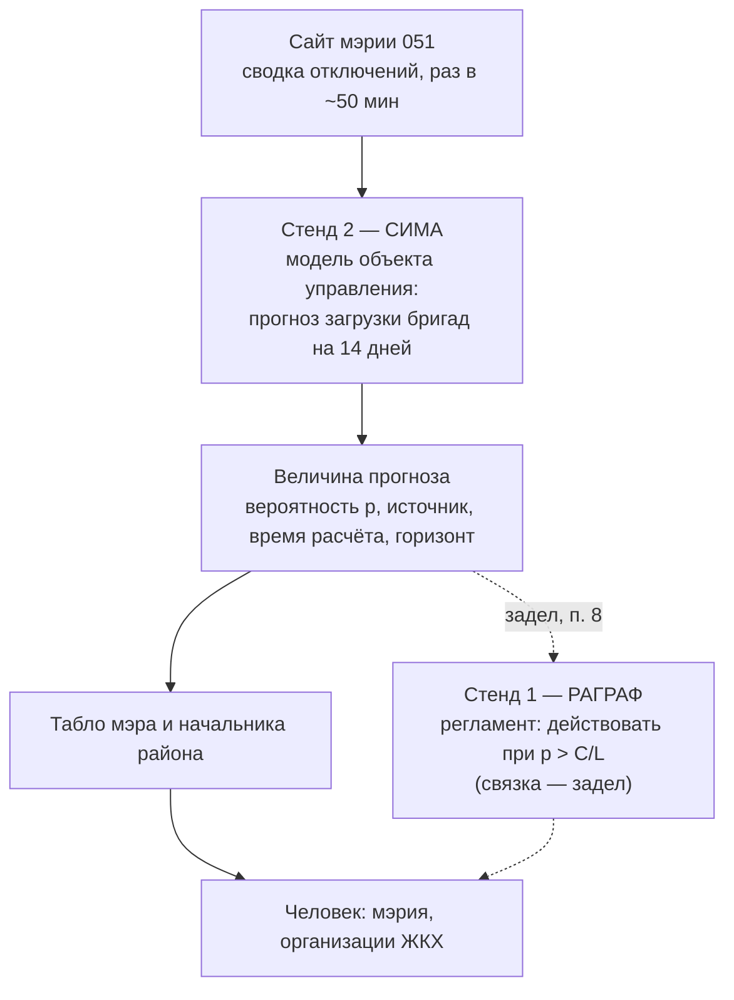
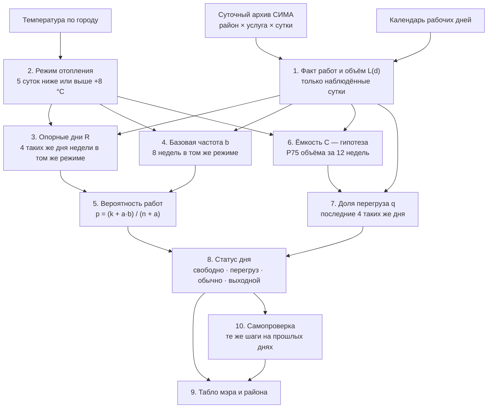

# ОТЧЁТ О НАУЧНО-ИССЛЕДОВАТЕЛЬСКОЙ РАБОТЕ

## Второй испытательный стенд СИМА: модель объекта управления «загрузка ремонтных бригад ЖКХ», прогноз с мерой неопределённости
### Краткий отчёт, редакция 1.1

---

> **Обозначение:** не присвоено. Отчёт написан отдельно; включать ли его приложением к отчёту
> о НИР РАГРАФ.НИР.002-2026 [1], решает руководитель работы после ревью.
> **Вид:** краткий, редакция 1.1 от 2026-11-17 (редакция 1.0 — того же дня). УДК и ГРНТИ не присвоены.
> **Изделие стенда:** модуль прогноза СИМА (кодовая база NSK_OpenData_Bot) — `src/power_forecast.py`,
> регламент `config/rules/power_forecast_rules.yaml` версии 1.1, коммит `27fdc88`. Состояние кода — прил. Б.
> **Основание:**
> - рекомендация 7 отчёта РАГРАФ [1]: «развить ЦД ОУ… прогноз между точками опроса с мерой
>   неопределённости» (п. 2.2 [1]);
> - цель задания на Фреймворк «Сигма» — «прогноз и выработка решений с объяснениями» [2];
> - интервью с заказчиком демонстрации (мэрия Новосибирска) 2026-11-16.
>
> **Место стенда.** СИМА — инициативный демонстрационный стенд ЦИИ НГУ для разведки открытых
> данных города. Он стоит **рядом с Фреймворком «Сигма», а не входит в него**. По отношению
> к работе РАГРАФ [1] он — второй испытательный стенд: первый (РАГРАФ) испытывает субъект
> управления — регламенты, второй (СИМА) — модель объекта управления, прогноз.
> **Стандарт:** ГОСТ 7.32-2017 [3].

---

## Состояние документа

**Что в отчёте.**
- **Постановка и стенд прогноза** загрузки бригад ЖКХ на две недели по открытой сводке отключений.
- **Отрицательный результат** о калибровке по месяцам.
- **Калибровка по режимам отопления** и откалиброванные вероятности.
- **Связь с понятиями отчёта РАГРАФ:** ЦД ОУ, частичный поставщик данных, правило
  «стоимость / потери».

**Чего в документе нет.**
- Печатной формы и точного числа страниц.
- Рецензий.
- Чистой проспективной проверки. Недели после 16.11.2026 ещё не наступили; отложенные
  недели частично видены при разведке (п. 6).
- Испытания связки «прогноз СИМА → регламент РАГРАФ»: она описана как направление (п. 8),
  но не собрана.
- Решения о месте отчёта: включать ли его приложением к отчёту РАГРАФ — после ревью.

**Изменения в редакции 1.1** (по просьбе руководителя работы, 2026-11-17):
- расширены термины (табл. 4);
- добавлены алгоритм прогноза по шагам с параметрами и методами (п. 4.6, рис. 2, табл. 10, 11) и
  объяснение, почему правило работает на данных Новосибирска (п. 4.7);
- надёжность вероятностей дополнена самопроверкой изделия на проде за последние четыре недели
  (п. 4.3, табл. 9): там верхние корзины уверенности оптимистичны — это добавлено в
  отрицательные результаты;
- исправлены расхождения текста с изделием: подписи табло (п. 4.3), вопрос о стоимости ошибки
  в модалке «?» (п. 8.2), состояние на проде (п. 7).

---

## Лист утверждения

Таблица 1 — Лист утверждения

| Роль | ФИО | Подпись | Дата |
|---|---|---|---|
| Руководитель работы, автор | Барбашин О. В. | _____________ | 2026-11-17 |

## Список исполнителей

Таблица 2 — Список исполнителей

| Роль | ФИО | Разделы |
|---|---|---|
| Руководитель и единственный исполнитель | Барбашин О. В. | все разделы |

**Методологическая опора** — авторы аппарата, на котором стоит работа. Исполнителями
они не являются.

Таблица 3 — Методологическая опора

| Аппарат | Авторы | Где используется |
|---|---|---|
| ЦД СУ и ЦД ОУ, задачное пространство | НИР «Фреймворк Сигма» 2024 [4]; Витяев Е. Е., Свириденко Д. И., Рофе А. Р. [5] | пп. 1, 8 |
| сезонная наивная модель (тот же день недели) | Hyndman R. J., Athanasopoulos G. [7] | пп. 3, 4.6 |
| эмпирический байесовский оценщик долей | Efron B., Morris C. [6] | пп. 4.2, 4.6 |
| оценка прогноза со скользящим началом | Hyndman R. J., Athanasopoulos G. [7]; Tashman L. J. [8] | пп. 3, 5 |
| прерывистый спрос | Teunter R. H., Syntetos A. A., Babai M. Z. [9] | п. 4.2 |
| надёжность вероятностного прогноза | Dimitriadis T., Gneiting T., Jordan A. I. [10] | п. 4.3 |
| шкала Брайера | Brier G. W. [23] | пп. 4.3, 4.6 |
| ценность вероятностного прогноза, правило «стоимость / потери» | Murphy A. H. [11] | п. 8.2 |

**Порядок работы.** Код, расчёты и текст подготовлены руководителем работы в паре
с ИИ-агентом. Агент — средство, а не исполнитель; ответственность за содержание несёт
руководитель работы.

---

## РЕФЕРАТ

Отчёт: 19 табл., 2 рис., 23 источн., 2 прил. Число страниц определяется по PDF при печати.

ЦИФРОВОЙ ДВОЙНИК ОБЪЕКТА УПРАВЛЕНИЯ, ПРОГНОЗ ПЛАНОВЫХ РАБОТ, РЕМОНТНЫЕ БРИГАДЫ, ЖКХ,
ОТКРЫТЫЕ ДАННЫЕ, РЕЖИМ ОТОПЛЕНИЯ, ЭМПИРИЧЕСКИЙ БАЙЕС, СКОЛЬЗЯЩЕЕ НАЧАЛО, МЕРА
НЕОПРЕДЕЛЁННОСТИ, КАЛИБРОВКА ВЕРОЯТНОСТЕЙ, ШКАЛА БРАЙЕРА, СТОИМОСТЬ И ПОТЕРИ,
ОТРИЦАТЕЛЬНЫЙ РЕЗУЛЬТАТ, ТАБЛО МЭРА

**Основание и замысел.** Отчёт о НИР РАГРАФ [1] назвал слабость модели мира этого изделия:
- прогноз приходит одним числом, без меры неопределённости;
- регламент решает без вероятности события, хотя по правилу «стоимость / потери» действовать
  выгодно при p > C/L [11].

Направление — двойник объекта управления (п. 2.2, рекомендация 7 [1]). Работа строит
такой двойник для одного объекта — загрузки ремонтных бригад ЖКХ — на втором стенде, СИМА.

**Объект исследования** — суточный ряд плановых и аварийных отключений систем
жизнеобеспечения Новосибирска: 10 районов, 5 услуг, 2026-03-25 … 2026-11-16. Ряд собран
СИМА с сайта мэрии [12].

**Цель** — дать мэру и начальнику района прогноз на две недели: в какие рабочие дни
бригады района по услуге будут свободны, а где ожидается перегруз. Прогноз должен
выдаваться вероятностью с проверяемой надёжностью, на уже собираемых данных, без
численности бригад.

**Метод:**
- правило по дню недели;
- режимы отопления по правилу «5 суток ниже/выше +8 °C» [13];
- сглаживание вероятности к обычной частоте работ (эмпирический Байес [6]);
- проверка со скользящим началом с разведением отборочных и отложенных недель [7], [8];
- оценка точностью меток, шкалой Брайера и таблицей «обещано / сбылось» [10].

**Результаты.**

*Завершено.*
1. **Стенд прогноза.** Модуль, регламент, эндпоинт `/power/forecast`, блок на табло мэра и
   в панели района, самопроверка на прошлых неделях. Проверок изделия 692 из 692 зелёные
   (коммит замеров `27fdc88`). С 17.11.2026 v2 отвечает на проде.
2. **Калибровка по 12 месяцам не проверяема:** каждый месяц встречается один раз.
   Сезонность в данных — это режим отопления, граница которого переносится год от года.
3. **Калиброванное правило v2.** На отложенных неделях точность «свободного дня» 79%
   против 66% у исходного (+13,4 п.п.). На всей истории (7763 прогноза с 27.04) вероятности
   откалиброваны: «свободно 82%» сбывается в 81% случаев. Шкала Брайера 0,156 против 0,179.
   На худшем горизонте и в первые недели после включения отопления правило слабее: самопроверка
   на проде за 20.10–16.11 — точность 70%, «обещано 95% — сбылось 83%» (п. 4.3).

*Условно.*
4. **Полнота v2** на отложенных неделях 47% против 49%: критерий заказчика «не меньшей
   полноты» формально не выполнен. Отложенные недели частично видены.
5. **Перегруз** лучше случайного в 1,5–3 раза. Ёмкость бригад — гипотеза.

*Задел.*
6. **Ёмкость** по наибольшему числу одновременно открытых работ из поштучных карточек [14].
7. **Передача прогноза в регламент РАГРАФ** как величины с вероятностью, источником,
   временем и горизонтом [15].

**Отрицательные результаты** (п. 6):
- помесячная калибровка отклонена;
- исходное правило самоуверенно на краях: «100% свободно» сбывалось в 87%;
- v2 на смене режима отопления оптимистично в верхних корзинах уверенности (на 4–12 п.п.);
- две ошибки формулы объёма в СИМА найдены и исправлены.

**Область применения** — табло мэра и начальника района. **Рекомендации** — п. «Рекомендации»
заключения. **Значимость** — пример внешнего модуля модели [15] с мерой неопределённости,
которую можно проверить серией, и с порогом решения, прочитанным как отношение
стоимости к потерям.

---

## СОДЕРЖАНИЕ

- Термины, определения и сокращения
- Введение
- 1 Второй стенд: место рядом с РАГРАФ
- 2 Исходные данные
- 3 Исходное правило и метрика «до»
- 4 Калибровка
- 5 Стенд и измерения
- 6 Отрицательные результаты и пределы
- 7 Новизна и чужое
- 8 Связь с работой РАГРАФ
- Заключение
- Список использованных источников
- Приложение А. Протокол замеров
- Приложение Б. Сверка чисел и состояние кода

## ТЕРМИНЫ, ОПРЕДЕЛЕНИЯ И СОКРАЩЕНИЯ

Таблица 4 — Термины и сокращения

| Термин | Значение в отчёте |
|---|---|
| **Данные** | |
| снимок | одно считывание сводки отключений сайта 051 сборщиком СИМА (около раза в 50 минут); в снимке у пары «район × услуга» не больше одной записи на группу — плановую и аварийную |
| сутки | сутки суточного архива СИМА по UTC — с 07:00 до 07:00 по Новосибирску; рабочий день бригады целиком внутри одних суток |
| наблюдённые сутки | сутки, в которые сборщик работал; сутки без снимков — пропуск сбора, а не «день без работ» |
| рабочий день | понедельник–пятница, кроме праздников и перенесённых выходных по календарю регламентов СИМА |
| ячейка | «район × услуга × рабочий день»: 10 районов, 5 услуг |
| работы в ячейке | в сутках есть хотя бы одна плановая запись района по услуге |
| объём L(d) | «домов в списке»: сумма домов плановых записей по снимкам суток, делённая на число снимков с плановой записью; так же считает «Отчёт за всё время» СИМА |
| авария | запись раздела «Аварийные отключения» сайта 051 |
| **Прогноз** | |
| горизонт | 14 суток, начиная с завтрашних; «сегодня» — по местному времени города |
| режим (отопления) | «включено» — со дня после 5 суток подряд со среднесуточной температурой ниже +8 °C, «выключено» — после 5 суток выше (п. 5 Правил № 354 [13]); температура — медиана районов по экологическому архиву СИМА; на горизонт режим продлевается |
| опорные дни R | дни, по которым судят о прогнозном дне: последние 4 наблюдённых рабочих дня с тем же днём недели и в том же режиме, сколь угодно далеко назад (v2); в v1 — те же дни недели за 6 недель без учёта режима |
| k, n | число опорных дней с работами и число опорных дней |
| базовая частота b | доля наблюдённых рабочих дней с работами в ячейке за 8 недель в том же режиме; если таких дней меньше 5 — за все 8 недель |
| сила сглаживания a | сколько «виртуальных» опорных дней даёт базовая частота; a = 4 |
| вероятность работ p | оценка вероятности плановых работ в ячейке: p = (k + a·b) / (n + a) в v2, p = k / n в v1 |
| уверенность «свободно» | 1 − p — вероятность, что плановых работ не будет |
| порог «свободно» | день называется свободным при p ≤ 0,35, то есть при уверенности не ниже 65% (в v1 — p ≤ 0,25) |
| ёмкость бригад C | гипотеза, а не измерение: 75-й процентиль объёма загруженных рабочих дней района по услуге за 12 недель, умноженный на коэффициент 1,0; для тепла — по дням того же режима; при менее чем 5 загруженных днях не оценивается |
| регулярная ячейка | ячейка с оценённой ёмкостью: не менее 5 рабочих дней с работами за 12 недель; только такие ячейки идут в «Свободные окна» табло |
| доля перегруза q | доля последних (до 4) таких же дней недели за 6 недель, в любом режиме, когда объём превышал ёмкость |
| перегруз | статус дня при q ≥ 0,5 и оценённой ёмкости |
| риск аварий r | доля наблюдённых суток с аварией за 28 суток; ожидаемое число аварийных дней на горизонте — r × 14 |
| **Проверка** | |
| скользящее начало | оценка, при которой прогноз на каждую дату строится только по данным до даты выпуска [7], [8] |
| отбор и отложенные недели | недели выпуска, на которых выбирались варианты и порог (до 12.10.2026), и недели однократной проверки (19.10–9.11.2026) |
| самопроверка изделия | та же оценка внутри модуля: каждый рабочий день последних 28 суток прогнозируется так, будто прогноз выпущен за 14 суток до него, — на худшем горизонте |
| точность «свободно» | доля дней, названных свободными, когда работ действительно не было |
| полнота | доля фактически свободных дней, которые правило назвало свободными |
| база | доля фактически свободных (для перегруза — тяжёлых) дней среди всех: точность, которую дало бы угадывание |
| подъём | отношение точности к базе |
| корзина уверенности | интервал уверенности «свободно»: 90–100, 70–90, 50–70, 30–50, 0–30% |
| обещано / сбылось | средняя уверенность прогнозов корзины и доля сбывшихся; у надёжной вероятности они близки [10] |
| шкала Брайера | средний квадрат разности вероятности работ и исхода (1 — работы были, 0 — нет): 0 — идеально, 0,25 — прогноз «50 на 50» [23] |
| **Управление** | |
| ЦД СУ, ЦД ОУ | цифровой двойник субъекта и объекта управления — по [4], п. 2.2 [1] |
| «стоимость / потери» | правило выбора действия при неопределённости: действовать, когда вероятность события выше отношения цены меры к цене потерь, p > C/L [11]; здесь — рекомендовать день свободным при уверенности выше c/(c + g) (п. 8.2) |
| частичный поставщик данных | источник, который может не ответить, и тогда его молчание — не «норма» (п. 5.2 [1]) |
| **Сокращения** | |
| п.п. | процентный пункт |
| ГВС, ХВС | горячее и холодное (вместе с канализацией) водоснабжение |
| P75 | 75-й процентиль |
| TSB | метод Teunter — Syntetos — Babai для прерывистого спроса [9] |

---

## ВВЕДЕНИЕ

### Основание и замысел

Модель мира РАГРАФ дискретна (п. 2.2 [1]). Мир виден в точках опроса, прогноз приходит
одним числом, история в решения не идёт. Выбор действия при неопределённости там не
моделируется. Направление — двойник объекта управления, дающий прогноз с мерой
неопределённости. В Платформе «Сигма» такой прогноз готовят внешние модули моделей,
а фреймворк принимает его с источником, временем расчёта и прогнозным периодом [15].
Строить такую модель — не задача модуля РАГРАФ. Настоящая работа строит её на втором стенде
для одного объекта управления.

### Актуальность

Бригад у ресурсоснабжающих организаций столько же, а плановых работ по дням то нет
совсем, то вдвое больше обычного: пустые дни — простой, перегруженные — сверхурочные
(интервью 2026-11-16). Выравнивание загрузки бригад планированием работ — известная задача
ресурсоснабжающих организаций [21]. Мэрия даты работ не назначает, только публикует. Прогноз
для неё — аргумент в разговоре с организациями. Численности бригад в открытых данных нет.

У задачи та же беда, что у регламентов РАГРАФ: **«нет данных — значит норма»**.
Там молчащий датчик давал «свободно» (п. 2.2 [1]). Здесь провал сбора выглядел бы днём
без работ и давал бы ложное «свободно». Решение то же: пропуск — третье значение, а не ноль.

### Цель работы

Дать мэру и начальнику района прогноз на две недели вперёд — свободные и перегруженные
рабочие дни бригад по району и услуге. Прогноз выдаётся вероятностью с проверяемой
надёжностью, работает на уже собираемых данных СИМА, а ёмкость бригад задана гипотезой.

### Задачи

Итоги по каждой задаче — в заключении, по тому же перечню.
- а) проверить пригодность и полноту данных СИМА об отключениях;
- б) построить правило прогноза и измерить его точность («до»);
- в) проверить предложение заказчика калибровать коэффициенты по месяцам или сезонам;
- г) найти способ оценки с откалиброванными вероятностями и проверить его на отложенных неделях;
- д) определить предсказуемость перегруза при гипотетической ёмкости бригад;
- е) связать результат с понятиями работы РАГРАФ: ЦД ОУ, частичный поставщик данных,
  выбор действия при неопределённости.

### Объект и предмет исследования

**Объект** — ряд отключений (см. реферат) как наблюдение объекта управления «загрузка
ремонтных бригад».

**Предмет** — способ оценки вероятности плановых работ в ячейке на горизонте 1–14 суток
и проверка надёжности этой вероятности.

---

## 1. ВТОРОЙ СТЕНД: МЕСТО РЯДОМ С РАГРАФ

Два стенда делят постановку работы РАГРАФ по ролям (рисунок 1): РАГРАФ исполняет регламенты
(ЦД СУ), СИМА моделирует объект управления (ЦД ОУ) и выдаёт прогноз с мерой
неопределённости. Связка двух стендов — задел (п. 8): прогноз СИМА в регламенты РАГРАФ
пока не передаётся.



Рисунок 1 — Два стенда: регламенты (РАГРАФ) и модель объекта управления (СИМА)

## 2. ИСХОДНЫЕ ДАННЫЕ

Источник — сводка «Отключения систем жизнеобеспечения города» [12]: по каждой из 5 услуг
плановые и аварийные отключения по районам, число домов. Соответствие групп разделам
сайта сверено с разметкой страницы 2026-11-16.

Таблица 5 — Полнота и сверка данных

| Показатель | Значение |
|---|---|
| Период | 2026-03-25 … 2026-11-16, 237 суток |
| Сутки со сбором | 219 |
| Пропуски сбора | 18 суток (17–19.05, 22.05–05.06): простой сервера, а не «дни без отключений» |
| Сутки с неполным сбором (менее 20 снимков) | 10 |
| Суточный архив против пересчёта из сырых снимков | 639 из 639 строк (29 полных суток) |
| Сутки по UTC против суток по НСК | профиль недели совпадает до 1 п.п. |
| Ключевые решения заказчика | пользователь — мэрия; горизонт 2 недели; задача — заранее найти свободные дни; метрика — +10 п.п. точности при не меньшей полноте на отложенных неделях; без ML, пока правило не обыграно |

## 3. ИСХОДНОЕ ПРАВИЛО И МЕТРИКА «ДО»

Правило v1: 4 последних таких же дня недели. Вероятность работ — доля этих дней с работами,
«свободно» — при вероятности не выше 0,25. Ёмкость бригад — гипотеза: P75 объёма
загруженных рабочих дней за 12 недель. «Перегруз» — объём выше ёмкости хотя бы в половине
опорных дней.

Таблица 6 — Метрика «до»: рабочие дни 19.10–13.11, горизонт 2 недели

| Услуга | Доля свободных дней | Точность «свободно» | Полнота |
|---|---|---|---|
| Электроснабжение | 44% | 57% | 28% |
| Теплоснабжение | 32% | 43% | 64% |
| ХВС | 70% | 75% | 71% |
| Регулярные ячейки, все услуги | 45,9% | 68,5% | 51,2% |

## 4. КАЛИБРОВКА

### 4.1. По месяцам — отрицательный результат

Лучший способ оценки по месяцам:
- июнь–сентябрь — частота работ ячейки за 8 недель без учёта дня недели;
- октябрь–ноябрь — сглаженный день недели.

Смена приходится на начало отопления, а не на календарь. Каждый месяц в истории
встречается один раз, поэтому коэффициенты «под месяц» нечем проверить [7], [16].
Параметры по месяцам — только после двух лет данных.

### 4.2. Режимы отопления и сглаживание (v2)

Режим «отопление включено» включается после 5 суток подряд ниже +8 °C и выключается после
5 суток выше. Это пороги п. 5 Правил № 354 [13], а сами даты назначает мэрия. Правило
по температуре СИМА дало 28.04 и 11.10.2026. Мэрия, по данным СМИ, отключила отопление с 29.04,
включила с 23.09 и подключала дома до 16.10 [17].

Вероятность плановых работ:

**p = (k + a·b) / (n + a)**

- k из n — сколько опорных дней были с работами; опорные — тот же день недели в том же режиме;
- b — обычная частота работ ячейки за 8 недель в том же режиме;
- a = 4 — сила сглаживания.

Это эмпирический Байес для доли [6] и ступенчатый аналог оценки вероятности появления
спроса в методе TSB [9].

Таблица 7 — Отбор (недели выпуска до 12.10) и отложенная проверка (19.10–9.11), регулярные ячейки

| Вариант | Отбор: точность / полнота | Отложено: точность / полнота |
|---|---|---|
| v1, порог 0,25 | 81% / 66% | 66% / 49% |
| v2, a = 4, порог 0,35 — выбран на отборе | 85% / 69% | **79% / 47%** |
| v2, a = 2, порог 0,35 | 84% / 68% | 78% / 42% |

Для тепла память в пределах режима снизила шкалу Брайера в первые 4 недели после смены
режима с 0,333 до 0,228, в остальное время — с 0,063 до 0,048. Режимы по датам мэрии и
четыре режима (переход, гидроиспытания) на отборе неотличимы от температурных (Брайер
0,1475–0,1494). Взят простейший вариант.

### 4.3. Мера неопределённости

Таблица 8 — «Обещано / сбылось», 7763 прогноза по регулярным ячейкам с 27.04

| v2: уверенность «свободно» | сбылось | v1: обещано | сбылось |
|---|---|---|---|
| 96% | 93% | 100% | 87% |
| 82% | 81% | 75% | 72% |
| 68% | 68% | 50% | 54% |
| 50% | 48% | 25% | 35% |
| 2% | 9% | 0% | 12% |

Шкала Брайера: v2 — 0,156, v1 — 0,179. В v1 «свободные» дни там, где бригада обычно
занята (частота работ не ниже 0,7), сбывались лишь в 40% случаев против 80% в остальных
ячейках. Сглаживание v2 такие дни не называет. На двухнедельную проверку приходится около
290 прогнозов, поэтому вероятность проверяется серией за 2–4 недели. На табло она выводится
с шагом 5% в клетках и в свободных окнах, под блоком — строка «обещано → сбылось», а
в модалке «?» — таблица корзин и шкала Брайера.

**Самопроверка изделия на проде.** Табло считает надёжность само, по последним четырём
неделям (таблица 9).

Таблица 9 — Самопроверка изделия на проде: рабочие дни 20.10–16.11.2026, прогноз за 14 суток до дня, 666 прогнозов по регулярным ячейкам

| Уверенность «свободно» | Прогнозов | Обещано | Сбылось |
|---|---|---|---|
| 90–100% | 60 | 95% | 83% |
| 70–90% | 117 | 79% | 68% |
| 50–70% | 126 | 60% | 56% |
| 30–50% | 151 | 38% | 37% |
| 0–30% | 212 | 16% | 20% |

Там же: точность «свободно» 70,1% при базе 44,7%, полнота 50,3%; перегруз — 28,2% при базе
10,4% (×2,7); шкала Брайера 0,208.

Числа таблиц 7–8 и таблицы 9 получены разной постановкой, и сравнивать их напрямую нельзя:
- исследование выпускает прогноз по понедельникам на 1–14 суток вперёд, в среднем на неделю;
  самопроверка судит каждый день так, будто прогноз выпущен ровно за 14 суток, — на худшем
  горизонте;
- самопроверка смотрит только последние четыре недели. Это первые недели после включения
  отопления 11.10: опорные дни режима для них — апрельские, а осенние кампании подключения
  домов в истории режима ещё не видны.

Отсюда меньшая точность (70% против 79%) и завышенная на 4–12 п.п. уверенность в верхних
корзинах. Это предел правила на смене режима (п. 4.7), и табло показывает его открыто.
Если на неделях после 16.11 разрыв не сократится, это довод за сглаживание на переходе
к частоте последних недель, а не только к частоте режима.

### 4.4. Перегруз

Подъём против базовой частоты тяжёлых дней — от 1,5 до 3 раз по сезонам и определениям
ёмкости. Самопроверка модуля на последних 4 неделях:
- v2 — 29,7% при базе 10,3% (×2,9);
- v1 — 25% при базе 11,3% (×2,2).

Ёмкость — определение, а не измерение: она выведена из тех же объёмов, с которыми
сравнивается, и калибровать её «по данным» нельзя.

### 4.5. Проверка формул и найденные ошибки

- **День недели верен:** независимый пересчёт вероятностей из таблицы совпал с модулем
  в 500 из 500 ячеек.
- **Факт по истории:** самый лёгкий будний день — понедельник (электросети 46% против 55–61%).
  Повторяющийся перегруз по теплу у Советского района по вторникам настоящий: самые тяжёлые
  работы с включения отопления — 3.11 (33 дома) и 10.11 (47 домов) при P75 около 23.
- **Ошибки СИМА, найдены и исправлены:**
  - объём делился на снимки с любой записью района по услуге, а не только с плановой —
    занижение у 17% пар. После исправления среднее аварийных домов в сутки по отчёту СИМА
    выросло с 372 до 501;
  - «сегодня» бралось по UTC.

### 4.6. Алгоритм прогноза v2

Алгоритм — правило, а не обучаемая модель: в нём нет подгоняемых по данным весов, кроме
параметров регламента (таблица 10), выбранных на отборочных неделях. Код — чистая функция
`build_forecast()` в `src/power_forecast.py`, без обращения к базе; данные собирает
`get_forecast()`. Схема — на рисунке 2.

**Вход:**
- строки суточного архива СИМА за 400 суток: сутки, район, услуга, дома плановых записей,
  число снимков с плановой и с аварийной записью;
- список наблюдённых суток;
- среднесуточная температура по городу — медиана районов по экологическому архиву СИМА,
  без строк-заглушек;
- календарь праздников и перенесённых выходных;
- регламент `power_forecast_rules` версии 1.1.

**Шаги:**
1. **Объём и факт работ.** Для каждой пары «район × услуга» и наблюдённых суток: работы были,
   если есть плановая запись; объём L(d) — домов в списке (табл. 4). В расчёт идут только
   наблюдённые рабочие сутки: пропуск сбора — третье значение, а не «день без работ».
2. **Режим отопления.** По ряду температур: «включено» со дня после 5 суток подряд ниже
   +8 °C, «выключено» — после 5 суток выше. Пропуск в ряду и ровно +8 °C прерывают серию.
   Режим вчерашних суток продлевается на весь горизонт.
3. **Опорные дни.** Для прогнозного дня t — последние 4 наблюдённых рабочих дня с тем же днём
   недели и в том же режиме. Глубина не ограничена: сразу после смены режима опоры берутся из
   прошлого такого же сезона.
4. **Базовая частота.** b — доля наблюдённых рабочих дней с работами в ячейке за 8 недель
   в том же режиме; если таких дней меньше 5 — за все 8 недель.
5. **Вероятность работ.** p = (k + a·b) / (n + a), a = 4. Значения 0 и 1 получаются, только
   если и опорные дни, и все 8 недель одинаковы — работ не было ни разу или они шли каждый день.
6. **Ёмкость — гипотеза.** C — 75-й процентиль объёма загруженных рабочих дней за 12 недель,
   умноженный на коэффициент 1,0; для тепла — только дни того же режима. Меньше 5 загруженных
   дней — ёмкость не оценивается, ячейка нерегулярная.
7. **Доля перегруза.** q — доля последних (до 4) таких же дней недели за 6 недель, в любом
   режиме, когда объём превышал ёмкость.
8. **Статус дня.** Выходной или праздник — «выходной»; оценки нет — «нет данных»; p ≤ 0,35 —
   «свободно»; иначе при оценённой ёмкости и q ≥ 0,5 — «перегруз»; иначе — «обычно».
   В клетке табло — вероятность своего статуса с шагом 5%.
9. **Сводка.** По городу — свободные окна регулярных ячеек, сначала там, где бригады обычно
   заняты; перегрузы; риск аварий r — доля наблюдённых суток с аварией за 28 суток, ожидаемо
   r × 14 аварийных дней. По району — сетка «услуга × день».
10. **Самопроверка.** Каждый наблюдённый рабочий день последних 28 суток прогнозируется шагами
    2–8 по данным до даты, отстоящей на 14 суток. Считаются точность и полнота «свободно»
    по услугам и для регулярных ячеек, точность перегруза против базы, корзины «обещано /
    сбылось» и шкала Брайера. Результат выводится на табло и в модалку «?».



Рисунок 2 — Алгоритм прогноза v2

Таблица 10 — Параметры регламента `power_forecast_rules` 1.1

| Параметр | Значение | Шаг |
|---|---|---|
| `estimator` | `eb_regime` (v2); `weekday` — правило v1 | 3–5 |
| `horizon_days` | 14 | горизонт |
| `history_weeks` | 4 | 3; для перегруза — окно `history_weeks` + 2 недели |
| `regime.threshold_c`, `regime.run_days` | +8 °C, 5 суток | 2 |
| `shrinkage.strength` (a) | 4 | 5 |
| `shrinkage.base_weeks`, `shrinkage.min_base_days` | 8 недель, 5 дней | 4 |
| `free_max_share` | 0,35 | 8 |
| `capacity.window_weeks`, `capacity.min_days` | 12 недель, 5 дней | 6 |
| `capacity.quantile`, `capacity.factor` | 0,75; 1,0 — гипотеза, управленческое допущение | 6 |
| `capacity.regime_utilities` | тепло | 6 |
| `capacity.overload_share` | 0,5 | 8 |
| `risk.window_days` | 28 | 9 |
| `backtest.window_days`, `backtest.min_lag_weeks` | 28 суток, 2 недели | 10 |

Таблица 11 — Методы и их место в алгоритме

| Метод | Что даёт | Шаг | Источник |
|---|---|---|---|
| Сезонная наивная модель: тот же день недели | недельный цикл работ организаций | 3 | [7, разд. 5.2] |
| Пороговое правило отопительного периода | две «эпохи» года вместо двенадцати месяцев | 2 | [13] |
| Эмпирический Байес для доли (сжатие к общей частоте) | устойчивая вероятность по четырём дням | 5 | [6] |
| Вероятность появления спроса в методе TSB | тот же приём для прерывистых работ | 5 | [9], [20] |
| Квантиль как мера пропускной способности | ёмкость без численности бригад | 6 | допущение работы |
| Персистентность нагрузки | перегруз по последним неделям | 7 | допущение работы, проверено (табл. 17) |
| Правило «стоимость / потери» | смысл порога «свободно» | 8 | [11] |
| Скользящее начало, разведение отбора и проверки | честная оценка без подглядывания | 10 | [7], [8], [16], [19] |
| Диаграмма надёжности по корзинам | проверка процентов серией | 10 | [10] |
| Шкала Брайера | одно число качества вероятностей | 10 | [23] |

Описанное поведение закреплено проверками `tests/test_power_forecast.py`: правило пяти суток,
сглаживание к обычной частоте, опоры из прошлого сезона после включения отопления, перегруз по
последним неделям в любом режиме, 100% уверенности только там, где работ не было вовсе.

### 4.7. Почему правило работает на данных Новосибирска

Точность простого правила держится на четырёх свойствах этого ряда. Где свойство не
выполняется, правило и ошибается.

1. **Плановые работы идут недельными циклами.** Организации планируют отключения заранее,
   по графикам бригад, и у одной пары «район × услуга» работы повторяются в те же дни недели.
   Самый лёгкий будний день — понедельник: у электросетей работы в 46% понедельников против
   55–61% в другие дни (п. 4.5). Поэтому одна только опора «тот же день недели» даёт подъём:
   у v1 точность «свободно» 68,5% при базе 45,9% (табл. 6).
2. **Характер работ меняет граница отопительного периода, а не календарь.** Летом теплосети
   раскапывают, ремонтируют и испытывают; в отопительный период копать трудно, дома
   подключают к теплу, а трубы чинят внутри зданий (интервью с заказчиком 2026-11-16).
   Частота работ по теплу при этом остаётся высокой — в октябре–ноябре 68% рабочих дней
   (табл. 6), — но меняется, в какие дни и какими объёмами они идут. Поэтому один и тот же
   день недели летом и осенью — разные дни. Без учёта режима правило переносило летнюю
   картину на осень и называло «свободными» не те дни. Учёт режима снизил ошибку по теплу в
   первые 4 недели после смены режима по шкале Брайера с 0,333 до 0,228 (п. 4.2). Месяц
   такой границей не служит: в 2026 году она пришлась на 28.04 и 11.10, в другом году
   сдвинется.
3. **Ячейки различаются обычной частотой работ, и основная информация — в ней.** Работы бывают
   у газа примерно в 3% рабочих дней, у ХВС — в трети, у электросетей и тепла — в большинстве
   дней (табл. 6 и самопроверка). Четыре опорных дня дают всего пять возможных оценок — 0, ¼, ½,
   ¾ и 1, — грубых и самоуверенных: «100% свободно» в v1 сбывалось в 87% (табл. 8).
   Сглаживание берёт уровень из восьми недель ячейки, а день недели лишь сдвигает его: при a = 4
   восемь недель весят как четыре дополнительных опорных дня. Отсюда промежуточные проценты,
   которым можно верить (табл. 8), и почти нет «свободных» дней у бригад, которые обычно заняты:
   в v1 такие дни сбывались лишь в 40% случаев.
4. **Тяжёлая нагрузка держится неделями.** Объём работ района растёт кампаниями — программа
   ремонта сетей, подключение домов после включения отопления — и держится несколько недель.
   Поэтому перегруз судится по последним таким же дням недели в любом режиме. Опоры из прошлого
   сезона описывают другую кампанию: с ними точность перегруза на самопроверке по выгрузке 16.11
   падала до 14% против 29,7%. Ёмкость тепла считается в пределах режима: летние объёмы
   испытаний сетей — плохая мера для зимы (табл. 17).

**Где правило слабее:**
- **сразу после смены режима:** опоры — из прошлого такого же сезона (для осени 2026 — апрель),
  а кампании нового сезона ещё не видны; на последних четырёх неделях уверенность в верхних
  корзинах завышена на 4–12 п.п. (табл. 9);
- **аварии** по дням случайны: для них только частота за 28 суток;
- **в ячейках с редкими работами** (газ) «свободно» тривиально, поэтому они не идут в «Свободные
  окна»;
- **зимы** в данных нет: правило не проверено на зимнем переходе.

## 5. СТЕНД И ИЗМЕРЕНИЯ

Таблица 12 — Состав стенда

| Часть | Что |
|---|---|
| Данные | `zhkh_daily_district.csv`, 11 850 строк — собрана `build_dataset.py` из выгрузок СИМА за 16.11, 19.08 и 31.03 |
| Эксперименты | `scripts/zhkh_calibration/`: Python 3.12, pandas 2.3, numpy 2.4 |
| Изделие | `src/power_forecast.py`, регламент 1.1, `GET /power/forecast`, блок табло |
| Проверки изделия | 692 зелёных, 52 пропущено (полный набор `tests/`), в том числе 24 проверки прогноза и 3 — формулы отчёта |

**Методика — скользящее начало** [7], [8]. Каждый понедельник с 27.04 выпускается прогноз
на 2 недели только по данным до этого дня: около 11 тыс. ячеек. Варианты и порог
выбирались на неделях выпуска до 12.10, затем один раз проверялись на 19.10–9.11.
Значимость разницы по шкале Брайера оценена бутстрепом по неделям выпуска (2000 повторов).
Независимых двухнедельных блоков около 9–10 — это предел точности.

**Способность проверки краснеть.** Проверки формулы объёма отчёта на старом коде падают
все три. Проверка «после включения отопления день не свободен» на правиле v1 показывает
тот самый изъян, который v2 исправляет.

## 6. ОТРИЦАТЕЛЬНЫЕ РЕЗУЛЬТАТЫ И ПРЕДЕЛЫ

Таблица 13 — Отрицательные результаты и ограничения

| № | Что | Почему важно |
|---|---|---|
| 1 | Помесячная калибровка отклонена как непроверяемая | один год — по одному примеру месяца |
| 2 | Отложенные недели не чистые: видены в разведке по сезонам | чистая проверка — недели после 16.11.2026, самопроверка на табло покажет её сама |
| 3 | Полнота v2 на 1,4 п.п. ниже исходной | порог 0,4 дал бы на тех же неделях 79% / 50%, но выбрать его по отложенным неделям значило бы подогнать результат |
| 4 | Перегруз предсказывается слабо | ёмкость — гипотеза; участки бригад могут не совпадать с районами |
| 5 | Нет зимы; даты отопления мэрии — из вторичных источников | правило режима не проверено на зимнем переходе |
| 6 | Объём — в домах, а не в трудозатратах | одна работа на фидере отключает сотни домов; поштучные карточки сайт публикует, СИМА их не собирает |
| 7 | Связка с РАГРАФ не собрана | п. 8 — описание направления, не испытание |
| 8 | На смене режима v2 оптимистично: за 20.10–16.11 «обещано 95% — сбылось 83%», «79% — 68%» | опоры после включения отопления — из апреля; проверить на неделях после 16.11 (табл. 9, п. 4.7) |

## 7. НОВИЗНА И ЧУЖОЕ

**Что известно:**
- сглаживание долей [6];
- оценка со скользящим началом [7], [8];
- прерывистый спрос [9];
- надёжность вероятностей [10];
- правило «стоимость / потери» [11];
- пороги отопительного периода [13];
- понятия ЦД СУ и ЦД ОУ [4], [5].

**Что своё:** сборка этих методов для прогноза загрузки бригад по открытой сводке
отключений, без численности бригад:
- вероятность — по тем же дням недели в том же режиме отопления, со сглаживанием;
- ёмкость — явная гипотеза;
- надёжность прогноза проверяется на прошлых неделях и выводится на табло рядом с прогнозом.

Проверено на данных одного города за 219 суток (10 районов × 5 услуг): точность «свободно»
79% против 66%, «обещано 82% — сбылось 81%». Уточнение границы: помесячная калибровка на
одном году не проверяема.

**Что не заявляется:**
- **новый статистический метод** — методы известны;
- **«впервые»** — обзора приоритета нет;
- **оценка численности бригад** — ёмкость гипотетическая;
- **влияние на сверхурочные и аварии** — не измерялось; связь «перегруз → аварии» в данных
  есть только как совпадение (аварии электросетей в 29% дней с плановыми работами против 19%
  без них);
- **уровень готовности технологии** — прогноз v1 слит в основную ветку СИМА 16.11.2026,
  v2 — 17.11.2026. На проде v2 отвечает и показывается на табло, самопроверка — табл. 9;
  проспективная проверка на новых неделях ещё впереди.

## 8. СВЯЗЬ С РАБОТОЙ РАГРАФ

### 8.1. Прогноз как частичный поставщик данных

По заданию «Сигмы» 2026 года фреймворк принимает прогноз от внешнего модуля с источником,
временем расчёта и прогнозным периодом и различает факт, прогноз и сценарий [15].
Ответ `/power/forecast` уже несёт эти поля:
- вероятность и уверенность по каждой ячейке;
- дату расчёта и горизонт;
- режим и его дату;
- самопроверку «обещано / сбылось».

Для регламента РАГРАФ это частичный поставщик данных в смысле п. 5.2 [1]. Пропуск
сбора не превращается в ноль: ячейка без опор получает «нет данных», а день простоя
сборщика не считается днём без работ. Это условие, на котором держится гарантия
сохранения вердикта работы РАГРАФ.

### 8.2. Порог решения как отношение стоимости к потерям

Отчёт РАГРАФ отмечает: при цене меры C и цене потерь L действовать выгодно при
p > C/L [11] (п. 2.2 [1]). В прогнозе СИМА решение — рекомендовать день организации
как свободный. Пусть ошибочная рекомендация (работы в этот день всё же будут) стоит c,
а угаданное окно приносит пользу g. Тогда рекомендовать выгодно при уверенности
«свободно» выше c / (c + g).

Принятый порог 0,35 по вероятности работ соответствует уверенности не ниже 0,65,
то есть c ≈ 1,9 g. Иначе говоря, порог неявно считает ошибку «свободно» почти вдвое
дороже пользы от угаданного окна. Это управленческое допущение, а не свойство данных.
С откалиброванной вероятностью его можно задать прямо, вопросом руководителю: во сколько
раз ошибка дороже пользы? Вопрос включён в модалку «?» на табло.

### 8.3. Что остаётся заделом

- **Регламент РАГРАФ, читающий прогноз СИМА**, — например, «ожидается перегруз с
  вероятностью ≥ q → предписание организации». Нужны канал величины с вероятностью и
  испытание по лестнице подтверждения отчёта РАГРАФ (п. 2.4 [1]).
- **Ёмкость организаций по одновременности работ.** Наибольшее число одновременно открытых
  работ — нижняя граница числа бригад [14]. Средняя загрузка — по закону Литтла [18].
  Организации — 6 коммунальных диспетчерских по открытому набору мэрии [22]:
  Горводоканал, НГЭС АО «РЭС», НТСК, МУП «Энергия», Газпром газораспределение Томск,
  Новосибирскоблгаз.

---

## ЗАКЛЮЧЕНИЕ

### Итоги по задачам

Таблица 14 — Итоги по задачам а)–е)

| Задача | Итог | Состояние |
|---|---|---|
| а) пригодность и полнота данных | ряд полон на 219 из 237 суток, пропуски распознаются, архив сходится с сырыми снимками; две ошибки формул исправлены (пп. 2, 4.5) | выполнено |
| б) правило и метрика «до» | правило v1 на табло с самопроверкой; метрика «до» — таблица 6 | выполнено |
| в) калибровка по месяцам | проверена и отклонена как непроверяемая; сезонность — режим отопления (п. 4.1) | выполнено, отрицательный результат |
| г) откалиброванные вероятности | v2: «обещано 82% — сбылось 81%», точность «свободно» +13,4 п.п. на отложенных неделях (пп. 4.2, 4.3) | частично: полнота −1,4 п.п.; отложенные недели не чистые |
| д) предсказуемость перегруза | лучше случайного в 1,5–3 раза (п. 4.4) | частично: ёмкость — гипотеза |
| е) связь с работой РАГРАФ | прогноз — частичный поставщик данных с мерой неопределённости; порог прочитан как отношение стоимости к потерям (п. 8) | частично: связка с РАГРАФ не собрана |

### Цель

Цель достигнута частично. Прогноз на две недели работает на уже собираемых данных и выдаёт
откалиброванную вероятность с проверкой на табло. Критерий заказчика по полноте формально
не выполнен, а чистая проверка на новых неделях ещё впереди.

### Главный вывод

На одном неполном году сезонность прогноза загрузки бригад калибруется режимами, а не
месяцами. Сглаживание в пределах режима даёт вероятность, которой можно верить как
вероятности. Мера неопределённости, которой отчёту РАГРАФ не хватало в модели мира,
для этого объекта управления получена и проверяема серией. Порог решения при этом
перестаёт быть подобранным числом и становится вопросом о стоимости ошибки.

### Результаты

**Завершено:**
- стенд прогноза и самопроверка;
- отрицательный результат о помесячной калибровке;
- v2 с откалиброванными вероятностями;
- исправление формул объёма в СИМА.

**Условно:**
- полнота v2 на отложенных неделях;
- предсказуемость перегруза.

**Задел:**
- ёмкость по одновременности работ из поштучных карточек;
- связка прогноза с регламентами РАГРАФ;
- режимы по календарю мэрии и окну гидроиспытаний;
- зимний переход.

### Рекомендации

1. **Проверить v2 проспективно** на неделях после 16.11.2026 и решить о его принятии по
   критерию заказчика.
2. **Собирать поштучные карточки работ** с сайта 051 и считать ёмкость организаций по
   одновременности работ [14], [18].
3. **Задать порог «свободно» через отношение стоимости ошибки к пользе** (п. 8.2) — вопросом
   руководителю на демонстрации.
4. **Не удалять суточный архив СИМА через 365 дней**, иначе история для сезонности сотрётся
   к весне 2027.
5. **Собрать регламент РАГРАФ, читающий прогноз СИМА**, и испытать его по лестнице
   подтверждения отчёта РАГРАФ.

---

## СПИСОК ИСПОЛЬЗОВАННЫХ ИСТОЧНИКОВ

Пометки о прочтении (исследование 2026-11-17): [П] — первоисточник целиком, [А] — аннотация,
[В] — вторичный источник.

1. Платформа «РАГРАФ» — замкнутый контур «датчик — регламент — задача — человек» : отчёт о НИР (итоговый, этапы 1 и 2), ред. 2.0 : РАГРАФ.НИР.002-2026 / ЦИИ НГУ ; рук. О. В. Барбашин. — Новосибирск, 2026. — Копия в Markdown: `~/RAGRAF/docs/OTCHET-NIR-RAGRAF-2026-ITOGOVYY.md`.
2. Фреймворк «Сигма» — программно-аппаратный комплекс для разработки, сопровождения и управления жизненным циклом систем проактивного управления городской инфраструктурой : техническое задание (уточнённое — 2025 год) : ИИ-01-01-01-1/1-ЛУ / НГУ, ЦИИ НГУ ; рук. разработки И. А. Болдырев. — Новосибирск, 2025. — 105 л.
3. ГОСТ 7.32-2017. Отчёт о научно-исследовательской работе. Структура и правила оформления. — Москва : Стандартинформ, 2017.
4. Фреймворк Сигма : отчёт о НИР (промежуточный, этап 1) / НГУ, ЦИИ НГУ ; рук. НИР И. А. Болдырев. — Новосибирск, 2024. — 110 с. — НИОКТР 124042200020-3.
5. Vityaev E. E., Sviridenko D. I., Rofe A. R. Task-Based Approach to Digital Transformations // Известия Иркутского государственного университета. Серия «Математика». — 2025. — Т. 54. — С. 78–95. — DOI 10.26516/1997-7670.2025.54.78.
6. Efron B., Morris C. Data analysis using Stein's estimator and its generalizations // Journal of the American Statistical Association. — 1975. — Vol. 70, no. 350. — P. 311–319. [А]
7. Hyndman R. J., Athanasopoulos G. Forecasting: principles and practice. 3rd ed. — Melbourne : OTexts, 2021. — Разд. 5.10. — URL: https://otexts.com/fpp3/tscv.html (дата обращения: 17.11.2026). [П]
8. Tashman L. J. Out-of-sample tests of forecasting accuracy: an analysis and review // International Journal of Forecasting. — 2000. — Vol. 16, no. 4. — P. 437–450. [А]
9. Teunter R. H., Syntetos A. A., Babai M. Z. Intermittent demand: linking forecasting to inventory obsolescence // European Journal of Operational Research. — 2011. — Vol. 214, no. 3. — P. 606–615. [А]
10. Dimitriadis T., Gneiting T., Jordan A. I. Stable reliability diagrams for probabilistic classifiers // Proceedings of the National Academy of Sciences. — 2021. — Vol. 118, no. 8. — e2016191118. [А]
11. Murphy A. H. The Value of Climatological, Categorical and Probabilistic Forecasts in the Cost-Loss Ratio Situation // Monthly Weather Review. — 1977. — Vol. 105, no. 7. — P. 803–816. — DOI 10.1175/1520-0493(1977)105<0803:TVOCCA>2.0.CO;2.
12. Отключения систем жизнеобеспечения города / Мэрия г. Новосибирска. — URL: http://051.novo-sibirsk.ru/sitepages/off.aspx (дата обращения: 16.11.2026).
13. О предоставлении коммунальных услуг собственникам и пользователям помещений в многоквартирных домах и жилых домов : постановление Правительства Рос. Федерации от 06.05.2011 № 354. — П. 5 ; письмо Минстроя России от 25.08.2026 № 52494-ДН/04. — URL: https://rulaws.ru/acts/Pismo-Minstroya-Rossii-ot-25.08.2026-N-52494-DN_04/ (дата обращения: 17.11.2026). [П, копия]
14. Kleinberg J., Tardos É. Algorithm design. — Boston : Pearson, 2006. — Разд. 4.1. [В]
15. Фреймворк «СИГМА» (версия 2.1) : техническое задание (уточнённое — 2026 год) : ИИ-01-01-01-2-ЛУ / НГУ, ЦИИ НГУ ; рук. разработки И. А. Болдырев. — Новосибирск, 2026. — 63 л.
16. Cawley G. C., Talbot N. L. C. On over-fitting in model selection and subsequent selection bias in performance evaluation // Journal of Machine Learning Research. — 2010. — Vol. 11. — P. 2079–2107. [А]
17. Отопительный сезон в Новосибирске стартовал: когда тепло придёт в ваш дом // Российская газета. — 2026. — URL: https://rg.ru/post/otopitelnyj-sezon-v-novosibirske-startoval-kogda-teplo-pridet-v-vash-dom.html (дата обращения: 17.11.2026) ; Мэр Новосибирска объявил о завершении отопительного сезона // RuNews24. — 28.04.2026. — URL: https://runews24.ru/novosibirsk/28/04/2026/mer-novosibirska-kudryavczev-obyavil-o-zavershenii-otopitelnogo-sezona (дата обращения: 17.11.2026). [В]
18. Little J. D. C. Little's law as viewed on its 50th anniversary // Operations Research. — 2011. — Vol. 59, no. 3. — P. 536–549. [А]
19. Cerqueira V., Torgo L., Mozetič I. Evaluating time series forecasting models: an empirical study on performance estimation methods // Machine Learning. — 2020. — Vol. 109. — P. 1997–2028. [А]
20. Syntetos A. A., Boylan J. E. The accuracy of intermittent demand estimates // International Journal of Forecasting. — 2005. — Vol. 21, no. 2. — P. 303–314. [А]
21. Smart scheduling for utilities: a fast solution for today's priorities / McKinsey & Company. — 2023. — URL: https://www.mckinsey.com/industries/electric-power-and-natural-gas/our-insights/smart-scheduling-for-utilities-a-fast-solution-for-todays-priorities (дата обращения: 17.11.2026). [П]
22. Открытые данные мэрии г. Новосибирска : набор ID 2 (дежурные и диспетчерские службы города). — URL: http://opendata.novo-sibirsk.ru/pass.aspx?ID=2 (дата обращения: 16.11.2026).
23. Brier G. W. Verification of forecasts expressed in terms of probability // Monthly Weather Review. — 1950. — Vol. 78, no. 1. — P. 1–3. [В]

---

## ПРИЛОЖЕНИЕ А. ПРОТОКОЛ ЗАМЕРОВ

Таблица 15 — Шкала Брайера по сезонам (меньше — лучше)

| Сезон прогнозного дня | Ячеек | v1 | частота за 8 недель | сглаживание a = 4 без режима |
|---|---|---|---|---|
| весна (май) | 300 | 0,1929 | 0,1860 | 0,1805 |
| лето (июнь–август) | 6000 | 0,1261 | 0,1101 | 0,1124 |
| осень (сентябрь–ноябрь) | 4600 | 0,1834 | 0,1741 | 0,1717 |

Бутстреп по неделям выпуска: разница с v1 значима летом (14 недель) и осенью (10 недель).
Весной недель две, вывод ненадёжен [19].

Таблица 16 — Режимы на отборе

| Режимы | Брайер | Точность / полнота при пороге 0,35 |
|---|---|---|
| по температуре (28.04 / 11.10) | 0,1491 | 85% / 69% |
| по датам мэрии (29.04 / 23.09) | 0,1475 | 85% / 68% |
| четыре (переход, гидроиспытания) | 0,1494 | 84% / 68% |

Таблица 17 — Перегруз: подъём против базы тяжёлых дней

| Ёмкость | Отбор | Отложено |
|---|---|---|
| P75 за 12 недель, все дни | ×2,5 | ×1,8 |
| P75 в режиме, все услуги | ×1,8 | ×1,8 |
| P75 в режиме только для тепла (принято) | ×2,3 | ×2,2 |

Таблица 18 — Плитки «Отчёта за всё время» СИМА до и после исправления формулы

| Плитка | Было | Стало |
|---|---|---|
| Чистых дней / дней с авариями | 0 / 216 из 217 | 0 / 216 из 217 |
| Макс. домов в сутки | 8 614 (15.07) | 8 647 (15.07) |
| Ср. домов в сутки | 372 | 501 |
| Плановых, сумма | 270 154 | 279 366 |

## ПРИЛОЖЕНИЕ Б. СВЕРКА ЧИСЕЛ И СОСТОЯНИЕ КОДА

**Состояние кода замеров:** СИМА, коммит `27fdc88` (ветка `dev`, 2026-11-17): модуль прогноза,
регламент 1.1, табло и скрипты калибровки; исправление формулы отчёта — коммит `15ef3e7`.
Слиты в основную ветку 2026-11-17. Текст модалки «?» сверен с кодом и поведение п. 4.6
закреплено проверками в коммите `2ad1fa1`; алгоритм п. 4.6 описан по `src/power_forecast.py`
этого коммита. Табл. 9 — ответ прода 2026-11-17, 12:29 UTC; числа меняются каждый день.

Таблица 19 — Команды получения чисел

| Числа | Команда (`D=~/Downloads/sima-zhkh-dataset-2026-11-16`) |
|---|---|
| таблица данных | `python3 -I $D/build_dataset.py $D <три выгрузки СИМА>` |
| табл. 15, п. 4.1 | `python3 -W ignore scripts/zhkh_calibration/calibration_experiment.py $D` |
| табл. 7, 17 | `python3 -W ignore scripts/zhkh_calibration/calibration_selection.py $D` |
| табл. 8 | `python3 -W ignore scripts/zhkh_calibration/reliability.py $D` |
| табл. 9 | `curl -s https://nsk-opendata-bot.up.railway.app/power/forecast` → поле `backtest` (`free.regular`, `overload`, `calibration`, `brier`) |
| табл. 16 | `python3 -W ignore scripts/zhkh_calibration/regime_variants.py $D` |
| табл. 5, п. 4.5 | `python3 -W ignore scripts/zhkh_calibration/weekday_check.py $D` |
| проверки изделия | `python3 -m pytest tests/ -q` |

Объём реферата подсчитан по этому файлу:

```bash
F=docs/NIR-SIMA-PROGNOZ-BRIGAD-2026.md
grep -c '^Таблица [0-9]' $F            # таблиц
grep -c '^Рисунок [0-9]' $F            # рисунков
awk '/^## СПИСОК ИСПОЛЬЗОВАННЫХ/{s=1;next} /^## ПРИЛОЖЕНИЕ/{s=0} s && /^[0-9]+\. /' $F | wc -l   # источников
grep -c '^## ПРИЛОЖЕНИЕ' $F            # приложений
```
