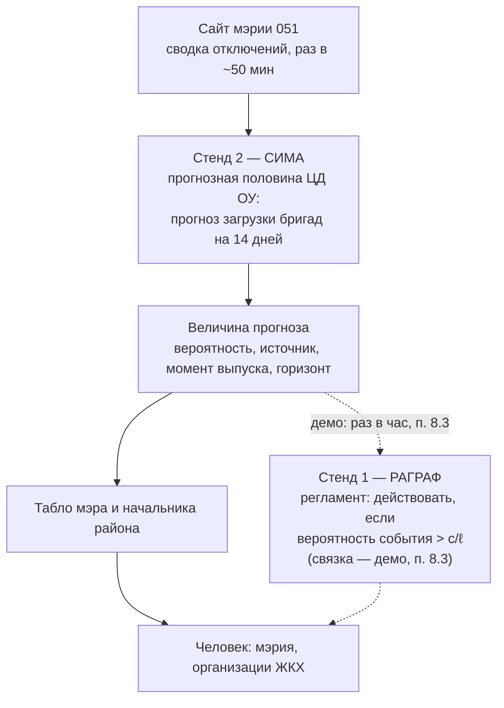
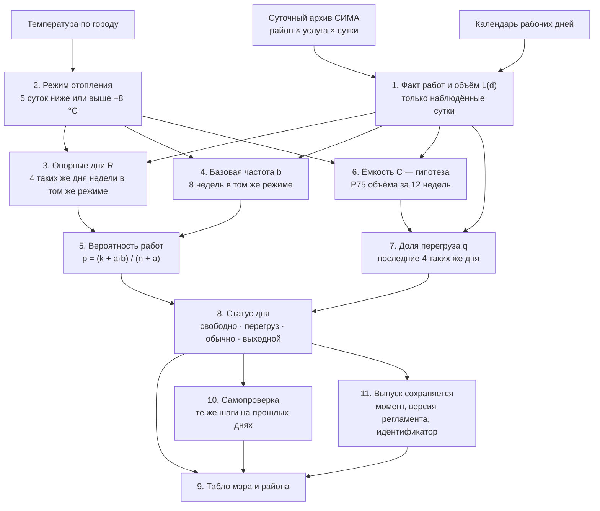

# ОТЧЁТ О НАУЧНО-ИССЛЕДОВАТЕЛЬСКОЙ РАБОТЕ

## РАГРАФ-ПРОГНОЗ: модель объекта управления и прогноз с мерой неопределённости на стенде СИМА
### Загрузка ремонтных бригад ЖКХ, снегопад и гололёд, нормы в решениях мэрии
### Дополнение к отчёту о НИР РАГРАФ.НИР.002-2026. Краткий отчёт, редакция 2.2

---

> **Обозначение:** РАГРАФ-ПРОГНОЗ.НИР.001-2026 (в ред. 1.2 — СИМА.НИР.001-2026).
> Это дополнение к отчёту о НИР РАГРАФ.НИР.002-2026 ред. 2.1 [1]. В том отчёте — краткое
> изложение, приложение Н на 2–3 страницы со ссылкой на настоящий отчёт; здесь — полный текст
> (решения руководителя работы 2026-11-17 и 2026-11-18).
> **Вид:** краткий, редакция 2.2 от 2026-11-18 (2.0 и 2.1 — того же дня, 1.0–1.2 — 2026-11-17). УДК и ГРНТИ не присвоены.
> **Изделие — РАГРАФ-ПРОГНОЗ** (кодовая база NSK_OpenData_Bot, стенд СИМА):
> - прогноз загрузки бригад ЖКХ — `src/power_forecast.py`, регламент `power_forecast_rules` 1.1.
>   Замеры — на коммите `27fdc88`, сохранение выпусков — коммит `f086138`;
> - погода для решений мэрии — `src/ecology_cache.py`, регламент `ecology_rules` 1.3: гололёд по
>   влаге, снегопад по районам на 1–3 суток, нормы в текстах табло (п. 9).
>
> Состояние кода — прил. Б.
> **Основание:**
> - задел 11 заключения отчёта РАГРАФ [1]: «цифровой двойник объекта управления над дискретной
>   моделью мира: состояние между точками опроса и прогноз с мерой неопределённости» (п. 2.2 [1]);
> - цель задания на Фреймворк «Сигма» — «прогноз и выработка решений с объяснениями» [2];
> - интервью 2026-11-16. Требования за заказчика демонстрации — мэрию Новосибирска —
>   сформулировал руководитель работы; с мэрией они не согласованы. Возможный участник
>   апробации на районе — администрация Советского района, без обязательств.
>
> **Проект и стенд.** РАГРАФ-ПРОГНОЗ — имя проекта с 2026-11-18: прогнозы с проверяемой
> надёжностью для решений мэрии в линейке РАГРАФ. Демо для мэрии показывается под этим именем.
>
> Испытан проект на стенде СИМА — инициативном демонстрационном стенде ЦИИ НГУ для разведки
> открытых данных города. СИМА стоит **рядом с Фреймворком «Сигма», а не входит в него**. Это и не
> Платформа СИГМА, и не ассистент «Сигма» Студии аналитика РАГРАФ (табл. 4).
>
> По отношению к работе РАГРАФ [1] СИМА — второй испытательный стенд: первый (РАГРАФ) испытывает
> субъект управления — регламенты, второй — модель объекта управления, прогноз.
> **Стандарт:** ГОСТ 7.32-2017 [3].

---

## Состояние документа

**Что в отчёте.**
- **Постановка и стенд прогноза** загрузки бригад ЖКХ на две недели по открытой сводке отключений.
- **Отрицательный результат** о калибровке по месяцам.
- **Калибровка по режимам отопления** и надёжность вероятностей на отборочных и отложенных
  выпусках.
- **Связь с понятиями отчёта РАГРАФ:** ЦД ОУ, частичный поставщик данных, правило
  «стоимость / потери»; связка с регламентом РАГРАФ, собранная как демо.
- **Погода и нормы** (п. 9): гололёд на исходах, сводка по городу, снегопад по районам с
  ретропроверкой, нормы и полномочия в текстах табло; воздух — модель, а не замер.

**Чего в документе нет.**
- Печатной формы и точного числа страниц.
- Рецензий.
- Проверки по выданным прогнозам. До 17.11.2026 выпуски не сохранялись, и самопроверка
  пересчитывает прошлое нынешним кодом (п. 4.3). С 17.11 выпуски сохраняются. Первые исходы
  будут 18.11, серия на две недели — к 01.12.2026.
- Чистой отложенной проверки: два отложенных выпуска частично видены при разведке (п. 6).
- Испытания связки «прогноз СИМА → регламент РАГРАФ». Связка собрана как демо (п. 8.3), но её
  решения по исходам не проверены, а работу по расписанию на изделии РАГРАФ ещё не видели.
- Проверки погоды по выданным прогнозам: архив выпусков погоды ведётся с 18.11.2026.

**Изменения в редакции 2.2** (2026-11-18, после коммита связки в РАГРАФ, `2c1a9c5`;
замечание сессии РАГРАФ № 18):
- связка «прогноз СИМА → регламент РАГРАФ» собрана как демо без токена и описана в п. 8.3:
  сборщик, пять величин регламента, правило устаревания, время решения;
- по этому факту исправлены п. 1, рис. 1, п. 7, табл. 14 (строка 7), табл. 19 (задача е),
  задел, «Условно» и рекомендация 5;
- нумерация таблиц и пунктов прежняя.

**Изменения в редакции 2.1** (2026-11-18, по сверке сессии РАГРАФ с отчётом РАГРАФ ред. 2.1;
номера — по ред. 2.1):
- ЦД ОУ названо точно: работа строит прогнозную половину двойника, а состояние объекта между
  точками опроса не восстанавливает — это задел (реферат, введение, п. 1);
- паспорт выпуска дополнен последними наблюдёнными сутками `history_to`. Момент выпуска
  говорит, когда прогноз посчитан, `history_to` — по каким данным (п. 4.3);
- в примере регламента (п. 8.3) «предписание организации» заменено рекомендацией мэрии
  попросить организацию перенести часть работ: даты работ мэрия не назначает;
- описаны поля p_free и p_overload и исправление `c500276`: у ячейки без оценённой ёмкости
  p_overload был 0,0 (табл. 4, п. 4.5);
- правило «стоимость / потери» записано на событии «работ не будет»: его вероятность 1 − p,
  c = e, ℓ = e + g (табл. 4, п. 8.2, рис. 1);
- к паспорту и пропуску величины отнесены условия 4 и 5 договора оракула, сказано, почему
  условие 3 к прогнозу неприменимо (п. 8.3);
- «снимок» сайта отделён от снимка величин M = (v, t). Добавлены термины «возраст выпуска»,
  «регламент СИМА», «поля p_free, p_overload»; частичный поставщик данных определён через ⊥
  (табл. 4);
- в табл. 14 добавлены сутки с неполным сбором и незакрытые сутки, которые читаются как
  наблюдённые;
- имена — как в [1]: Платформа СИГМА, Студия аналитика; ссылка [1] — с правками 18.11.2026.

**Изменения в редакции 2.0** (2026-11-18, решения руководителя работы):
- проект называется РАГРАФ-ПРОГНОЗ, обозначение — РАГРАФ-ПРОГНОЗ.НИР.001-2026; отчёт оформлен
  как дополнение к отчёту о НИР РАГРАФ.НИР.002-2026;
- добавлен п. 9 «Погода и нормы» с таблицами 15–18: гололёд на исходах, сводка по городу,
  снегопад по районам с ретропроверкой, нормы и полномочия, воздух. Добавлены задачи ж)–и)
  и источники [25]–[35];
- ретропроверка правил гололёда на ДТП пересчитана на ERA5. В исследовании 17.11 погода была
  взята из архива Open-Meteo без явной модели — для этих лет это ECMWF IFS — и за октябрь–апрель.
  Выводы те же, числа — в табл. 16;
- у чисел без команды названо, откуда они получены (прил. Б);
- таблицы 15–21 ред. 1.2 получили номера 19–25;
- уточнение того же дня по просьбе сессии РАГРАФ: координаты точки для табл. 16 и 18 (пп. 9.2, 9.4).

**Изменения в редакции 1.2** (по замечаниям сессии РАГРАФ 2026-11-17; исправления согласовал
руководитель работы; номера таблиц — по ред. 1.2):
- присвоено обозначение и решено место отчёта; заказчик демонстрации назван точно (табл. 4);
- ссылки на отчёт РАГРАФ приведены к ред. 2.1. Правило «стоимость / потери» записано в
  обозначениях [1] — c и ℓ, своя цена ошибки обозначена e (п. 8.2). Уточнено, о чём говорит
  гарантия сохранения вердикта (п. 8.1);
- надёжность посчитана отдельно на отложенных выпусках (табл. 9). Отложенных выпусков два —
  19.10 и 26.10, а не недели по 9.11, как сказано в ред. 1.1;
- табл. 8 перестроена: все корзины табло и число прогнозов в каждой. В ред. 1.1 у v2 были
  опущены две корзины из семи, в том числе «обещано 19% — сбылось 27%»;
- значимость оценена блочным бутстрепом по 2 недели выпуска (табл. 17); в табл. 16 добавлен v2;
- прямо сказано, что самопроверка — пересчёт, а не проверка выданного (п. 4.3). С 17.11 выпуски
  сохраняются, ответ несёт паспорт выпуска;
- набор данных, скрипт сборки, ответ прода и протоколы лежат в репозитории с контрольными
  суммами (прил. Б);
- исправлены числа:
  - «692 из 692 зелёные» → «692 прошли, 52 пропущены»;
  - «около 290 прогнозов на проверку» → около 320 на выпуск;
  - «9–10 независимых блоков» → 12;
  - у двух чисел перегруза указаны дата и источник.

**Изменения в редакции 1.1** (по просьбе руководителя работы, 2026-11-17):
- расширены термины (табл. 4);
- добавлены алгоритм прогноза по шагам с параметрами и методами (п. 4.6, рис. 2; в ред. 1.2 — табл. 11, 12) и
  объяснение, почему правило работает на данных Новосибирска (п. 4.7);
- надёжность вероятностей дополнена самопроверкой изделия на проде за последние четыре недели
  (п. 4.3; в ред. 1.2 — табл. 10): там верхние корзины уверенности оптимистичны — это добавлено в
  отрицательные результаты;
- исправлены расхождения текста с изделием: подписи табло (п. 4.3), вопрос о стоимости ошибки
  в модалке «?» (п. 8.2), состояние на проде (п. 7).

---

## Лист утверждения

Таблица 1 — Лист утверждения

| Роль | ФИО | Подпись | Дата |
|---|---|---|---|
| Руководитель работы, автор | Барбашин О. В. | _____________ | 2026-11-17 |

## Список исполнителей

Таблица 2 — Список исполнителей

| Роль | ФИО | Разделы |
|---|---|---|
| Руководитель и единственный исполнитель | Барбашин О. В. | все разделы |

**Методологическая опора** — авторы аппарата, на котором стоит работа. Исполнителями
они не являются.

Таблица 3 — Методологическая опора

| Аппарат | Авторы | Где используется |
|---|---|---|
| ЦД СУ и ЦД ОУ, задачное пространство | НИР «Фреймворк Сигма» 2024 [4]; Витяев Е. Е., Свириденко Д. И., Рофе А. Р. [5] | пп. 1, 8 |
| сезонная наивная модель (тот же день недели) | Hyndman R. J., Athanasopoulos G. [7] | пп. 3, 4.6 |
| эмпирический байесовский оценщик долей | Efron B., Morris C. [6] | пп. 4.2, 4.6 |
| оценка прогноза со скользящим началом | Hyndman R. J., Athanasopoulos G. [7]; Tashman L. J. [8] | пп. 3, 5 |
| прерывистый спрос | Teunter R. H., Syntetos A. A., Babai M. Z. [9] | п. 4.2 |
| надёжность вероятностного прогноза | Dimitriadis T., Gneiting T., Jordan A. I. [10] | п. 4.3 |
| шкала Брайера | Brier G. W. [23] | пп. 4.3, 4.6 |
| ценность вероятностного прогноза, правило «стоимость / потери» | Murphy A. H. [11] | п. 8.2 |

**Порядок работы.** Код, расчёты и текст подготовлены руководителем работы в паре
с ИИ-агентом. Агент — средство, а не исполнитель; ответственность за содержание несёт
руководитель работы.

---

## РЕФЕРАТ

Отчёт: 25 табл., 2 рис., 35 источн., 2 прил. Число страниц определяется по PDF при печати.

ЦИФРОВОЙ ДВОЙНИК ОБЪЕКТА УПРАВЛЕНИЯ, ПРОГНОЗ ПЛАНОВЫХ РАБОТ, РЕМОНТНЫЕ БРИГАДЫ, ЖКХ,
ОТКРЫТЫЕ ДАННЫЕ, РЕЖИМ ОТОПЛЕНИЯ, ЭМПИРИЧЕСКИЙ БАЙЕС, СКОЛЬЗЯЩЕЕ НАЧАЛО, МЕРА
НЕОПРЕДЕЛЁННОСТИ, КАЛИБРОВКА ВЕРОЯТНОСТЕЙ, ШКАЛА БРАЙЕРА, СТОИМОСТЬ И ПОТЕРИ,
ВЫПУСК ПРОГНОЗА, ОТРИЦАТЕЛЬНЫЙ РЕЗУЛЬТАТ, ТАБЛО МЭРА, СНЕГОПАД, ГОЛОЛЁД, ПРОВЕРКА НА ИСХОДАХ,
ГОСТ Р 50597-2017

**Основание и замысел.** Отчёт о НИР РАГРАФ [1] назвал слабость модели мира этого изделия:
- прогноз приходит одним числом, без меры неопределённости;
- регламент решает без вероятности события, хотя по правилу «стоимость / потери» действовать
  выгодно, когда вероятность события выше c/ℓ [11].

Направление — двойник объекта управления (п. 2.2 и задел 11 заключения [1]). Работа строит
прогнозную половину такого двойника — прогноз с мерой неопределённости — для загрузки ремонтных
бригад ЖКХ. Состояния объекта между точками опроса она не восстанавливает; прототип этой
половины по роли — блок склейки событий госномеров РАГРАФ (п. 2.2 [1]). Затем тот же подход
переносится на прогноз погоды для мэрии — снегопад и гололёд:
- правило проверяется на исходах;
- выпуски сохраняются;
- рядом с рекомендацией стоит норма.

Проект — РАГРАФ-ПРОГНОЗ, стенд — СИМА.

**Объект исследования** — суточный ряд плановых и аварийных отключений систем
жизнеобеспечения Новосибирска: 10 районов, 5 услуг, 2026-03-25 … 2026-11-16. Ряд собран
СИМА с сайта мэрии [12]. Для п. 9 объект — прогноз погоды Open-Meteo по точкам города [28]. Исходы
для его проверки — ДТП Новосибирска 2015 — январь 2026 по данным ДТП-Стат [30] и реанализ ERA5 [31].

**Цель** — дать мэру и начальнику района прогноз на две недели: в какие рабочие дни
бригады района по услуге будут свободны, а где ожидается перегруз. Прогноз должен
выдаваться вероятностью с проверяемой надёжностью, на уже собираемых данных, без
численности бригад. По погоде цель — подсказать службам мэрии снегопад по районам на 1–3 суток
с нормой и сроком и не поднимать ложных тревог о гололёде.

**Метод:**
- правило по дню недели;
- режимы отопления по правилу «5 суток ниже/выше +8 °C» [13];
- сглаживание вероятности к обычной частоте работ ячейки в духе эмпирического Байеса [6],
  сила сглаживания выбрана на отборе;
- проверка со скользящим началом с разведением отборочных и отложенных выпусков [7], [8],
  значимость — блочным бутстрепом [24];
- оценка точностью меток, шкалой Брайера и таблицей «обещано / сбылось» [10];
- для погоды — проверка правил на исходах (ДТП [30]) и прогноза снега на прошлых прогнозах
  против ERA5 [28], [31]: доля названных событий, ложных тревог и CSI [34].

**Результаты.**

*Завершено.*
1. **Стенд прогноза.** Модуль, регламент, эндпоинт `/power/forecast`, блок на табло мэра и
   в панели района, самопроверка на прошлых неделях. Проверки изделия на коммите замеров
   `27fdc88`: 692 прошли, 52 пропущены. С 17.11.2026 v2 отвечает на проде, а каждый выпуск
   сохраняется с моментом выпуска, версией регламента и идентификатором (коммит `f086138`).
   С 18.11 паспорт выпуска называет и последние наблюдённые сутки — по каким данным он посчитан.
2. **Калибровка по 12 месяцам не проверяема:** каждый месяц встречается один раз.
   Сезонность в данных — это режим отопления, граница которого переносится год от года.
3. **Калиброванное правило v2.**
   - На двух отложенных выпусках (19.10 и 26.10, прогнозные дни 19.10–06.11) точность
     «свободного дня» 79% против 66% у исходного правила (+13,4 п.п.). Шкала Брайера
     0,221 против 0,252.
   - На всех 24 выпусках с 11.05 (7 763 прогноза) обещанное близко к сбывшемуся в верхних
     корзинах уверенности: 95,8 → 92,2% и 79,5 → 79,4%. В нижней корзине уверенность
     «свободно» занижена: 9,1 → 16,1%. Шкала Брайера 0,156 против 0,179.
   - После включения отопления v2 слишком резок на обоих краях. На отложенных выпусках —
     96,8 → 83,6% и 16,2 → 29,8%, в самопроверке прода за 20.10–16.11 — 95 → 83% (п. 4.3).
     На отборочных выпусках верхняя корзина надёжна (95,8 → 92,5%): разрыв даёт период,
     а не способ проверки.
4. **Погода и нормы** (п. 9).
   - Прежнее правило гололёда — «сутки проходят через 0 °C», без осадков — на исходах не
     отличало дней с ДТП «недостатки зимнего содержания»: 0,71 против 1,17 таких ДТП в сутки,
     ноябрь–март 2015–2026. Оно заменено правилом по влаге в два уровня. Снегопад от 2 см такие
     дни отличает — в 1,56 раза.
   - Прогноз снегопада по районам на 1–3 суток выведен на табло мэра и района с нормами
     ГОСТ Р 50597-2017 и Правил благоустройства. Прогноз «снег от 2 см» на завтра на прошлых
     зимах назвал 78% снегопадов и сбылся в 78% случаев.
   - Тексты табло приведены к нормам и полномочиям. Выпуски погоды сохраняются с 18.11.2026.

*Условно.*
5. **Полнота v2** на отложенных выпусках 47% против 49%: критерий заказчика «не меньшей
   полноты» формально не выполнен. Отложенные выпуски частично видены.
6. **Перегруз** лучше случайного в 1,5–3 раза. Ёмкость бригад — гипотеза.

*Задел.*
7. **Ёмкость** по наибольшему числу одновременно открытых работ из поштучных карточек [14].
8. **Испытание связки с регламентом РАГРАФ** по исходам. Сама связка собрана как демо
   18.11.2026 (п. 8.3): регламент `sima-brigady-peregruz` раз в час читает прогноз по
   Советскому району без токена — величины с вероятностью, паспортом выпуска и давностью данных.
9. **Почасовое правило гололёда** с проверкой по наблюдениям METAR и **замеры воздуха** —
   без них прогноз воздуха проверить нечем.
10. **Вторая половина ЦД ОУ** — состояние объекта между точками опроса (п. 2.2 [1]).

**Отрицательные результаты** (п. 6):
- помесячная калибровка отклонена;
- исходное правило самоуверенно на краях: «100% свободно» сбывалось в 87,4%;
- v2 после включения отопления слишком резок на обоих краях (табл. 9, 10). В нижней корзине
  уверенность «свободно» занижена и на всей истории;
- до 17.11.2026 выданные прогнозы не сохранялись: самопроверка — пересчёт, а не проверка выданного;
- две ошибки формулы объёма в СИМА найдены и исправлены;
- правила гололёда по суточным данным — и прежнее, и новое — не отличают дней с ДТП
  «недостатки зимнего содержания»;
- код погоды по городу нельзя ни усреднять, ни брать наибольшим (п. 9.3);
- архив Open-Meteo без явной модели отдаёт прогноз, а не реанализ: проверка сравнила бы
  прогноз с самим собой.

**Область применения** — табло мэра и начальника района. **Рекомендации** — п. «Рекомендации»
заключения. **Значимость** — пример внешнего модуля модели [15] с мерой неопределённости,
которую можно проверить серией, и с порогом решения, прочитанным как отношение
стоимости к потерям.

---

## СОДЕРЖАНИЕ

- Термины, определения и сокращения
- Введение
- 1 Второй стенд: место рядом с РАГРАФ
- 2 Исходные данные
- 3 Исходное правило и метрика «до»
- 4 Калибровка
- 5 Стенд и измерения
- 6 Отрицательные результаты и пределы
- 7 Новизна и чужое
- 8 Связь с работой РАГРАФ
- 9 Погода и нормы: гололёд, снегопад, воздух
- Заключение
- Список использованных источников
- Приложение А. Протокол замеров
- Приложение Б. Сверка чисел и состояние кода

## ТЕРМИНЫ, ОПРЕДЕЛЕНИЯ И СОКРАЩЕНИЯ

Таблица 4 — Термины и сокращения

| Термин | Значение в отчёте |
|---|---|
| **Стенд** | |
| СИМА | Система интеллектуального муниципального анализа — инициативный демонстрационный стенд ЦИИ НГУ на открытых данных Новосибирска (кодовая база NSK_OpenData_Bot). Не Фреймворк «Сигма» и не Платформа СИГМА. Ассистент Студии аналитика РАГРАФ называется «Сигма» (до 05.11.2026 — «Сима») и к СИМА не относится |
| РАГРАФ-ПРОГНОЗ | имя проекта с 18.11.2026: прогнозы с проверяемой надёжностью для решений мэрии в линейке РАГРАФ. Испытан на стенде СИМА; демо для мэрии показывается под этим именем |
| заказчик демонстрации | мэрия Новосибирска. Требования за неё сформулировал руководитель работы на интервью 2026-11-16, с мэрией они не согласованы. «Критерий заказчика» в отчёте — этот критерий |
| регламент СИМА | файл параметров правил (`*_rules.yaml`, например `power_forecast_rules`), а не регламент РАГРАФ в смысле [1]. После связки «версия регламента» есть у двух объектов: у файла параметров СИМА и у регламента РАГРАФ, читающего прогноз |
| **Данные** | |
| снимок (сайта) | одно считывание сводки отключений сайта 051 сборщиком СИМА (около раза в 50 минут); в снимке у пары «район × услуга» не больше одной записи на группу — плановую и аварийную. Не путать со снимком величин M = (v, t) в [1] (п. 8.1) |
| сутки | сутки суточного архива СИМА по UTC — с 07:00 до 07:00 по Новосибирску; рабочий день бригады целиком внутри одних суток |
| наблюдённые сутки | сутки, в которые сборщик работал; сутки без снимков — пропуск сбора, а не «день без работ» |
| рабочий день | понедельник–пятница, кроме праздников и перенесённых выходных по календарю регламентов СИМА |
| ячейка | «район × услуга × рабочий день»: 10 районов, 5 услуг |
| работы в ячейке | в сутках есть хотя бы одна плановая запись района по услуге |
| объём L(d) | «домов в списке»: сумма домов плановых записей по снимкам суток, делённая на число снимков с плановой записью; так же считает «Отчёт за всё время» СИМА |
| авария | запись раздела «Аварийные отключения» сайта 051 |
| **Прогноз** | |
| горизонт | 14 суток, начиная с завтрашних; «сегодня» — по местному времени города |
| режим (отопления) | «включено» — со дня после 5 суток подряд со среднесуточной температурой ниже +8 °C, «выключено» — после 5 суток выше (п. 5 Правил № 354 [13]); температура — медиана районов по экологическому архиву СИМА; на горизонт режим продлевается |
| опорные дни R | дни, по которым судят о прогнозном дне: последние 4 наблюдённых рабочих дня с тем же днём недели и в том же режиме, сколь угодно далеко назад (v2); в v1 — те же дни недели за 6 недель без учёта режима |
| k, n | число опорных дней с работами и число опорных дней |
| базовая частота b | доля наблюдённых рабочих дней с работами в ячейке за 8 недель в том же режиме; если таких дней меньше 5 — за все 8 недель |
| сила сглаживания a | сколько «виртуальных» опорных дней даёт базовая частота; a = 4, выбрана на отборочных выпусках |
| вероятность работ p | оценка вероятности плановых работ в ячейке: p = (k + a·b) / (n + a) в v2, p = k / n в v1 |
| уверенность «свободно» | 1 − p — вероятность, что плановых работ не будет |
| порог «свободно» | день называется свободным при p ≤ 0,35, то есть при уверенности не ниже 65% (в v1 — p ≤ 0,25) |
| ёмкость бригад C | гипотеза, а не измерение: 75-й процентиль объёма загруженных рабочих дней района по услуге за 12 недель, умноженный на коэффициент 1,0; для тепла — по дням того же режима; при менее чем 5 загруженных днях не оценивается |
| регулярная ячейка | ячейка с оценённой ёмкостью: не менее 5 рабочих дней с работами за 12 недель; только такие ячейки идут в «Свободные окна» табло |
| доля перегруза q | доля последних (до 4) таких же дней недели за 6 недель, в любом режиме, когда объём превышал ёмкость |
| перегруз | статус дня при q ≥ 0,5 и оценённой ёмкости |
| поля p_free, p_overload | поля ячейки в ответе `/power/forecast`: p_free = 1 − p (уверенность «свободно»), p_overload = q (доля перегруза). Нет оценки — нет поля: у выходного и у ячейки без опор нет p_free, у ячейки без оценённой ёмкости — p_overload (с 18.11.2026, п. 4.5) |
| риск аварий r | доля наблюдённых суток с аварией за 28 суток; ожидаемое число аварийных дней на горизонте — r × 14 |
| выпуск | прогноз по городу на 14 суток с моментом выпуска (UTC), версией регламента, последними наблюдёнными сутками (`history_to`) и идентификатором. Повторный расчёт того же прогноза — тот же выпуск; изменилось содержимое — новый. Сохраняется с 17.11.2026 (п. 4.3) |
| возраст выпуска | время от момента выпуска до чтения ответа. Давность данных — другое, она считается от последних наблюдённых суток `history_to`: замолчи сборщик, и выпуск будет свежим, а данные — старыми (п. 4.3) |
| **Проверка** | |
| скользящее начало | оценка, при которой прогноз на каждую дату строится только по данным до даты выпуска [7], [8] |
| отборочные и отложенные выпуски | 22 понедельничных выпуска 11.05–12.10.2026, на которых выбирались варианты и порог, и 2 выпуска однократной проверки — 19.10 и 26.10 (прогнозные дни 19.10–06.11). Исходы 19–23.10 прогнозировал и последний отборочный выпуск |
| самопроверка изделия | та же оценка внутри модуля: каждый рабочий день последних 28 суток прогнозируется так, будто прогноз выпущен за 14 суток до него, — на худшем горизонте. Это пересчёт нынешним кодом по нынешнему архиву, а не проверка выданного |
| точность «свободно» | доля дней, названных свободными, когда работ действительно не было |
| полнота | доля фактически свободных дней, которые правило назвало свободными |
| база | доля фактически свободных (для перегруза — тяжёлых) дней среди всех: точность, которую дало бы угадывание |
| подъём | отношение точности к базе |
| корзина уверенности | интервал уверенности «свободно»: 90–100, 70–90, 50–70, 30–50, 0–30%; те же корзины на табло, в самопроверке и в табл. 8–10 |
| обещано / сбылось | средняя уверенность прогнозов корзины и доля сбывшихся; у надёжной вероятности они близки [10] |
| шкала Брайера | средний квадрат разности вероятности работ и исхода (1 — работы были, 0 — нет): 0 — идеально, 0,25 — прогноз «50 на 50» [23] |
| блочный бутстреп | оценка интервала, при которой повторно выбираются скользящие блоки по 2 недели выпуска, а не отдельные недели: горизонты соседних выпусков пересекаются, и недели не независимы [24] |
| **Управление** | |
| ЦД СУ, ЦД ОУ | цифровой двойник субъекта и объекта управления — по [4], п. 2.2 [1] |
| «стоимость / потери» | правило выбора действия при неопределённости: при цене меры c и потерях ℓ действовать выгодно, когда вероятность события выше c/ℓ [11] (обозначения п. 2.2 [1]). Здесь событие — «работ не будет», его вероятность — уверенность «свободно» 1 − p, а c = e и ℓ = e + g: рекомендовать день свободным при 1 − p > e/(e + g), где e — цена ошибочного «свободно», g — польза угаданного окна (п. 8.2) |
| частичный поставщик данных (оракул) | источник, который отвечает регламенту, а не вычисляется им: на часть вопросов отвечает, на остальные нет. Молчание — ⊥, а не ноль и не «норма»; формально — снимок величин M = (v, t) (пп. 5.1, 12.5 [1]) |
| **Погода (п. 9)** | |
| гололёд, гололедица | на табло — два уровня (ecology_rules 1.1). «Гололёд» — ледяной дождь или морось в прогнозе на сутки, коды WMO 56, 57, 66, 67. «Возможна гололедица» — днём дождь от 1 мм, следующей ночью до −1 °C. По РД 52.04.563-2013 гололедица на дорогах — неблагоприятное, а не опасное явление [26] |
| уровень снегопада | 1, 2, 3 — снег за сутки по прогнозу от 2, 5 и 15 см (ecology_rules 1.3, `snow_outlook`); действия — табл. 17 |
| проверка на исходах | сравнение частоты исхода в дни срабатывания правила и в остальные дни того же месяца. Исход здесь — ДТП с отметкой «недостатки зимнего содержания» [30] |
| POD, FAR, CSI | доля событий, которые прогноз назвал; доля тревог, которые не сбылись; доля попаданий среди дней, где событие было в прогнозе или в факте [34] |
| ERA5 | реанализ погоды ECMWF, сетка 0,25° [31] — модель, а не замер станции |
| CAMS | модель качества воздуха Copernicus, сетка 0,4° [28] |
| выпуск прогноза погоды | загруженный прогноз Open-Meteo с моментом загрузки; сохраняется с 18.11.2026 (`eco_forecast_issues`) |
| **Сокращения** | |
| п.п. | процентный пункт |
| ДЭУ | дорожно-эксплуатационное учреждение района (МКУ «ДЭУ») департамента транспорта и дорожно-благоустроительного комплекса мэрии |
| НМУ | неблагоприятные метеорологические условия для рассеивания примесей |
| ПДК | предельно допустимая концентрация |
| УГМС | Западно-Сибирское управление по гидрометеорологии и мониторингу окружающей среды (Росгидромет) |
| WMO | Всемирная метеорологическая организация; коды погоды — по её таблице |
| ГВС, ХВС | горячее и холодное (вместе с канализацией) водоснабжение |
| P75 | 75-й процентиль |
| TSB | метод Teunter — Syntetos — Babai для прерывистого спроса [9] |

---

## ВВЕДЕНИЕ

### Основание и замысел

Модель мира РАГРАФ дискретна (п. 2.2 [1]). Мир виден в точках опроса. Между ними состояние
неизвестно, а на вход регламента идёт последнее значение без предела давности (п. 4.4 [1]);
молчание источника — ⊥. Прогноз приходит одним числом, история в решения не идёт. Выбор
действия при неопределённости там не моделируется. Направление — двойник объекта управления,
дающий прогноз с мерой неопределённости. В Платформе СИГМА такой прогноз готовят внешние
модули моделей, а фреймворк принимает его с источником, временем расчёта и прогнозным
периодом [15]. Строить такую модель — не задача модуля РАГРАФ. Настоящая работа строит на
втором стенде её прогнозную половину для одного объекта управления; состояния между точками
опроса она не восстанавливает.

### Актуальность

Бригад у ресурсоснабжающих организаций столько же, а плановых работ по дням то нет
совсем, то вдвое больше обычного: пустые дни — простой, перегруженные — сверхурочные
(интервью 2026-11-16). Выравнивание загрузки бригад планированием работ — известная задача
ресурсоснабжающих организаций [21]. Мэрия даты работ не назначает, только публикует. Прогноз
для неё — аргумент в разговоре с организациями. Численности бригад в открытых данных нет.

У задачи та же беда, что у регламентов РАГРАФ: **«нет данных — значит норма»**.
Там молчащий датчик давал «свободно» (п. 2.2 [1]; на S₁₄; после замера — «нет данных»,
п. 11.3 [1]). Здесь провал сбора выглядел бы днём
без работ и давал бы ложное «свободно». Решение то же: пропуск — третье значение,
«неизвестно» (⊥ в обозначениях [1]), а не ноль.

### Цель работы

Дать мэру и начальнику района прогноз на две недели вперёд — свободные и перегруженные
рабочие дни бригад по району и услуге. Прогноз выдаётся вероятностью с проверяемой
надёжностью, работает на уже собираемых данных СИМА, а ёмкость бригад задана гипотезой.

### Задачи

Итоги по каждой задаче — в заключении, по тому же перечню.
- а) проверить пригодность и полноту данных СИМА об отключениях;
- б) построить правило прогноза и измерить его точность («до»);
- в) проверить предложение заказчика калибровать коэффициенты по месяцам или сезонам;
- г) найти способ оценки с откалиброванными вероятностями и проверить его на отложенных выпусках;
- д) определить предсказуемость перегруза при гипотетической ёмкости бригад;
- е) связать результат с понятиями работы РАГРАФ: ЦД ОУ, частичный поставщик данных,
  выбор действия при неопределённости;
- ж) проверить на исходах погодные оповещения табло (гололёд) и исправить правило;
- з) построить прогноз снегопада по районам на 1–3 суток для служб мэрии и проверить его
  на прошлых прогнозах;
- и) привести тексты табло к нормам со сроками и к полномочиям по закону.

### Объект и предмет исследования

**Объект** — ряд отключений (см. реферат) как наблюдение объекта управления «загрузка
ремонтных бригад».

**Предмет** — способ оценки вероятности плановых работ в ячейке на горизонте 1–14 суток
и проверка надёжности этой вероятности.

Для задач ж)–и):
- **объект** — прогноз погоды по точкам города и исходы: ДТП и реанализ ERA5;
- **предмет** — правила оповещений, их проверка на исходах и нормы в текстах решений.

---

## 1. ВТОРОЙ СТЕНД: МЕСТО РЯДОМ С РАГРАФ

Два стенда делят постановку работы РАГРАФ по ролям (рисунок 1): РАГРАФ исполняет регламенты
(ЦД СУ), СИМА строит прогнозную половину ЦД ОУ — прогноз с мерой неопределённости. Состояния
объекта между точками опроса СИМА не восстанавливает. Связка двух стендов собрана как демо
(п. 8.3): регламент РАГРАФ раз в час читает прогноз СИМА по Советскому району. Решения
регламента по исходам ещё не проверены.



Рисунок 1 — Два стенда: регламенты (РАГРАФ) и модель объекта управления (СИМА)

## 2. ИСХОДНЫЕ ДАННЫЕ

Источник — сводка «Отключения систем жизнеобеспечения города» [12]: по каждой из 5 услуг
плановые и аварийные отключения по районам, число домов. Соответствие групп разделам
сайта сверено с разметкой страницы 2026-11-16.

Таблица 5 — Полнота и сверка данных

| Показатель | Значение |
|---|---|
| Период | 2026-03-25 … 2026-11-16, 237 суток |
| Сутки со сбором | 219 |
| Пропуски сбора | 18 суток (17–19.05, 22.05–05.06): простой сервера, а не «дни без отключений» |
| Сутки с неполным сбором (менее 20 снимков) | 10 |
| Суточный архив против пересчёта из сырых снимков | 639 из 639 строк (29 полных суток) |
| Сутки по UTC против суток по НСК | профиль недели совпадает до 1 п.п. |
| Требования заказчика (сформулированы руководителем работы, интервью 2026-11-16; с мэрией не согласованы) | пользователь — мэрия; горизонт 2 недели; задача — заранее найти свободные дни; метрика — +10 п.п. точности при не меньшей полноте на отложенных неделях; без ML, пока правило не обыграно |

## 3. ИСХОДНОЕ ПРАВИЛО И МЕТРИКА «ДО»

Правило v1: 4 последних таких же дня недели. Вероятность работ — доля этих дней с работами,
«свободно» — при вероятности не выше 0,25. Ёмкость бригад — гипотеза: P75 объёма
загруженных рабочих дней за 12 недель. «Перегруз» — объём выше ёмкости хотя бы в половине
опорных дней.

Таблица 6 — Метрика «до»: рабочие дни 19.10–13.11, горизонт 2 недели

| Услуга | Доля свободных дней | Точность «свободно» | Полнота |
|---|---|---|---|
| Электроснабжение | 44% | 57% | 28% |
| Теплоснабжение | 32% | 43% | 64% |
| ХВС | 70% | 75% | 71% |
| Регулярные ячейки, все услуги | 45,9% | 68,5% | 51,2% |

## 4. КАЛИБРОВКА

### 4.1. По месяцам — отрицательный результат

Лучший способ оценки по месяцам:
- июнь–сентябрь — частота работ ячейки за 8 недель без учёта дня недели;
- октябрь–ноябрь — сглаженный день недели.

Смена приходится на начало отопления, а не на календарь. Каждый месяц в истории
встречается один раз, поэтому коэффициенты «под месяц» нечем проверить [7], [16].
Параметры по месяцам — только после двух лет данных.

### 4.2. Режимы отопления и сглаживание (v2)

Режим «отопление включено» включается после 5 суток подряд ниже +8 °C и выключается после
5 суток выше. Это пороги п. 5 Правил № 354 [13], а сами даты назначает мэрия. Правило
по температуре СИМА дало 28.04 и 11.10.2026. Мэрия, по данным СМИ, отключила отопление с 29.04,
включила с 23.09 и подключала дома до 16.10 [17].

Вероятность плановых работ:

**p = (k + a·b) / (n + a)**

- k из n — сколько опорных дней были с работами; опорные — тот же день недели в том же режиме;
- b — обычная частота работ ячейки за 8 недель в том же режиме;
- a = 4 — сила сглаживания.

Это сглаживание к обычной частоте ячейки в духе эмпирического Байеса [6]: бета-априорная
оценка со средним b и весом a. У Эфрона и Морриса сила сжатия оценивается по ансамблю, а здесь
a = 4 выбрана на отборочных выпусках. Это и ступенчатый аналог оценки вероятности появления
спроса в методе TSB [9].

Таблица 7 — Отбор (22 выпуска 11.05–12.10) и отложенная проверка (выпуски 19.10 и 26.10, прогнозные дни 19.10–06.11), регулярные ячейки

| Вариант | Отбор: точность / полнота | Отложено: точность / полнота |
|---|---|---|
| v1, порог 0,25 | 81% / 66% | 66% / 49% |
| v2, a = 4, порог 0,35 — выбран на отборе | 85% / 69% | **79% / 47%** |
| v2, a = 2, порог 0,35 | 84% / 68% | 78% / 42% |

Отложенных выпусков два. Выпуски 02.11 и 09.11 в проверку не вошли: последний полный день
данных — 13.11. Исходы 19–23.10 прогнозировал и последний отборочный выпуск, 12.10.

Для тепла память в пределах режима снизила шкалу Брайера в первые 4 недели после смены
режима с 0,333 до 0,228, в остальное время — с 0,063 до 0,048. Режимы по датам мэрии и
четыре режима (переход, гидроиспытания) на отборе неотличимы от температурных (Брайер
0,1475–0,1494). Взят простейший вариант.

### 4.3. Мера неопределённости

Надёжность вероятности проверяется таблицей «обещано / сбылось» по корзинам уверенности
«свободно» — тем же, что на табло (табл. 4). В каждой корзине — число прогнозов, средняя
обещанная уверенность и доля дней, когда работ действительно не было.

Таблица 8 — «Обещано / сбылось» на всех выпусках: 24 выпуска с 11.05, 7 763 прогноза по регулярным ячейкам

| Уверенность «свободно» | v1: прогнозов | v1: обещано → сбылось | v2: прогнозов | v2: обещано → сбылось |
|---|---|---|---|---|
| 90–100% | 1 643 | 100 → 87,4% | 1 447 | 95,8 → 92,2% |
| 70–90% | 1 588 | 75,0 → 72,0% | 1 396 | 79,5 → 79,4% |
| 50–70% | 1 327 | 50,0 → 54,4% | 1 082 | 59,7 → 60,0% |
| 30–50% | 0 | — | 1 130 | 39,1 → 39,6% |
| 0–30% | 3 205 | 9,8 → 21,0% | 2 708 | 9,1 → 16,1% |
| Шкала Брайера | | 0,179 | | 0,156 |

v1 даёт только пять значений вероятности — 0, ¼, ½, ¾ и 1 — и самоуверен на краях: «100%
свободно» сбывалось в 87,4%. У v2 в четырёх верхних корзинах обещанное и сбывшееся расходятся
меньше чем на 4 п.п. В нижней корзине уверенность «свободно» занижена: обещано 9,1%,
сбылось 16,1%. По более мелким корзинам (протокол `reliability.txt`):
- «обещано 19% — сбылось 27%» — 871 прогноз;
- «2% — 9%» — 1 669 прогнозов.

В ред. 1.1 эти две корзины в таблицу не попали. В v1 «свободные» дни там, где бригада обычно
занята (частота работ не ниже 0,7), сбывались лишь в 40% случаев против 80% в остальных
ячейках. Сглаживание v2 такие дни не называет.

Табл. 8 смешивает отборочные выпуски, на которых выбраны a = 4 и порог, с отложенными.
По наборам отдельно — таблица 9. Она же сравнивает v1 и v2 без порога: в табл. 7 у них
разные пороги, 0,25 и 0,35.

Таблица 9 — «Обещано / сбылось» отдельно на отборочных и отложенных выпусках, регулярные ячейки

| Уверенность «свободно» | Отбор, v2: прогнозов, обещано → сбылось | Отложено, v1 | Отложено, v2 |
|---|---|---|---|
| 90–100% | 1 392: 95,8 → 92,5% | 107: 100 → 75,7% | 55: 96,8 → 83,6% |
| 70–90% | 1 287: 79,5 → 79,9% | 152: 75,0 → 59,2% | 109: 78,8 → 73,4% |
| 50–70% | 960: 59,7 → 60,0% | 193: 50,0 → 45,1% | 122: 59,4 → 59,8% |
| 30–50% | 927: 39,4 → 39,8% | 0 | 203: 37,5 → 38,4% |
| 0–30% | 2 456: 8,4 → 14,7% | 289: 14,7 → 32,5% | 252: 16,2 → 29,8% |
| Прогнозов; шкала Брайера | 7 022; 0,149 | 741; 0,252 | 741; 0,221 |

На отложенных выпусках v2 лучше v1 по шкале Брайера (0,221 против 0,252) и в каждой корзине
ближе к сбывшемуся. Но и сам v2 здесь слишком резок на обоих краях: 96,8 → 83,6% и
16,2 → 29,8%. На отборочных выпусках таких расхождений нет; шкала Брайера v1 там — 0,172.
Отложенные выпуски — первые недели после включения отопления 11.10.

Горизонт на двух выпусках от календаря не отделить. У v2 шкала Брайера на сутках 8–14
(0,209) ниже, чем на сутках 1–7 (0,231): дни 1–7 выпуска 19.10 (19–23.10) ближе всех
к включению отопления (протокол `heldout_reliability.txt`).

**Самопроверка изделия на проде.** Табло считает надёжность само, по последним четырём неделям
(таблица 10). Это пересчёт: каждый прошедший рабочий день прогнозируется нынешним кодом по
нынешнему архиву так, будто прогноз выпущен за 14 суток до него. До 17.11.2026 выданные
прогнозы не сохранялись. Поэтому табл. 10 показывает обещания, которые v2 дал бы, а не те,
что видел мэр: на 20.10–16.11 табло показывало v1, а v2 работает на проде с 17.11. К тому же
пересчёт идёт уже после исправлений формулы объёма (`15ef3e7`) и «сегодня» по местному
времени, то есть не тем кодом, что работал тогда.

Таблица 10 — Самопроверка изделия на проде: рабочие дни 20.10–16.11.2026, прогноз за 14 суток до дня, 666 прогнозов по регулярным ячейкам; ответ прода 2026-11-17, 12:29 UTC

| Уверенность «свободно» | Прогнозов | Обещано | Сбылось |
|---|---|---|---|
| 90–100% | 60 | 95% | 83% |
| 70–90% | 117 | 79% | 68% |
| 50–70% | 126 | 60% | 56% |
| 30–50% | 151 | 38% | 37% |
| 0–30% | 212 | 16% | 20% |

Там же, в ответе прода 17.11 12:29 UTC:
- точность «свободно» 70,1% при базе 44,7%, полнота 50,3%;
- перегруз — 28,2% при базе 10,4% (×2,7);
- шкала Брайера 0,208.

Тот же ответ снят файлом в 14:32 UTC, поля `backtest` совпадают (прил. Б).

Числа таблиц 7–9 и таблицы 10 получены разной постановкой:
- исследование выпускает прогноз по понедельникам на 1–14 суток вперёд; самопроверка судит
  каждый день так, будто прогноз выпущен ровно за 14 суток, — на худшем горизонте;
- самопроверка смотрит только последние четыре недели. Это первые недели после включения
  отопления 11.10: опорные дни режима для них — апрельские, а осенние кампании подключения
  домов в истории режима ещё не видны.

Разрыв верхней корзины (95 → 83%) повторяется на отложенных выпусках в постановке
исследования (96,8 → 83,6%, табл. 9) и не виден на отборочных (95,8 → 92,5%). Значит, его
даёт период — смена режима (п. 4.7), — а не способ проверки. Табло показывает этот разрыв
открыто. Если на выпусках после 17.11 он не сократится, это довод сглаживать на переходе
к частоте последних недель, а не только к частоте режима.

На двухнедельный выпуск приходится около 320 прогнозов по регулярным ячейкам (7 763 на
24 выпуска), поэтому вероятность проверяется серией за 2–4 недели. Как она выводится на табло:
- в клетках и в свободных окнах — с шагом 5%;
- под блоком — строка «обещано → сбылось»;
- в модалке «?» — таблица корзин и шкала Брайера.

**Выпуски сохраняются с 17.11.2026** (коммит `f086138`). Каждый выпуск по городу ложится
в базу СИМА: момент выпуска, версия регламента, последние наблюдённые сутки, идентификатор,
ячейки с p и статусом. Ответ `/power/forecast` несёт паспорт выпуска — `issue_id`,
`issued_at`, `rules_version`, `history_to`. Прогноз района — часть выпуска по городу с тем же
паспортом. У ячейки без оценки поля p нет совсем: не 0 и не строка «нет данных». У ячейки без
оценённой ёмкости нет и `p_overload` (с 18.11.2026, п. 4.5). Проверка «обещано / сбылось» по
выданному пойдёт по этим выпускам (рекомендация 1); первые исходы будут 18.11.

Момент выпуска говорит, когда прогноз посчитан, а `history_to` — по каким данным: это
последние наблюдённые сутки до дня выпуска. Опоры v2 берутся без предела давности, режим
отопления — последний известный. Поэтому при молчании сборщика выпуски выходят каждый день
со свежим моментом, а `history_to` стоит на месте; давность данных считается от него,
отдельно от возраста выпуска. С 18.11.2026 `history_to` входит в отпечаток выпуска: у одного
`issue_id` одно значение, в базе то же, что в ответе. Предела давности, после которого прогноз
не выдаётся, в изделии нет (бэклог 16).

### 4.4. Перегруз

Подъём против базовой частоты тяжёлых дней — от 1,5 до 3 раз по сезонам и определениям
ёмкости. Самопроверка модуля на последних 4 неделях дана по двум срезам данных, и числа
различаются из-за срезов:
- выгрузка (бэкап) 16.11, расчёт модулем на машине автора (разбор калибровки, K.1): v2 — 29,7%
  при базе 10,3% (×2,9), v1 — 25% при базе 11,3% (×2,2);
- ответ прода 17.11, 12:29 UTC (табл. 10): v2 — 28,2% при базе 10,4% (×2,7).

Ёмкость — определение, а не измерение: она выведена из тех же объёмов, с которыми
сравнивается, и калибровать её «по данным» нельзя.

### 4.5. Проверка формул и найденные ошибки

- **День недели верен:** независимый пересчёт вероятностей из таблицы совпал с модулем
  в 500 из 500 ячеек.
- **Факт по истории:** самый лёгкий будний день — понедельник (электросети 46% против 55–61%).
  Повторяющийся перегруз по теплу у Советского района по вторникам настоящий: самые тяжёлые
  работы с включения отопления — 3.11 (33 дома) и 10.11 (47 домов) при P75 около 23.
- **Ошибки СИМА, найдены и исправлены:**
  - объём делился на снимки с любой записью района по услуге, а не только с плановой —
    занижение у 17% пар. После исправления среднее аварийных домов в сутки по отчёту СИМА
    выросло с 372 до 501;
  - «сегодня» бралось по UTC;
  - у ячейки без оценённой ёмкости p_overload был 0,0 — регламент прочёл бы «перегруза нет».
    С 18.11.2026 (`c500276`) поля нет: перегруз без ёмкости не оценён (⊥), а не равен нулю.

### 4.6. Алгоритм прогноза v2

Алгоритм — правило, а не обучаемая модель: в нём нет подгоняемых по данным весов, кроме
параметров регламента (таблица 11), выбранных на отборочных выпусках. Код — чистая функция
`build_forecast()` в `src/power_forecast.py`, без обращения к базе; данные собирает
`get_forecast()`. Схема — на рисунке 2.

**Вход:**
- строки суточного архива СИМА за 400 суток: сутки, район, услуга, дома плановых записей,
  число снимков с плановой и с аварийной записью;
- список наблюдённых суток;
- среднесуточная температура по городу — медиана районов по экологическому архиву СИМА,
  без строк-заглушек;
- календарь праздников и перенесённых выходных;
- регламент `power_forecast_rules` версии 1.1.

**Шаги:**
1. **Объём и факт работ.** Для каждой пары «район × услуга» и наблюдённых суток: работы были,
   если есть плановая запись; объём L(d) — домов в списке (табл. 4). В расчёт идут только
   наблюдённые рабочие сутки: пропуск сбора — третье значение, «неизвестно» (⊥ в обозначениях
   [1]), а не «день без работ».
2. **Режим отопления.** По ряду температур: «включено» со дня после 5 суток подряд ниже
   +8 °C, «выключено» — после 5 суток выше. Пропуск в ряду и ровно +8 °C прерывают серию.
   Режим вчерашних суток продлевается на весь горизонт.
3. **Опорные дни.** Для прогнозного дня t — последние 4 наблюдённых рабочих дня с тем же днём
   недели и в том же режиме. Глубина не ограничена: сразу после смены режима опоры берутся из
   прошлого такого же сезона.
4. **Базовая частота.** b — доля наблюдённых рабочих дней с работами в ячейке за 8 недель
   в том же режиме; если таких дней меньше 5 — за все 8 недель.
5. **Вероятность работ.** p = (k + a·b) / (n + a), a = 4. Значения 0 и 1 получаются, только
   если и опорные дни, и все 8 недель одинаковы — работ не было ни разу или они шли каждый день.
6. **Ёмкость — гипотеза.** C — 75-й процентиль объёма загруженных рабочих дней за 12 недель,
   умноженный на коэффициент 1,0; для тепла — только дни того же режима. Меньше 5 загруженных
   дней — ёмкость не оценивается, ячейка нерегулярная.
7. **Доля перегруза.** q — доля последних (до 4) таких же дней недели за 6 недель, в любом
   режиме, когда объём превышал ёмкость.
8. **Статус дня.** Выходной или праздник — «выходной»; оценки нет — «нет данных»; p ≤ 0,35 —
   «свободно»; иначе при оценённой ёмкости и q ≥ 0,5 — «перегруз»; иначе — «обычно».
   В клетке табло — вероятность своего статуса с шагом 5%.
9. **Сводка.** По городу — свободные окна регулярных ячеек, сначала там, где бригады обычно
   заняты; перегрузы; риск аварий r — доля наблюдённых суток с аварией за 28 суток, ожидаемо
   r × 14 аварийных дней. По району — сетка «услуга × день».
10. **Самопроверка.** Каждый наблюдённый рабочий день последних 28 суток прогнозируется шагами
    2–8 по данным до даты, отстоящей на 14 суток. Считаются точность и полнота «свободно»
    по услугам и для регулярных ячеек, точность перегруза против базы, корзины «обещано /
    сбылось» и шкала Брайера. Результат выводится на табло и в модалку «?». Это пересчёт
    нынешним кодом по нынешнему архиву, а не проверка выданного (п. 4.3).
11. **Выпуск.** Прогноз по городу сохраняется с моментом выпуска, версией регламента и
    идентификатором. Ответ несёт этот паспорт, у ячейки без оценки поля p нет (п. 4.3).



Рисунок 2 — Алгоритм прогноза v2

Таблица 11 — Параметры регламента `power_forecast_rules` 1.1

| Параметр | Значение | Шаг |
|---|---|---|
| `estimator` | `eb_regime` (v2); `weekday` — правило v1 | 3–5 |
| `horizon_days` | 14 | горизонт |
| `history_weeks` | 4 | 3; для перегруза — окно `history_weeks` + 2 недели |
| `regime.threshold_c`, `regime.run_days` | +8 °C, 5 суток | 2 |
| `shrinkage.strength` (a) | 4 | 5 |
| `shrinkage.base_weeks`, `shrinkage.min_base_days` | 8 недель, 5 дней | 4 |
| `free_max_share` | 0,35 | 8 |
| `capacity.window_weeks`, `capacity.min_days` | 12 недель, 5 дней | 6 |
| `capacity.quantile`, `capacity.factor` | 0,75; 1,0 — гипотеза, управленческое допущение | 6 |
| `capacity.regime_utilities` | тепло | 6 |
| `capacity.overload_share` | 0,5 | 8 |
| `risk.window_days` | 28 | 9 |
| `backtest.window_days`, `backtest.min_lag_weeks` | 28 суток, 2 недели | 10 |

Таблица 12 — Методы и их место в алгоритме

| Метод | Что даёт | Шаг | Источник |
|---|---|---|---|
| Сезонная наивная модель: тот же день недели | недельный цикл работ организаций | 3 | [7, разд. 5.2] |
| Пороговое правило отопительного периода | две «эпохи» года вместо двенадцати месяцев | 2 | [13] |
| Сжатие к частоте ячейки в духе эмпирического Байеса; сила a выбрана на отборе | устойчивая вероятность по четырём дням | 5 | [6] |
| Вероятность появления спроса в методе TSB | тот же приём для прерывистых работ | 5 | [9], [20] |
| Квантиль как мера пропускной способности | ёмкость без численности бригад | 6 | допущение работы |
| Персистентность нагрузки | перегруз по последним неделям | 7 | допущение работы, проверено (табл. 23) |
| Правило «стоимость / потери» | смысл порога «свободно» | 8 | [11] |
| Скользящее начало, разведение отбора и проверки | честная оценка без подглядывания | 10 | [7], [8], [16], [19] |
| Диаграмма надёжности по корзинам | проверка процентов серией | 10 | [10] |
| Шкала Брайера | одно число качества вероятностей | 10 | [23] |
| Блочный бутстреп по 2 недели выпуска | интервал разницы шкалы Брайера при пересекающихся горизонтах | проверка, п. 5 | [24] |
| Величина с моментом выпуска | проверка по выданному, а не пересчётом; вход регламента | 11 | п. 12.5 [1] |

Описанное поведение закреплено проверками `tests/test_power_forecast.py`: правило пяти суток,
сглаживание к обычной частоте, опоры из прошлого сезона после включения отопления, перегруз по
последним неделям в любом режиме, 100% уверенности только там, где работ не было вовсе,
сохранение выпуска и паспорт в ответе, отсутствие поля p у ячейки без оценки.

### 4.7. Почему правило работает на данных Новосибирска

Точность простого правила держится на четырёх свойствах этого ряда. Где свойство не
выполняется, правило и ошибается.

1. **Плановые работы идут недельными циклами.** Организации планируют отключения заранее,
   по графикам бригад, и у одной пары «район × услуга» работы повторяются в те же дни недели.
   Самый лёгкий будний день — понедельник: у электросетей работы в 46% понедельников против
   55–61% в другие дни (п. 4.5). Поэтому одна только опора «тот же день недели» даёт подъём:
   у v1 точность «свободно» 68,5% при базе 45,9% (табл. 6).
2. **Характер работ меняет граница отопительного периода, а не календарь.** Летом теплосети
   раскапывают, ремонтируют и испытывают; в отопительный период копать трудно, дома
   подключают к теплу, а трубы чинят внутри зданий (интервью с заказчиком 2026-11-16).
   Частота работ по теплу при этом остаётся высокой — в октябре–ноябре 68% рабочих дней
   (табл. 6), — но меняется, в какие дни и какими объёмами они идут. Поэтому один и тот же
   день недели летом и осенью — разные дни. Без учёта режима правило переносило летнюю
   картину на осень и называло «свободными» не те дни. Учёт режима снизил ошибку по теплу в
   первые 4 недели после смены режима по шкале Брайера с 0,333 до 0,228 (п. 4.2). Месяц
   такой границей не служит: в 2026 году она пришлась на 28.04 и 11.10, в другом году
   сдвинется.
3. **Ячейки различаются обычной частотой работ, и основная информация — в ней.** Работы бывают
   у газа примерно в 3% рабочих дней, у ХВС — в трети, у электросетей и тепла — в большинстве
   дней (табл. 6 и самопроверка). Четыре опорных дня дают всего пять возможных оценок — 0, ¼, ½,
   ¾ и 1, — грубых и самоуверенных: «100% свободно» в v1 сбывалось в 87% (табл. 8).
   Сглаживание берёт уровень из восьми недель ячейки, а день недели лишь сдвигает его: при a = 4
   восемь недель весят как четыре дополнительных опорных дня. Отсюда промежуточные проценты,
   близкие к сбывшемуся на отборочных выпусках (табл. 8, 9), и почти нет «свободных» дней у
   бригад, которые обычно заняты:
   в v1 такие дни сбывались лишь в 40% случаев.
4. **Тяжёлая нагрузка держится неделями.** Объём работ района растёт кампаниями — программа
   ремонта сетей, подключение домов после включения отопления — и держится несколько недель.
   Поэтому перегруз судится по последним таким же дням недели в любом режиме. Опоры из прошлого
   сезона описывают другую кампанию: с ними точность перегруза на самопроверке по выгрузке 16.11
   падала до 14% против 29,7%. Ёмкость тепла считается в пределах режима: летние объёмы
   испытаний сетей — плохая мера для зимы (табл. 23).

**Где правило слабее:**
- **сразу после смены режима:** опоры — из прошлого такого же сезона (для осени 2026 — апрель),
  а кампании нового сезона ещё не видны; на отложенных выпусках и в самопроверке прода v2
  слишком резок на обоих краях (табл. 9, 10);
- **аварии** по дням случайны: для них только частота за 28 суток;
- **в ячейках с редкими работами** (газ) «свободно» тривиально, поэтому они не идут в «Свободные
  окна»;
- **зимы** в данных нет: правило не проверено на зимнем переходе.

## 5. СТЕНД И ИЗМЕРЕНИЯ

Таблица 13 — Состав стенда

| Часть | Что |
|---|---|
| Данные | `zhkh_daily_district.csv`, 11 850 строк — собрана `scripts/zhkh_calibration/build_dataset.py` из выгрузок СИМА за 16.11, 19.08 и 31.03; архив с контрольными суммами — `docs/nir-sima-2026/artefakty/` (прил. Б) |
| Эксперименты | `scripts/zhkh_calibration/`: Python 3.12.0, pandas 2.3.3, numpy 2.4.3; протоколы — `docs/nir-sima-2026/artefakty/protokoly/` |
| Изделие | `src/power_forecast.py`, регламент 1.1, `GET /power/forecast` с паспортом выпуска, таблицы выпусков, блок табло |
| Проверки изделия | на коммите замеров `27fdc88`: 692 прошли, 52 пропущены (полный набор `tests/`), в том числе 24 проверки прогноза и 3 — формулы отчёта. На коммите `b1eb7b2` (ред. 1.2): 746 прошли, 52 пропущены, в том числе 30 проверок прогноза |

**Методика — скользящее начало** [7], [8]. Каждый понедельник с 27.04 выпускается прогноз
на 2 недели только по данным до этого дня. Прогнозы есть у 24 выпусков: 27.04 и 04.05 —
мало истории, 25.05 пришёлся на простой сбора. Всего около 11 тыс. прогнозов по ячейкам,
из них 7 763 — по регулярным. Варианты и порог выбирались на 22 выпусках 11.05–12.10, затем
один раз проверялись на двух выпусках 19.10 и 26.10 (прогнозные дни 19.10–06.11).

Значимость разницы по шкале Брайера оценена блочным бутстрепом (табл. 21). Горизонты
соседних выпусков пересекаются, поэтому повторно выбираются скользящие блоки по 2 недели
выпуска, а не отдельные недели [24]. Повторов 2000, интервалы 90% и 95%. Непересекающихся
двухнедельных блоков 12 (летом 7, осенью 5, весной 1) — это предел точности.

**Способность проверки краснеть.**
- Проверки формулы объёма отчёта на старом коде падают все три.
- Проверка «после включения отопления день не свободен» на правиле v1 показывает тот самый
  изъян, который v2 исправляет.
- Проверки сохранения выпусков на коде до правки красные все пять: у выходного было
  `p_planned: null`, в ответе не было `issue_id`.

## 6. ОТРИЦАТЕЛЬНЫЕ РЕЗУЛЬТАТЫ И ПРЕДЕЛЫ

Таблица 14 — Отрицательные результаты и ограничения

| № | Что | Почему важно |
|---|---|---|
| 1 | Помесячная калибровка отклонена как непроверяемая | один год — по одному примеру месяца |
| 2 | Отложенная проверка не чистая: всего два выпуска, недели видены в разведке по сезонам, исходы 19–23.10 прогнозировал и отборочный выпуск 12.10 | чистая проверка — по выпускам, сохранённым с 17.11.2026 |
| 3 | Полнота v2 на 1,4 п.п. ниже исходной | порог 0,4 дал бы на тех же неделях 79% / 50%, но выбрать его по отложенным неделям значило бы подогнать результат |
| 4 | Перегруз предсказывается слабо | ёмкость — гипотеза; участки бригад могут не совпадать с районами |
| 5 | Нет зимы; даты отопления мэрии — из вторичных источников | правило режима не проверено на зимнем переходе |
| 6 | Объём — в домах, а не в трудозатратах | одна работа на фидере отключает сотни домов; поштучные карточки сайт публикует, СИМА их не собирает |
| 7 | Связка с РАГРАФ собрана как демо, но не испытана | решения регламента по исходам не проверены — по выпускам, когда наберётся серия (бэклог 13); работу связки по расписанию на изделии РАГРАФ ещё не видели (п. 8.3) |
| 8 | После включения отопления v2 слишком резок на обоих краях: на отложенных выпусках «96,8 → 83,6%» и «16,2 → 29,8%» (табл. 9), в самопроверке прода за 20.10–16.11 — «95 → 83%», «79 → 68%» (табл. 10) | на отборочных выпусках надёжен (95,8 → 92,5%): разрыв — свойство периода, опоры которого из апреля (п. 4.7); проверить по выпускам после 17.11 |
| 9 | До 17.11.2026 выданные прогнозы не сохранялись | самопроверка и табл. 10 — пересчёт нынешним кодом, а не то, что видел мэр; проверка выданного возможна только с 17.11 |
| 10 | В нижней корзине v2 занижает уверенность «свободно» и на всей истории: «9,1 → 16,1%» (табл. 8). В ред. 1.1 две такие корзины в табл. 8 не были показаны | проценты ниже 30% на табло осторожнее, чем исход |
| 11 | Правила гололёда по суточным данным — прежнее и новое — не отличают дней с ДТП «недостатки зимнего содержания» (табл. 16) | новое правило убрало ложные тревоги, но гололёд им не предсказан; нужен почасовой расчёт и наблюдения METAR |
| 12 | Код погоды по городу усредняли, а затем брали наибольшим — обе сводки ошибочны (п. 9.3) | средний код давал ложную «ледяную морось», наибольший — терял снег рядом с ливнем и грозой |
| 13 | Архив Open-Meteo без явной модели — это прогноз ECMWF IFS, а не реанализ (п. 9.4) | проверка прогноза снега сравнила бы прогноз с самим собой; исследование 17.11 подписало погоду как ERA5 — исправлено пересчётом |
| 14 | Снегопадов от 5 и от 15 см в проверке мало (6 случаев от 5 см) | надёжность уровней 2 и 3 проверкой не установлена |
| 15 | Сутки с неполным сбором (10 из 219, табл. 5) и ночью незакрытые сутки UTC считаются наблюдёнными | частичный пропуск читается как «работ не было»; отбраковка и закрытые сутки — бэклог, пп. 7 и 14 |

## 7. НОВИЗНА И ЧУЖОЕ

**Что известно:**
- сглаживание долей [6];
- оценка со скользящим началом [7], [8];
- прерывистый спрос [9];
- надёжность вероятностей [10];
- правило «стоимость / потери» [11];
- пороги отопительного периода [13];
- понятия ЦД СУ и ЦД ОУ [4], [5].

**Что своё:** сборка этих методов для прогноза загрузки бригад по открытой сводке
отключений, без численности бригад:
- вероятность — по тем же дням недели в том же режиме отопления, со сглаживанием;
- ёмкость — явная гипотеза;
- надёжность прогноза проверяется на прошлых неделях и выводится на табло рядом с прогнозом;
- для погоды — та же сборка. Правило проверяется на исходах до показа, норма и срок стоят рядом с
  рекомендацией, выпуски сохраняются (п. 9).

Проверено на данных одного города за 219 суток (10 районов × 5 услуг):
- на двух отложенных выпусках точность «свободно» 79% против 66%, шкала Брайера 0,221 против 0,252;
- на всех выпусках — «обещано 79,5% — сбылось 79,4%» в корзине 70–90%.

Уточнение границы: помесячная калибровка на одном году не проверяема.

**Что не заявляется:**
- **новый статистический метод** — методы известны;
- **«впервые»** — обзора приоритета нет;
- **свой прогноз погоды** — его нет: прогноз — модель Open-Meteo [28]. По п. 3.4 ГОСТ Р 50597-2017
  он срок устранения скользкости не запускает [25];
- **оценка численности бригад** — ёмкость гипотетическая;
- **влияние на сверхурочные и аварии** — не измерялось; связь «перегруз → аварии» в данных
  есть только как совпадение (аварии электросетей в 29% дней с плановыми работами против 19%
  без них);
- **уровень готовности технологии** — прогноз v1 слит в основную ветку СИМА 16.11.2026,
  v2 — 17.11.2026. На проде v2 отвечает и показывается на табло, самопроверка — табл. 10.
  Выпуски сохраняются с 17.11.2026, проверка по выданному ещё впереди. Связка с регламентом
  РАГРАФ собрана как демо 18.11.2026 (РАГРАФ, коммит `2c1a9c5`) и по исходам не испытана.

## 8. СВЯЗЬ С РАБОТОЙ РАГРАФ

### 8.1. Прогноз как частичный поставщик данных

По заданию «Сигмы» 2026 года фреймворк принимает прогноз от внешнего модуля с источником,
временем расчёта и прогнозным периодом и различает факт, прогноз и сценарий [15].
Ответ `/power/forecast` уже несёт эти поля:
- вероятность и уверенность по каждой ячейке;
- паспорт выпуска: идентификатор, момент выпуска, версию регламента и последние наблюдённые
  сутки `history_to` (п. 4.3). «Время расчёта» по [15] здесь — момент выпуска: повторный
  расчёт с тем же содержимым — тот же выпуск;
- дату расчёта и горизонт;
- режим и его дату;
- самопроверку «обещано / сбылось».

Для регламента РАГРАФ это частичный поставщик данных в смысле п. 12.5 [1]. Пропуск
сбора не превращается в ноль: ячейка без опор получает «нет данных» и не несёт величины p,
а день простоя сборщика не считается днём без работ.

Это посылка гарантии: в снимке величин M = (v, t) (Определение 2, п. 5.1 [1]) неизвестное —
⊥, а не ноль. Сама гарантия (Теорема 1, п. 5.2 [1]) говорит о регламентах фрагмента L₀
и о пополнении снимка величин одного момента. Новый выпуск прогноза — новый снимок величин,
то есть другая модель, а не пополнение прежней; о нём гарантия не говорит. Пересмотр уже
переданного значения — не пополнение (Определение 2 [1]).

Поэтому прогноз передаётся величиной с моментом выпуска, а «нет данных» — отсутствием
величины, а не строкой и не нулём. Строкой статус «свободно / перегруз» в формулу регламента
не идёт: строка в формуле допустима только как имя величины или окно функции рядов
(условие О3 [1]). Регламент читает величины p_free и p_overload, а статус входит в него
только числом: так демо-регламент РАГРАФ считает число дней со статусом «перегруз».

### 8.2. Порог решения как отношение стоимости к потерям

Отчёт РАГРАФ отмечает: при цене меры c и потерях ℓ действовать выгодно, когда вероятность
события выше c/ℓ [11] (п. 2.2 [1]). В прогнозе СИМА решение — рекомендовать день организации
как свободный, а событие — «работ в этот день не будет». Его вероятность — уверенность
«свободно» 1 − p, а не вероятность работ p. Пусть ошибочная рекомендация (работы в этот день
всё же будут) стоит e, а угаданное окно приносит пользу g. Тогда c = e, ℓ = e + g, и
рекомендовать выгодно при 1 − p > e / (e + g). Правило верно, пока вероятность надёжна, —
поэтому порог стоит на уверенности, надёжность которой проверяют табл. 8, 9.

Принятый порог 0,35 по вероятности работ соответствует уверенности не ниже 0,65:
0,65 = e / (e + g), откуда e = (0,65 / 0,35) · g ≈ 1,9 g. Иначе говоря, порог неявно считает
ошибку «свободно» почти вдвое дороже пользы от угаданного окна. Это управленческое допущение,
а не свойство данных. Когда надёжность вероятности проверена серией, порог можно задать
прямо, вопросом руководителю: во сколько раз ошибка дороже пользы? Вопрос включён в модалку
«?» на табло.

### 8.3. Связка как демо и что остаётся заделом

- **Связка «прогноз СИМА → регламент РАГРАФ» собрана как демо** 18.11.2026 (РАГРАФ, коммит
  `2c1a9c5`; разбор — `~/RAGRAF/docs/PROGNOZ-BRIGAD-SVYAZKA-RAZBOR.md`):
  - сборщик РАГРАФ `sima-forecast` раз в час берёт `GET /power/forecast?district=Советский`
    без токена и записывает выпуск целиком: номер, момент выпуска, версию правил и
    `history_to`. Выпуск с уже записанным номером повторно не пишется;
  - регламент `sima-brigady-peregruz` получает пять величин: перегруз и число дней перегруза —
    по дням со статусом «перегруз» (p_overload); уверенность «свободно» — по дню со статусом
    «свободно» (p_free); возраст выпуска; давность данных — от конца суток `history_to`.
    Строки статуса в формулы не идут (п. 8.1);
  - выпуск или данные старше 36 ч, как и выпуск без `history_to`, дают «прогноз устарел»,
    а вероятности — ⊥. Номер выпуска стоит в основании решения;
  - решение — в 08:00 рабочих дней и при новом выпуске до 18:00, чтобы ночная смена номера
    не будила регламент. Панель «РАГРАФ-ПРОГНОЗ» — в ситуационном центре РАГРАФ.

  Пример правила на этих величинах — «ожидается перегруз (q ≥ 0,5) и есть день с уверенностью
  «свободно» выше e/(e + g) → рекомендация мэрии попросить организацию перенести часть работ».
  Предписывать организации мэрия не вправе: даты работ она не назначает, только публикует
  (введение, «Актуальность»). Правило «стоимость / потери» в нём стоит на уверенности
  «свободно», проверенной табл. 8, 9, а не на доле перегруза: q — доля дней, а не проверенная
  вероятность.
- **Испытание связки** остаётся заделом: по лестнице подтверждения отчёта РАГРАФ (п. 7.1 [1])
  и по исходам выпусков, когда наберётся серия (бэклог 13).
- **Канал величины.** Демо читает `GET /power/forecast` без токена; токен и закрытие ручки —
  отдельный шаг. Ответ несёт паспорт выпуска с давностью данных (`history_to`), а ячейка без
  оценки — без величины p.
  Этого требуют условия 4 и 5 договора оракула (п. 9 и задел 8 [1]): молчание — ⊥ и возраст
  ответа, а не 0; в журнал пишутся версия, время и возраст. Журнал здесь — таблица выпусков:
  версия регламента, момент выпуска и `history_to`, от которого считается возраст данных.
  Условие 3 — монотонность по
  знанию — к прогнозу неприменимо: прогноз отвечает и на неполных данных, каждый выпуск —
  отдельный снимок величин (п. 12.5 [1]).
- **Ёмкость организаций по одновременности работ.** Наибольшее число одновременно открытых
  работ — нижняя граница числа бригад [14]. Средняя загрузка — по закону Литтла [18].
  Организации — 6 коммунальных диспетчерских по открытому набору мэрии [22]:
  Горводоканал, НГЭС АО «РЭС», НТСК, МУП «Энергия», Газпром газораспределение Томск,
  Новосибирскоблгаз.

## 9. ПОГОДА И НОРМЫ: ГОЛОЛЁД, СНЕГОПАД, ВОЗДУХ

Второе направление стенда — прогноз погоды для решений мэрии. Основа раздела — исследование
2026-11-17 (`docs/EKOLOGIYA-POGODA-ISSLEDOVANIE.md`) и пилот снегопада 2026-11-18
(`docs/SNEGOPAD-RAZBOR.md`). Подход тот же, что у прогноза бригад:
- правило проверяется на исходах до показа;
- выпуски сохраняются;
- текст служащему называет норму, срок и того, кто вправе действовать.

Прогноз погоды — модель Open-Meteo [28], а не прогноз Росгидромета.

### 9.1. Нормы и полномочия

Таблица 15 — Нормы и полномочия в текстах табло

| Явление | Норма, срок | Кто действует | Источник |
|---|---|---|---|
| Снег на улицах | снег с проезжей части — за 3–6 ч после окончания снегопада, с тротуаров — за 1–3 ч; валы вывезти за 9–12 суток | ДЭУ районов | ГОСТ Р 50597-2017, табл. 8.1 [25] |
| Снег на улицах | при снегопаде дольше 3 ч начинать уборку с прироста 2 см, весь снег — не позднее 12 ч | ДЭУ, управляющие компании | Правила благоустройства Новосибирска [29] |
| Зимняя скользкость | на улицах — 5–6 ч с момента обнаружения, на тротуарах — 12–24 ч. Момент обнаружения — и получение прогноза её образования на ближайшие 4 ч с дорожных метеостанций или от организаций Росгидромета | ДЭУ; прогноз — Росгидромет | ГОСТ Р 50597-2017, п. 3.4, табл. 8.4 [25] |
| Опасные явления | «очень сильный снег» — от 20 мм за 12 ч и менее; гололедица на дорогах — неблагоприятное, а не опасное явление | объявляет Западно-Сибирское УГМС | РД 52.04.563-2013 [26] |
| Мороз | расчётная температура для отопления Новосибирска −37 °C | теплоснабжающая организация, мэрия | СП 131.13330.2018 [32] |
| Воздух, PM2.5 | среднесуточная ПДК 0,035 мг/м³; ориентир ВОЗ 2021 — 15 мкг/м³ за сутки | — | СанПиН 1.2.3685-21 [33]; ВОЗ [35] |
| НМУ | прогноз НМУ дают учреждения Росгидромета. Органы местного самоуправления организуют мероприятия по порядку, который утверждает область; выбросы снижают сами предприятия | Росгидромет, область, предприятия | ст. 19 закона 96-ФЗ в ред. 548-ФЗ (с 01.03.2026), приказ Минприроды № 651 [27] |

Нормы стоят рядом с рекомендациями табло: так табло служит аргументом в разговоре с мэрией
(замысел руководителя работы 2026-11-17). Сверка текстов с нормами нашла две ошибки:
- текст служащему предлагал мэрии объявить НМУ и выпустить предписания предприятиям;
- порог 35 мкг/м³ был подписан «нормой ВОЗ», а это ПДК по СанПиН.

Обе исправлены 17.11. Те же ошибки сессия РАГРАФ нашла в своём регламенте НМУ — по её разбору
это действие вне полномочий субъекта, которое верификатор графа не ловит.

### 9.2. Гололёд: правило на исходах

**Каким было правило.** «Средняя за сутки от −3 до +2 °C»; в прогнозе — сутки проходят через
0 °C. Осадки правило не учитывало. В ноябре 2026 оно горело 14 суток из 16 при почти сухой погоде.
Отсюда замечание руководителя работы 17.11: «модель оповещений врёт».

**Как проверено.** Исход — ДТП в г. Новосибирске с отметкой «недостатки зимнего содержания»
по открытым данным ДТП-Стат [30]: 1 909 ДТП за 2015 — январь 2026. Погода — ERA5 [31] в точке
центра города: запрос — 55,03° с. ш., 82,92° в. д., узел сетки ERA5 — 55,0; 83,0. Частота таких ДТП в дни срабатывания правила сравнивается с остальными днями — за
ноябрь–март и внутри каждого месяца (табл. 16).

Таблица 16 — Правила гололёда и снегопада на исходах: ДТП «недостатки зимнего содержания», ноябрь–март 2015–2026, ERA5 в узле 55,0; 83,0

| Правило | Дней | ДТП в сутки: в дни правила / в остальные | Отношение | Ноябрь | Март |
|---|---|---|---|---|---|
| сутки проходят через 0 °C (прежнее) | 277 | 0,71 / 1,17 | 0,61 | 0,54 / 0,82 | 0,49 / 0,74 |
| дождь от 1 мм, следующей ночью до −1 °C (новое; ДТП — на следующие сутки) | 44 | 0,59 / 1,11 | 0,53 | 0,45 / 0,77 | 0,43 / 0,65 |
| снегопад от 2 см | 237 | 1,58 / 1,01 | 1,56 | 1,35 / 0,62 | 1,26 / 0,59 |
| снегопад от 5 см | 37 | 1,59 / 1,08 | 1,47 | 1,33 / 0,72 | 1,00 / 0,64 |

**Что показала проверка.**
- В дни срабатывания прежнего правила таких ДТП меньше, чем в остальные дни (POD 0,12, FAR 0,60).
- Новое правило срабатывает в шесть раз реже (44 дня против 277), но по суточным данным
  тоже не отличает дней с такими ДТП.
- Снегопад отличает: в 1,56 раза в целом и в 1,06–2,2 раза внутри месяцев.
- Отметка «недостатки зимнего содержания» говорит о содержании дороги, а не о покрытии:
  «гололедицы» в выгрузке нет.

**Решения руководителя работы 17.11:**
- гололёд — по влаге, в два уровня (термины, табл. 4). В ноябре 2026 тревог стало 3 суток
  вместо 14 (`tests/test_ice_rule.py`);
- в текстах: первыми обмерзают мосты, эстакады и путепроводы — под ними нет тёплой подушки
  грунта; термин «гололёд» вместо «чёрного льда»;
- главный погодный сценарий для мэрии — снегопад (п. 9.4).

Почасовое правило гололёда с проверкой по наблюдениям METAR аэропорта Толмачёво — задел.

**Поправка к исследованию 17.11.** Погода там была взята из архива Open-Meteo без явной модели:
для этих лет это ECMWF IFS, а не ERA5 (п. 9.4). Общие числа посчитаны за октябрь–апрель. Табл. 16 —
пересчёт на ERA5 за ноябрь–март; выводы те же.

### 9.3. Сводка по городу: явление дня

Прогноз по городу на табло — сводка 11 точек. Код погоды WMO по точкам сначала усредняли:
«морось» 51 и «дождь» 61 давали 56, то есть ложную «ледяную морось», а «пасмурно» с осадками —
несуществующий код 34.

Первая правка брала наибольший код. Это тоже ошибка, её нашла сессия РАГРАФ: коды растут
с силой явления только внутри группы. MAX(75 «сильный снег», 80 «ливень») = 80, MAX(73, 95) = 95 —
снег пропадал. Флаг снегопада по диапазону кодов 70–86 горел на ливневом дожде, в том числе летом.

Теперь:
- код дня — по явному рангу групп: ледяные осадки > снег > гроза > дождь > морось > туман >
  облачность;
- снегопад — по списку кодов снега (ecology_rules 1.2).

Проверка `tests/test_weather_summary.py` на прежнем коде красная.

### 9.4. Снегопад по районам на 1–3 суток

**Интервью 2026-11-18** с руководителем работы:
- где — табло мэра и панель района;
- какие решения — техника и смены ДЭУ, оповещение управляющих компаний и жителей;
- проверка — сразу, на прошлых прогнозах.

Регламента ДЭУ по технике и сменам не найдено, парка машин по районам в открытых данных нет.
Поэтому пороги — управленческие и привязаны к нормам (табл. 17), а число машин не считается.

Таблица 17 — Уровни снегопада (снег за сутки по прогнозу) и действия

| Уровень | Порог | ДЭУ | Управляющие компании и жители | Основание |
|---|---|---|---|---|
| 1 | от 2 см | уборку начинать с прироста 2 см, весь снег — за 12 ч | подготовить расчистку дворов; жителям — «каша и колея, закладывайте время на дорогу» | Правила благоустройства [29] |
| 2 | от 5 см | вся техника района и подрядчики — в готовность, запас материалов; снег с проезжей части — за 3–6 ч после окончания снегопада | расчистка в день снегопада; машины вдоль дорог не оставлять | ГОСТ Р 50597-2017, табл. 8.1 [25] |
| 3 | от 15 см | смены до 12 ч, вся техника и вывоз снега, штаб; сверить с УГМС — близко к опасному явлению «очень сильный снег» | кровли, подходы к домам; по возможности — общественный транспорт | практика ДЭУ [29]; РД 52.04.563-2013 [26] |

**Проверка — до показа** (урок гололёда). Прошлые прогнозы того же Open-Meteo с
заблаговременностью 1–3 суток [28] сравнивались с ERA5 [31] в точке центра города. Запрос —
55,03° с. ш., 82,92° в. д.; узел прогноза — 55,079; 82,994, узел ERA5 — 55,0; 83,0. Окно — октябрь–апрель
с января 2024 года: 569 суток, 60 снегопадов от 2 см (табл. 18).

Таблица 18 — Ретропроверка прогноза «снег от 2 см за сутки», 01.2024–11.2026, октябрь–апрель, точка 55,03; 82,92

| Заблаговременность | Названо снегопадов (POD) | Сбылось прогнозов (1 − FAR) | CSI |
|---|---|---|---|
| 1 сутки | 78% | 78% | 64% |
| 2 суток | 72% | 75% | 58% |
| 3 суток | 65% | 74% | 53% |

По зимам, на 1 сутки:
- 2024/25 — названо 53%, сбылось 67%;
- 2025/26 — 84% и 89%;
- осень 2026 — из 7 прогнозов снега сбылись 2.

Снегопадов от 5 см было 6, надёжность этого уровня проверкой не установлена. Числа выводятся
на табло строкой «насколько верить» рядом с прогнозом. Сторож-проверка пересчитывает их из
сохранённой суточной таблицы.

**Ловушка, найденная до выводов.** Архив Open-Meteo без явной модели для этих лет отдаёт ECMWF
IFS — те же данные, что свежий прогноз. «Факт» совпал с прогнозом на 1 047 сутках из 1 047,
а метрики при этом выглядели правдоподобно: 77% и 88%. Факт берётся с явной моделью ERA5.

**Ограничения:**
- ERA5 — реанализ 0,25°, а не замер станции;
- проверка — по одной точке города.

**На табло с 18.11.2026:**
- мэру — самый снежный район и день, таблица районов по суткам;
- району — трое суток и тексты для ДЭУ, управляющих компаний и жителей.

### 9.5. Воздух: модель, а не замер

Качество воздуха по районам на табло — модель CAMS global (Open-Meteo Air Quality [28]) с шагом
0,4°, около 44 × 26 км на широте города. В один момент у 8 районов из 11 одинаковые PM2.5, PM10
и NO2; за сутки в среднем 3 разных значения на 11 точек.

Открытых замеров нет:
- посты УГМС отбирают пробы вручную 3–4 раза в сутки и PM2.5 не меряют;
- открытая лента CityAir остановлена в 2022 году.

Поэтому прогноз воздуха проверить нечем. На табло стоят подпись «модель, не замер» и «риск
застоя воздуха» вместо «НМУ»: по закону НМУ — продукт Росгидромета (табл. 15).

### 9.6. Выпуски погоды сохраняются

С 18.11.2026 каждый загруженный прогноз погоды остаётся в архиве (`eco_forecast_issues`): точка,
дата прогноза, момент загрузки (момент выпуска модели Open-Meteo не хранится) и значения. Так же сохраняются выпуски прогноза бригад (п. 4.3).
Через зиму по архиву можно будет проверить прогноз снега и тексты табло по выданному, а не по
архиву модели.

### 9.7. Пределы

- Правила гололёда по суточным данным не отличают дней с ДТП. Нужен почасовой расчёт и
  наблюдения METAR; Толмачёво — за чертой города, расстояние назвать при замере.
- Уровни снегопада 2 и 3 проверкой не подтверждены: случаев мало.
- ERA5 — модель; проверка — по одной точке.
- Пороги снегопада — допущение для демо, с ДЭУ не согласованы.
- Воздух — без замеров.

---

## ЗАКЛЮЧЕНИЕ

### Итоги по задачам

Таблица 19 — Итоги по задачам а)–и)

| Задача | Итог | Состояние |
|---|---|---|
| а) пригодность и полнота данных | ряд полон на 219 из 237 суток, пропуски распознаются, архив сходится с сырыми снимками; две ошибки формул исправлены (пп. 2, 4.5) | выполнено |
| б) правило и метрика «до» | правило v1 на табло с самопроверкой; метрика «до» — таблица 6 | выполнено |
| в) калибровка по месяцам | проверена и отклонена как непроверяемая; сезонность — режим отопления (п. 4.1) | выполнено, отрицательный результат |
| г) откалиброванные вероятности | v2: на отложенных выпусках точность «свободно» +13,4 п.п., шкала Брайера 0,221 против 0,252; на всех выпусках «обещано 79,5% — сбылось 79,4%» в корзине 70–90% (пп. 4.2, 4.3) | частично: полнота −1,4 п.п.; отложенная проверка не чистая; на смене режима v2 слишком резок |
| д) предсказуемость перегруза | лучше случайного в 1,5–3 раза (п. 4.4) | частично: ёмкость — гипотеза |
| е) связь с работой РАГРАФ | прогноз — частичный поставщик данных с мерой неопределённости, ответ несёт паспорт выпуска; порог прочитан как отношение стоимости к потерям (п. 8); связка с регламентом РАГРАФ собрана как демо (п. 8.3) | частично: связка по исходам не испытана |
| ж) погодные оповещения на исходах | прежнее правило гололёда не отличало дней с ДТП и горело при сухой погоде; заменено правилом по влаге в два уровня (п. 9.2) | частично: новое правило убрало ложные тревоги, но по суточным данным гололёд не предсказывает |
| з) прогноз снегопада по районам | на табло мэра и района с нормами; на завтра названо 78% снегопадов, сбылось 78% (п. 9.4) | выполнено для демо; уровни 2 и 3 не проверены, пороги с ДЭУ не согласованы |
| и) нормы и полномочия в текстах | сроки ГОСТ Р 50597-2017 и Правил благоустройства, ПДК по СанПиН, роль мэрии при НМУ по закону 96-ФЗ в ред. 548-ФЗ (п. 9.1) | выполнено |

### Цель

Цель достигнута частично. Прогноз на две недели работает на уже собираемых данных и выдаёт
вероятность, надёжность которой проверяется на табло; выданные прогнозы сохраняются
с 17.11.2026. Критерий заказчика по полноте формально не выполнен, а проверка по выданным
прогнозам ещё впереди. По погоде цель достигнута для демо: снегопад по районам на табло с нормами
и проверкой на прошлых прогнозах, ложные тревоги о гололёде убраны; гололёд по-прежнему не
предсказан.

### Главный вывод

На одном неполном году сезонность прогноза загрузки бригад калибруется режимами, а не
месяцами. Сглаживание в пределах режима даёт вероятность, близкую к частотам на отборочных
выпусках; на смене режима она слишком резка, и табло это показывает. Мера неопределённости,
которой отчёту РАГРАФ не хватало в модели мира,
для этого объекта управления получена и проверяема серией. Порог решения при этом
перестаёт быть подобранным числом и становится вопросом о стоимости ошибки.

Тот же порядок работает и для погоды: правило проверяется на исходах до показа. Без проверки
правило гололёда по одной температуре было фоном, а не оповещением. С проверкой оказалось, что
мэрии полезнее снегопад: у него есть исход, норма со сроком и прямой исполнитель.

### Результаты

**Завершено:**
- стенд прогноза и самопроверка;
- сохранение выпусков и паспорт выпуска в ответе;
- отрицательный результат о помесячной калибровке;
- v2: вероятности, надёжность которых проверена серией;
- исправление формул объёма в СИМА;
- правило гололёда по влаге и исправленная сводка кодов погоды;
- прогноз снегопада по районам на 1–3 суток с ретропроверкой и нормами;
- нормы и полномочия в текстах табло; архив выпусков погоды.

**Условно:**
- полнота v2 на отложенных выпусках;
- предсказуемость перегруза;
- связка с регламентом РАГРАФ — собрана как демо, не испытана.

**Задел:**
- вторая половина ЦД ОУ — состояние объекта между точками опроса;
- ёмкость по одновременности работ из поштучных карточек;
- испытание связки с регламентом РАГРАФ по исходам;
- режимы по календарю мэрии и окну гидроиспытаний;
- зимний переход;
- почасовое правило гололёда с проверкой по METAR;
- замеры воздуха для проверки его прогноза.

### Рекомендации

1. **Проверить v2 проспективно** по выпускам, сохранённым с 17.11.2026, а не пересчётом,
   и решить о его принятии по критерию заказчика.
2. **Собирать поштучные карточки работ** с сайта 051 и считать ёмкость организаций по
   одновременности работ [14], [18].
3. **Задать порог «свободно» через отношение стоимости ошибки к пользе** (п. 8.2) — вопросом
   руководителю на демонстрации.
4. **Не удалять суточный архив СИМА через 365 дней**, иначе история для сезонности сотрётся
   к весне 2027.
5. **Испытать регламент РАГРАФ, читающий прогноз СИМА**, — он собран как демо (п. 8.3), — по
   лестнице подтверждения отчёта РАГРАФ (п. 7.1 [1]) и по исходам выпусков (бэклог 13).
6. **Гололёд — почасово**: правило по температуре, точке росы и осадкам с проверкой по
   наблюдениям METAR Толмачёво, а не подгонкой суточных порогов.
7. **Согласовать пороги снегопада с ДЭУ** или департаментом транспорта и проверить прогноз
   снега через зиму по архиву выпусков погоды.
8. **Воздух — сначала замеры**: договор с CityAir или архив постов УГМС, затем прогноз.

---

## СПИСОК ИСПОЛЬЗОВАННЫХ ИСТОЧНИКОВ

Пометки о прочтении (исследование 2026-11-17): [П] — первоисточник целиком, [А] — аннотация,
[В] — вторичный источник.

1. Платформа «РАГРАФ» — замкнутый контур «датчик — регламент — задача — человек» : отчёт о НИР (итоговый, этапы 1 и 2), ред. 2.1 от 17.11.2026 с правками 18.11.2026 : РАГРАФ.НИР.002-2026 / ЦИИ НГУ ; рук. О. В. Барбашин. — Новосибирск, 2026. — Копия в Markdown: `~/RAGRAF/docs/OTCHET-NIR-RAGRAF-2026-ITOGOVYY.md`.
2. Фреймворк «Сигма» — программно-аппаратный комплекс для разработки, сопровождения и управления жизненным циклом систем проактивного управления городской инфраструктурой : техническое задание (уточнённое — 2025 год) : ИИ-01-01-01-1/1-ЛУ / НГУ, ЦИИ НГУ ; рук. разработки И. А. Болдырев. — Новосибирск, 2025. — 105 л.
3. ГОСТ 7.32-2017. Отчёт о научно-исследовательской работе. Структура и правила оформления. — Москва : Стандартинформ, 2017.
4. Фреймворк Сигма : отчёт о НИР (промежуточный, этап 1) / НГУ, ЦИИ НГУ ; рук. НИР И. А. Болдырев. — Новосибирск, 2024. — 110 с. — НИОКТР 124042200020-3.
5. Vityaev E. E., Sviridenko D. I., Rofe A. R. Task-Based Approach to Digital Transformations // Известия Иркутского государственного университета. Серия «Математика». — 2025. — Т. 54. — С. 78–95. — DOI 10.26516/1997-7670.2025.54.78.
6. Efron B., Morris C. Data analysis using Stein's estimator and its generalizations // Journal of the American Statistical Association. — 1975. — Vol. 70, no. 350. — P. 311–319. [А]
7. Hyndman R. J., Athanasopoulos G. Forecasting: principles and practice. 3rd ed. — Melbourne : OTexts, 2021. — Разд. 5.10. — URL: https://otexts.com/fpp3/tscv.html (дата обращения: 17.11.2026). [П]
8. Tashman L. J. Out-of-sample tests of forecasting accuracy: an analysis and review // International Journal of Forecasting. — 2000. — Vol. 16, no. 4. — P. 437–450. [А]
9. Teunter R. H., Syntetos A. A., Babai M. Z. Intermittent demand: linking forecasting to inventory obsolescence // European Journal of Operational Research. — 2011. — Vol. 214, no. 3. — P. 606–615. [А]
10. Dimitriadis T., Gneiting T., Jordan A. I. Stable reliability diagrams for probabilistic classifiers // Proceedings of the National Academy of Sciences. — 2021. — Vol. 118, no. 8. — e2016191118. [А]
11. Murphy A. H. The Value of Climatological, Categorical and Probabilistic Forecasts in the Cost-Loss Ratio Situation // Monthly Weather Review. — 1977. — Vol. 105, no. 7. — P. 803–816. — DOI 10.1175/1520-0493(1977)105<0803:TVOCCA>2.0.CO;2.
12. Отключения систем жизнеобеспечения города / Мэрия г. Новосибирска. — URL: http://051.novo-sibirsk.ru/sitepages/off.aspx (дата обращения: 16.11.2026).
13. О предоставлении коммунальных услуг собственникам и пользователям помещений в многоквартирных домах и жилых домов : постановление Правительства Рос. Федерации от 06.05.2011 № 354. — П. 5 ; письмо Минстроя России от 25.08.2026 № 52494-ДН/04. — URL: https://rulaws.ru/acts/Pismo-Minstroya-Rossii-ot-25.08.2026-N-52494-DN_04/ (дата обращения: 17.11.2026). [П, копия]
14. Kleinberg J., Tardos É. Algorithm design. — Boston : Pearson, 2006. — Разд. 4.1. [В]
15. Фреймворк «СИГМА» (версия 2.1) : техническое задание (уточнённое — 2026 год) : ИИ-01-01-01-2-ЛУ / НГУ, ЦИИ НГУ ; рук. разработки И. А. Болдырев. — Новосибирск, 2026. — 63 л.
16. Cawley G. C., Talbot N. L. C. On over-fitting in model selection and subsequent selection bias in performance evaluation // Journal of Machine Learning Research. — 2010. — Vol. 11. — P. 2079–2107. [А]
17. Отопительный сезон в Новосибирске стартовал: когда тепло придёт в ваш дом // Российская газета. — 2026. — URL: https://rg.ru/post/otopitelnyj-sezon-v-novosibirske-startoval-kogda-teplo-pridet-v-vash-dom.html (дата обращения: 17.11.2026) ; Мэр Новосибирска объявил о завершении отопительного сезона // RuNews24. — 28.04.2026. — URL: https://runews24.ru/novosibirsk/28/04/2026/mer-novosibirska-kudryavczev-obyavil-o-zavershenii-otopitelnogo-sezona (дата обращения: 17.11.2026). [В]
18. Little J. D. C. Little's law as viewed on its 50th anniversary // Operations Research. — 2011. — Vol. 59, no. 3. — P. 536–549. [А]
19. Cerqueira V., Torgo L., Mozetič I. Evaluating time series forecasting models: an empirical study on performance estimation methods // Machine Learning. — 2020. — Vol. 109. — P. 1997–2028. [А]
20. Syntetos A. A., Boylan J. E. The accuracy of intermittent demand estimates // International Journal of Forecasting. — 2005. — Vol. 21, no. 2. — P. 303–314. [А]
21. Smart scheduling for utilities: a fast solution for today's priorities / McKinsey & Company. — 2023. — URL: https://www.mckinsey.com/industries/electric-power-and-natural-gas/our-insights/smart-scheduling-for-utilities-a-fast-solution-for-todays-priorities (дата обращения: 17.11.2026). [П]
22. Открытые данные мэрии г. Новосибирска : набор ID 2 (дежурные и диспетчерские службы города). — URL: http://opendata.novo-sibirsk.ru/pass.aspx?ID=2 (дата обращения: 16.11.2026).
23. Brier G. W. Verification of forecasts expressed in terms of probability // Monthly Weather Review. — 1950. — Vol. 78, no. 1. — P. 1–3. [В]
24. Künsch H. R. The jackknife and the bootstrap for general stationary observations // The Annals of Statistics. — 1989. — Vol. 17, no. 3. — P. 1217–1241.
25. ГОСТ Р 50597-2017. Дороги автомобильные и улицы. Требования к эксплуатационному состоянию, допустимому по условиям обеспечения безопасности дорожного движения. Методы контроля. — П. 3.4, табл. 8.1, 8.4. — URL: https://rulaws.ru/acts/GOST-R-50597-2017.-Natsionalnyy-standart-Rossiyskoy-Federatsii.-Dorogi-avtomobilnye-i-ulitsy.-Trebova/ (дата обращения: 17.11.2026). [П]
26. РД 52.04.563-2013. Инструкция по подготовке и передаче штормовых сообщений наблюдательными подразделениями. — URL: https://meganorm.ru/mega_doc/norm/instrukciya/1/rd_52_04_563-2013_rukovodyashchiy_dokument_instruktsiya_po.html (дата обращения: 17.11.2026). [П]
27. О внесении изменений в Федеральный закон «Об охране атмосферного воздуха» : федер. закон от 28.12.2024 № 548-ФЗ. — URL: https://rulaws.ru/laws/Federalnyy-zakon-ot-28.12.2024-N-548-FZ/ ; приказ Минприроды России от 26.11.2025 № 651. — URL: https://www.kontur-extern.ru/info/normativ/document/1/504949-prikaz-minprirody-rf-ot-26-11-2025-n-651 (дата обращения: 17.11.2026). [П]
28. Open-Meteo : Weather Forecast API, Previous Runs API, Historical Weather API, Air Quality API. — URL: https://open-meteo.com/en/docs ; https://open-meteo.com/en/docs/previous-runs-api ; https://open-meteo.com/en/docs/historical-weather-api ; https://open-meteo.com/en/docs/air-quality-api (дата обращения: 18.11.2026). [П]
29. Правила благоустройства территории города Новосибирска; практика районных ДЭУ в снегопад (сообщения СМИ 2025 года). [В]
30. ДТП-Стат : открытые данные о дорожно-транспортных происшествиях, Новосибирская область. — URL: https://dtp-stat.ru/opendata (дата обращения: 17.11.2026). [П]
31. Hersbach H. et al. The ERA5 global reanalysis // Quarterly Journal of the Royal Meteorological Society. — 2020. — Vol. 146, no. 730. — P. 1999–2049. [В]
32. СП 131.13330.2018. Строительная климатология. [П]
33. СанПиН 1.2.3685-21. Гигиенические нормативы и требования к обеспечению безопасности и (или) безвредности для человека факторов среды обитания. — Табл. 1.1. [В]
34. Forecast verification: issues, methods and FAQ / WWRP/WGNE Joint Working Group on Forecast Verification Research. — URL: https://jwgfvr.github.io/forecastverification (дата обращения: 17.11.2026). [П]
35. WHO global air quality guidelines: particulate matter (PM2.5 and PM10), ozone, nitrogen dioxide, sulfur dioxide and carbon monoxide. — Geneva : World Health Organization, 2021. [В]

---

## ПРИЛОЖЕНИЕ А. ПРОТОКОЛ ЗАМЕРОВ

Таблица 20 — Шкала Брайера по сезонам (меньше — лучше), прогнозы по всем ячейкам

| Сезон прогнозного дня | Прогнозов | v1 | частота за 8 недель | сглаживание a = 4 без режима | v2 |
|---|---|---|---|---|---|
| весна (май) | 300 | 0,1929 | 0,1860 | 0,1805 | 0,1476 |
| лето (июнь–август) | 6000 | 0,1261 | 0,1101 | 0,1124 | 0,1097 |
| осень (сентябрь–ноябрь) | 4600 | 0,1834 | 0,1741 | 0,1717 | 0,1624 |

Таблица 21 — Разница шкалы Брайера с v1: бутстреп, 2000 повторов, 95%-е интервалы

| Сезон (недель выпуска / блоков в повторе) | Сравнение | Δ | По неделям | Блоками по 2 недели |
|---|---|---|---|---|
| лето (14 / 7) | частота за 8 недель − v1 | −0,0160 | [−0,0187; −0,0132] | [−0,0189; −0,0137] |
| лето | v2 − v1 | −0,0164 | [−0,0215; −0,0128] | [−0,0221; −0,0122] |
| осень (10 / 5) | сглаживание без режима − v1 | −0,0117 | [−0,0144; −0,0082] | [−0,0144; −0,0080] |
| осень | v2 − v1 | −0,0210 | [−0,0288; −0,0139] | [−0,0265; −0,0135] |
| все сезоны (24 / 12) | частота за 8 недель − v1 | −0,0129 | [−0,0164; −0,0086] | [−0,0170; −0,0081] |
| все сезоны | v2 − v1 | −0,0191 | [−0,0240; −0,0151] | [−0,0233; −0,0142] |

С v1 сравниваются два варианта:
- в каждом сезоне — лучший из вариантов разведки, без v2: летом — частота за 8 недель,
  осенью — сглаживание a = 4 без режима. Он выбран на тех же неделях, на которых оценён,
  поэтому оценка оптимистична;
- сам v2. Он выбирался на отборочных выпусках (п. 4.2).

Блоки — скользящие, по 2 недели выпуска [24]: соседние выпуски делят неделю прогнозных дней.
Все интервалы целиком ниже нуля, и блоки расширили их мало. Весной выпусков два, это один
блок: интервал не определён, и разница v2 − v1 весной (−0,0453) не оценена [19].

Таблица 22 — Режимы на отборе

| Режимы | Брайер | Точность / полнота при пороге 0,35 |
|---|---|---|
| по температуре (28.04 / 11.10) | 0,1491 | 85% / 69% |
| по датам мэрии (29.04 / 23.09) | 0,1475 | 85% / 68% |
| четыре (переход, гидроиспытания) | 0,1494 | 84% / 68% |

Таблица 23 — Перегруз: подъём против базы тяжёлых дней

| Ёмкость | Отбор | Отложено |
|---|---|---|
| P75 за 12 недель, все дни | ×2,5 | ×1,8 |
| P75 в режиме, все услуги | ×1,8 | ×1,8 |
| P75 в режиме только для тепла (принято) | ×2,3 | ×2,2 |

Таблица 24 — Плитки «Отчёта за всё время» СИМА до и после исправления формулы

| Плитка | Было | Стало |
|---|---|---|
| Чистых дней / дней с авариями | 0 / 216 из 217 | 0 / 216 из 217 |
| Макс. домов в сутки | 8 614 (15.07) | 8 647 (15.07) |
| Ср. домов в сутки | 372 | 501 |
| Плановых, сумма | 270 154 | 279 366 |

## ПРИЛОЖЕНИЕ Б. СВЕРКА ЧИСЕЛ И СОСТОЯНИЕ КОДА

**Состояние кода замеров:** СИМА, коммит `27fdc88` (ветка `dev`, 2026-11-17): модуль прогноза,
регламент 1.1, табло и скрипты калибровки; исправление формулы отчёта — коммит `15ef3e7`.
Слиты в основную ветку 2026-11-17. Текст модалки «?» сверен с кодом и поведение п. 4.6
закреплено проверками в коммите `2ad1fa1`; шаги 1–10 п. 4.6 описаны по `src/power_forecast.py`
этого коммита.

**Редакция 1.2** (в основной ветке с 2026-11-17, слияние `72098ea`):
- сохранение выпусков, паспорт выпуска в ответе, ячейка без оценки без поля p — коммит
  `f086138`; шаг 11 п. 4.6 описан по нему;
- набор данных, скрипт сборки, ответ прода, протоколы, `heldout_reliability.py` и блочный
  бутстреп — коммит `b1eb7b2`.

**Редакция 2.0 — погода (п. 9)**, в основной ветке:
- гололёд по влаге, нормы в текстах, роль мэрии при НМУ — `99862dd`, `136da1d`;
- сводка по рангу явлений, снегопад по кодам снега — `facc5bc`;
- прогноз снегопада по районам, ретропроверка, архив выпусков погоды — `6bc1cf3`, `9bafe8e`;
- пересчёт гололёда на ERA5 — скрипт `scripts/ice_retro/ice_dtp_check.py`, данные и протокол —
  `docs/gololed-2026/`.

**Редакция 2.1** (по сверке сессии РАГРАФ 18.11):
- p_overload без оценённой ёмкости — нет поля: `c500276` (ветка `dev` — `b88dade`), проверка
  `tests/test_power_forecast.py::TestВыпуски::test_перегруз_без_ёмкости_не_ноль`;
- `history_to` в отпечатке выпуска и в договоре полей `RAGRAF_POLYA` — коммит `3476209`,
  проверки `TestВыпуски::test_молчание_сборщика_видно_по_history_to` и
  `::test_договор_полей_с_РАГРАФ`; на коде до правки обе красные.

**Редакция 2.2:** код СИМА не менялся. Связка собрана в РАГРАФ — коммит `2c1a9c5`, main
РАГРАФ `6ff6e4c`.

**Где лежат числа** — папка `docs/nir-sima-2026/artefakty/`, опись — `README.md` в ней:
- набор `sima-zhkh-dataset-2026-11-16.tar.gz` — четыре файла, их суммы в `SHA256SUMS` внутри
  архива;
- ответ прода `power-forecast-prod-2026-11-17T1432Z.json` — источник табл. 10. Снят в 14:32 UTC;
  поля `backtest` совпадают с ответом 12:29 UTC, по которому составлена таблица. Та же команда
  `curl` в другой день даст другие числа;
- протоколы `protokoly/*.txt` — вывод каждого скрипта на архиве набора.

Контрольные суммы файлов папки — в `MANIFEST.sha256`.

Подготовка к командам таблицы 25:

```bash
A=docs/nir-sima-2026/artefakty
(cd $A && shasum -a 256 -c MANIFEST.sha256)
D=$(mktemp -d) && tar -xzf $A/sima-zhkh-dataset-2026-11-16.tar.gz -C $D && D=$D/sima-zhkh-dataset-2026-11-16
(cd $D && shasum -a 256 -c SHA256SUMS)
```

Таблица 25 — Команды получения чисел

| Числа | Команда |
|---|---|
| таблица данных | `python3 -I scripts/zhkh_calibration/build_dataset.py <папка> <три бэкапа СИМА>` (бэкапы — у руководителя работы) |
| табл. 20, 21, п. 4.1 | `python3 -W ignore scripts/zhkh_calibration/calibration_experiment.py $D` |
| п. 4.2, 4.7: тепло после смены режима | `python3 -W ignore scripts/zhkh_calibration/calibration_followup.py $D` |
| табл. 7, 23 | `python3 -W ignore scripts/zhkh_calibration/calibration_selection.py $D` |
| табл. 8 | `python3 -W ignore scripts/zhkh_calibration/reliability.py $D` |
| табл. 9 | `python3 -W ignore scripts/zhkh_calibration/heldout_reliability.py $D` |
| табл. 10 | `python3 -c "import json; print(json.load(open('$A/power-forecast-prod-2026-11-17T1432Z.json'))['backtest'])"` |
| табл. 22 | `python3 -W ignore scripts/zhkh_calibration/regime_variants.py $D` |
| табл. 5, п. 4.5 | `python3 -W ignore scripts/zhkh_calibration/weekday_check.py $D` |
| табл. 16 | `python3 -I scripts/ice_retro/ice_dtp_check.py <novosibirskaia-oblast.geojson> docs/gololed-2026/era5_nsk_daily_2015_2026.json` (ДТП — скачать с dtp-stat.ru/opendata; сумма файла — `docs/gololed-2026/README.md`) |
| табл. 18, п. 9.4 | `python3 -I scripts/snow_retro/snow_retro.py score docs/snegopad-2026/snow_retro_daily.csv` |
| проверки изделия | `python3 -m pytest tests/ -q` |

**Числа без команды в репозитории** — получены разовыми расчётами 16–17.11.2026, при следующей
редакции их нужно снять скриптом:
- табл. 6 (метрика «до») — самопроверка модуля v1 на бэкапе 16.11, разбор
  `docs/ZHKH-PROGNOZ-RAZBOR.md`;
- п. 4.5: «500 из 500 ячеек» — независимый пересчёт вероятностей; «3.11 — 33 дома, 10.11 — 47
  домов, P75 около 23» — выборка из суточного архива;
- п. 7: «аварии электросетей в 29% дней с плановыми работами против 19% без них»;
- п. 9.1 и 9.5: доля одинаковых значений CAMS по районам и «3 разных значения на 11 точек» —
  замеры исследования 17.11 по архиву СИМА.

Объём реферата подсчитан по этому файлу:

```bash
F=docs/NIR-SIMA-PROGNOZ-BRIGAD-2026.md
grep -c '^Таблица [0-9]' $F            # таблиц
grep -c '^Рисунок [0-9]' $F            # рисунков
awk '/^## СПИСОК ИСПОЛЬЗОВАННЫХ/{s=1;next} /^## ПРИЛОЖЕНИЕ/{s=0} s && /^[0-9]+\. /' $F | wc -l   # источников
grep -c '^## ПРИЛОЖЕНИЕ' $F            # приложений
```
