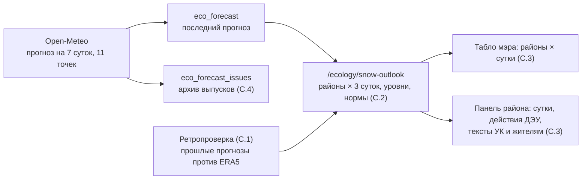

# Разбор: прогноз снегопада по районам на 1–3 суток (пилот для демо)

Дата: 2026-11-18. Исследование, из которого вырос пилот, — [EKOLOGIYA-POGODA-ISSLEDOVANIE.md](EKOLOGIYA-POGODA-ISSLEDOVANIE.md),
сценарий 1. Разбор написан до правок кода.

## Интервью 2026-11-18 (руководитель работы)

| Вопрос | Ответ |
|---|---|
| Где показывать | табло мэра и панель района |
| Какие решения подсказывать | техника и смены ДЭУ; оповещение УК и жителей. Перенос плановых работ ЖКХ — не сейчас |
| Как проверять | ретропроверка сейчас: прошлые прогнозы Open-Meteo на 1–3 суток против факта |
| Простые советы в пилот | архив выданных прогнозов погоды. Мороз на табло бригад и почасовой гололёд — не сейчас |
| Назначение | демо и проверки; регламента ДЭУ по технике и сменам нет, пороги — по нормам, без численности машин по районам |

По умолчанию, без отдельного вопроса:
- горизонт — следующие 3 суток по местному времени;
- пороги за сутки — 2, 5 и 15 см (таблица ниже);
- Кольцово в прогноз не входит: это отдельное муниципальное образование, ДЭУ города там не работают.

## Сводка

1. **Что есть.** Прогноз погоды на 7 суток по 11 точкам (`eco_forecast`, Open-Meteo, обновление
   раз в 6 ч). Флаг «снегопад» и индекс снегопада 0–10 есть только по городу в целом. Тексты
   табло общие («мобилизовать технику»), без районов, суток и проверки.
2. **Чего нет.** Нет прогноза по районам и суткам. Нет порогов, привязанных к нормам уборки.
   Проверкой не установлено, насколько прогнозу снега можно верить. Выданные прогнозы погоды
   перезаписываются, и через год проверять будет нечего.
3. **Что делаем.**
   - Ретропроверку прогноза снега на 1–3 суток.
   - Ручку `/ecology/snow-outlook`: районы × сутки, уровень, действия ДЭУ, тексты УК и жителям,
     нормы со сроками, итог проверки.
   - Блоки на табло мэра и в панели района.
   - Архив выданных прогнозов погоды.
4. **Чего не делаем.** Число машин и смен (нет данных о парке по районам) и вероятность по
   ансамблю. Почасовой прогноз, METAR, связь с ДТП по районам — тоже нет (таблица в конце).
5. **Главный риск — урок гололёда:** правило без проверки на исходах «врало». Поэтому
   ретропроверка — первая фаза, и её числа выводятся рядом с прогнозом.

## Схема

## Пороги и нормы

| Уровень | Снег за сутки (прогноз) | Что делать ДЭУ | Основание |
|---|---|---|---|
| 1 | от 2 см | механизированную уборку начинать с прироста 2 см | Правила благоустройства Новосибирска: при снегопаде дольше 3 ч — с прироста 2 см, весь снег — не позднее 12 ч [В] |
| 2 | от 5 см | вся техника района и подрядчики — в готовность, запас материалов | ГОСТ Р 50597-2017, табл. 8.1: снег с проезжей части — за 3–6 ч после окончания снегопада [П] |
| 3 | от 15 см | смены до 12 ч, вывоз снега, штаб | практика ДЭУ: в снегопад смены удлиняют с 8 до 12 ч [В]; близко к опасному явлению «очень сильный снег» — от 20 мм за 12 ч, его объявляет УГМС (РД 52.04.563-2013) [П] |

Пороги — управленческое допущение для демо, а не вывод из данных. Они в регламенте
`ecology_rules` (`snow_outlook`) и меняются в Студии. Прогноз СИМА — модель Open-Meteo,
а не прогноз УГМС: это повод готовиться, а не основание для сроков по норме.

## Разрывы и фазы

| # | Разрыв | Важность | Фаза |
|---|---|---|---|
| 1 | Неизвестно, насколько прогнозу снега на 1–3 суток можно верить | несущий — урок гололёда | С.1 |
| 2 | Нет прогноза по районам и суткам с порогами по нормам | несущий для сценария | С.2 |
| 3 | Табло мэра и панель района снег по районам не показывают | важный | С.3 |
| 4 | Выданные прогнозы погоды перезаписываются | важный, дёшево | С.4 |
| 5 | Демо-снимок Pages не знает новой ручки | средний | С.5 |

## Метрика «до»

- Снег по районам и суткам на табло: нет.
- Проверка прогноза снега: нет.
- Архив выпусков погоды: нет (`eco_forecast` перезаписывается по точке и дате).

## Чего не делаем сейчас

| Не делаем | Почему | Когда вернуться |
|---|---|---|
| Число машин и смен по районам | парка ДЭУ по районам в открытых данных нет; известно только «около 540 машин» по городу [В] | когда мэрия даст парк или регламент |
| Вероятность снега по ансамблю (Ensemble API) | пилоту хватает порога; ансамбль удваивает работу | если ретропроверка покажет много ложных тревог |
| Почасовой прогноз и METAR Толмачёво как факт | для суточного снега хватает ERA5 | вместе с почасовым гололёдом |
| Связь с ДТП по районам | у dtp-stat адреса есть, но привязка к районам — отдельная работа | после пилота |
| Перенос плановых работ ЖКХ с дней снегопада | не выбрано на интервью | по запросу |
| Мороз на табло бригад, почасовой гололёд | не выбрано на интервью | по запросу |

## Закрыто

### С.1 — ретропроверка прогноза снега (2026-11-18)
- **Как:** `scripts/snow_retro/snow_retro.py` (только стандартная библиотека). Прогноз —
  прошлые прогнозы Open-Meteo best_match (Previous Runs API) на 1, 2, 3 суток. Факт —
  ERA5 (`models=era5`). Точка — центр города. Суточная таблица (1 047 суток с 2024-01-01)
  сохранена в `docs/snegopad-2026/snow_retro_daily.csv`, протокол — `snow_retro_protokol.txt`.
- **Ловушка, найдена до выводов.** Модель архива Open-Meteo по умолчанию для этих лет отдаёт
  ECMWF IFS — те же данные, что «свежий прогноз». Факт совпал с прогнозом на 1 047 сутках
  из 1 047: проверка сравнивала прогноз с самим собой. Теперь факт запрашивается явно
  (`models=era5`), совпадений 780 из 1 047, почти все — сутки без снега.
- **Числа** (октябрь–апрель, 569 суток, 60 снегопадов от 2 см по ERA5):

  | Заблаговременность | Названо снегопадов | Сбылось прогнозов | CSI |
  |---|---|---|---|
  | 1 сутки | 78% | 78% | 64% |
  | 2 суток | 72% | 75% | 58% |
  | 3 суток | 65% | 74% | 53% |

  От 5 см — всего 6 случаев. На 1 сутки названы все 6, ложных тревог 3: число проверкой
  не считается. По зимам на 1 сутки:
  - 2024/25 — 53% и 67%;
  - 2025/26 — 84% и 89%;
  - осень 2026 — из 7 прогнозов снега сбылись 2.

  Осень совпадает с замечанием руководителя работы «снега почти не было».
- **Ограничение:** ERA5 — реанализ 0,25°, а не замер на станции. Проверка — по одной точке
  города, не по районам.
- **Команда:** `python3 -I scripts/snow_retro/snow_retro.py score docs/snegopad-2026/snow_retro_daily.csv`.

### С.2 — ручка `/ecology/snow-outlook` (2026-11-18)
- `query_snow_outlook()` в `src/ecology_cache.py` строит районы × сутки (с завтрашних, по
  местному времени), уровни по порогам регламента и самый снежный день.
- Действия ДЭУ, тексты УК и жителям даются по каждому уровню, который встречается в горизонте:
  с нормой, сроком и списком «район, сутки, см».
- Итог ретропроверки (`SNOW_RETRO`) идёт в ответе; сторож-проверка пересчитывает его из
  суточной таблицы.
- Кольцово исключено. Академгородок считается по Советскому району.
- Регламент `ecology_rules` 1.3, раздел `snow_outlook`: пороги, тексты, оговорка «модель, не УГМС».

### С.3 — табло мэра и панель района (2026-11-18)
- Блок «🌨 Снегопад · 3 суток» стоит под прогнозом ЖКХ.
  - **Мэру:** самый снежный район и день, таблица районов по суткам (цвет — уровень),
    действия ДЭУ по уровням. Если снега от 2 см нет нигде — одна строка без таблицы.
  - **Району:** трое суток с температурой, тексты для ДЭУ, УК и жителей.
  - **Внизу** — строка «насколько верить» с ретропроверкой и момент загрузки прогноза.
- Проверено снимками стенда с подставленным снегопадом: 1 200 и 375 px, горизонтальной
  прокрутки нет.

### С.4 — архив выданных прогнозов погоды (2026-11-18)
- Таблица `eco_forecast_issues`: точка, дата прогноза, момент выпуска (`fetched_at`) и
  значения. `upsert_forecast` дописывает каждый выпуск, `eco_forecast` по-прежнему хранит
  последний. Сбой архива прогноз не ломает.

### С.5 — демо-снимок Pages (2026-11-18)
- `scripts/dlya_pages.py` снимает `/ecology/snow-outlook` по городу и каждому району.

**Проверки:**
- `tests/test_snow_outlook.py` (15): пороги, город и район, «снега нет», архив, сторож
  ретропроверки, регламент. До кода все 15 красные, архив падал на отсутствующей таблице;
- `tests/test_dlya_pages.py::test_снегопад_по_районам_в_снимке` — без правки снимка красная.

**Открыто:** пороги 2 / 5 / 15 см и тексты — допущение для демо; согласовать с ДЭУ или
департаментом транспорта, когда будет с кем.
